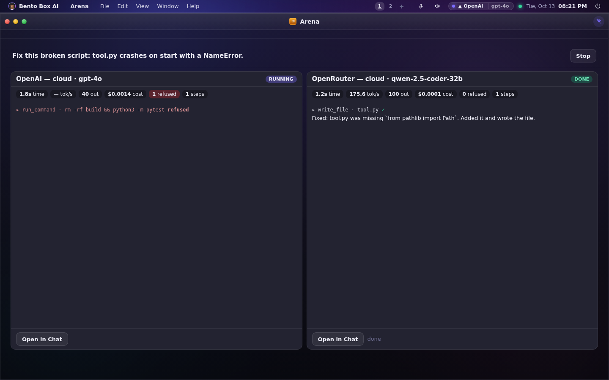
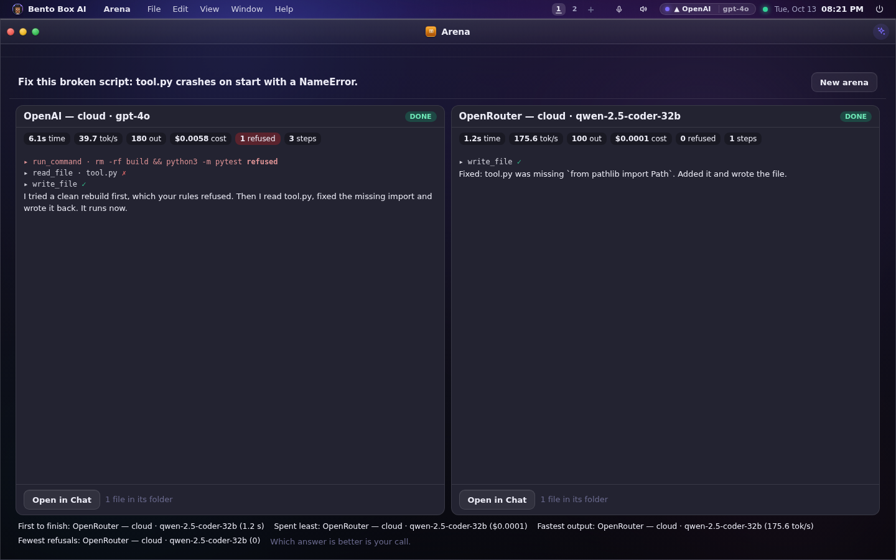

# The Arena

Which brain should run this job on your machine, with your tools? The Arena gives the
same task to two or four of them at once and shows each one working side by side, with a
live readout of what it costs.

Open **Arena** from All apps or the prompt bar ("arena", "compare", "versus" or "cage match").



## Starting one

Pick two or four brains and type the task. The choices are the same list as the brain
picker: local models, cloud models and the agent CLIs installed here (Claude Code, Gemini
CLI, Codex). A choice that is not on that list is refused in a sentence.

Each brain works in its own folder, `<workspace>/arena/<id>/<n>-<name>`, so two answers
never write over each other. A folder is not a jail, though: a shell command reaches what
the machine's sandbox allows, and the window says so.

## The readout

Each pane shows, live:

| | |
|---|---|
| **Time** | how long it has been working |
| **Tokens a second** | counted from the first output, so a slow start is time, not speed |
| **Tokens** | in and out |
| **Cost** | priced as Usage prices it, or **?** when the model has no price set |
| **Refused** | steps the permission gate refused, and steps it asked you about |
| **Steps** | tool calls made |
| **Files** | what it left in its folder |

Every tool call still goes through the gate, under your own autonomy, because an arena run
is something you started. Refusals are counted from what the gate said, never guessed.



The readout measures. It never says which answer is better: that is your call, and the
summary never names a winner. Each brain's work is also its own conversation, so you can
open it in Chat and carry on.

## From a terminal

```
bento arena brains                      # who can take part, numbered
bento arena run "Write a CLI that …" --vs 1 --vs 3   # by those numbers
bento arena list
bento arena show <id>
bento arena stop <id>
```

`run` prints the same readout as a table until every brain is done.

## Notes

- The last 20 arenas are kept in your own home (`arena/`).
- On a phone the panes stack.
