# Your company: departments of agents

Say what your business does and Bento sets it up as a company: departments like Admin,
HR, Finance, Supply, Sales, Tech and Marketing, each with a head and two or three staff.
Every person has a job title and a persona written for your business. They sit in their
department's room in the Office, and each department can be given work. When a
department finishes a task, its head signs it off, then each boss above it, up to your
agent. Then an independent auditor checks it before the answer reaches you.

Give the company an **objective** and the draft also has the work it needs: missions that
repeat (some on a schedule) and tasks to start now, each given to a department. You can
keep **several companies**, each with its own office, people, objective and work. A
services firm and a factory can live side by side without seeing each other.

## Set it up

**In the Office:** press **▦ Company**, write a sentence about the business, say what it
should achieve under **Objective** if you like, and press **Draft my company**. You can also tick the departments you want. With none ticked, your
AI picks the ones your business needs. The setup wizard's crew step has a **Set up a
whole company** button that opens the same panel.

The draft shows everything before anything is made: every department, what it does for
your business, every person with their title, their persona and the tools they would
have. Untick a person or a whole department, or open a persona and change it. The button
counts what will be made, and the count changes as you untick.

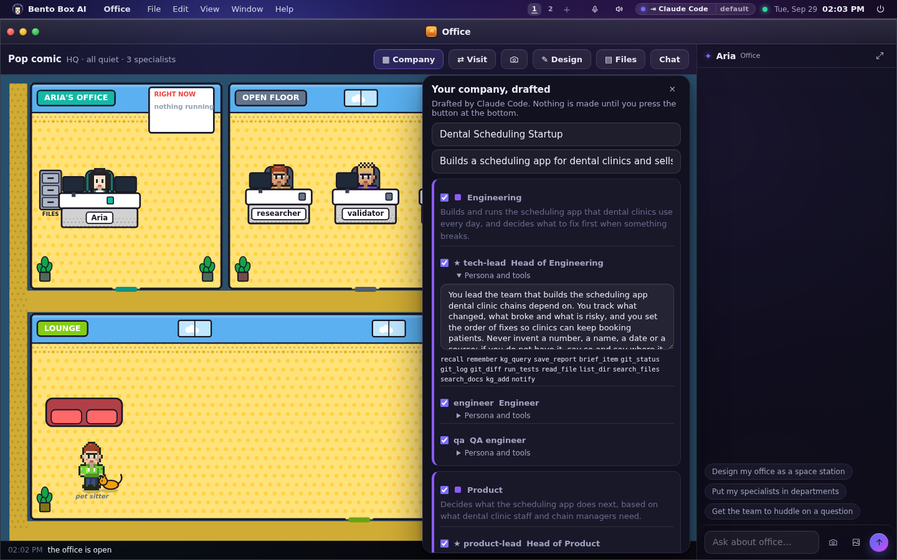

**In a terminal:**

```
bento company setup "a dental scheduling startup, fifteen people, selling to clinic chains"
bento company setup "..." --departments admin,finance,sales    # exactly these
bento company setup "..." --objective "win ten clinic clients this quarter"
bento company setup "..." --words      # skip the AI, use the catalogue as it is
bento company templates                # the departments to choose from
```

It shows the same plan and asks before making anything (`--yes` skips the question).

With no AI set up, the catalogue fills the plan in as it is, with your company's name
and description in every persona. The panel says when that happened.

## The objective, and the work it calls for

An objective is your own words for what the company is for: "sign ten new clinic clients
this quarter", "cut defects in half by June". With one, the draft has a section **For the
objective** under the departments:

- **Missions** are work that repeats: "Find five clinics a day that fit, and draft the
  first email for each". Most have a schedule (every day at 08:30, every Friday at 16:00);
  a few are started by hand.
- **Tasks to start** are one piece of work each: "List twenty clinics in Pune that should
  be talking to us".

Each belongs to one department, and you can untick any of them. The button counts what
will be made.

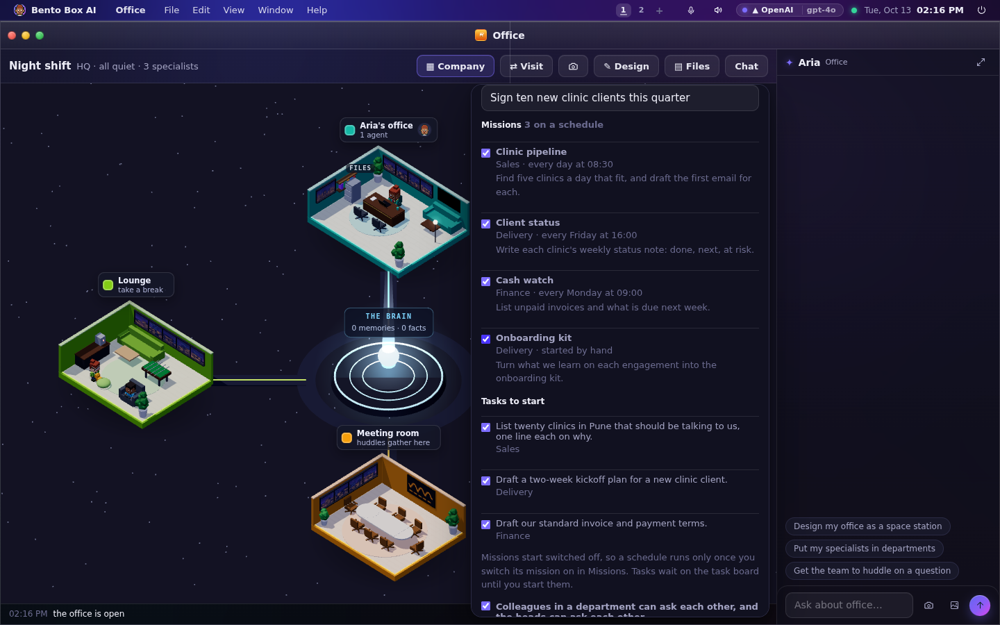

What saving makes:

- **Each mission is a mission in Missions**, with its department's people as its team
  and the objective in its brief. It starts **switched off**, like a desk: the schedule is
  there but nothing runs until you switch the mission on, which is when it gets its
  permissions. A mission with the same name that is already here is kept as it is.
- **Each task waits on the task board** as **to do**, with **Start it** and **Not now**.
  Start it runs the department's desk with that task, like any task you type.

A mission is its department's work, so its runs show on the department's card and the
task board, and every finished run goes up the same sign-off chain and past the same
auditor as the desk's.

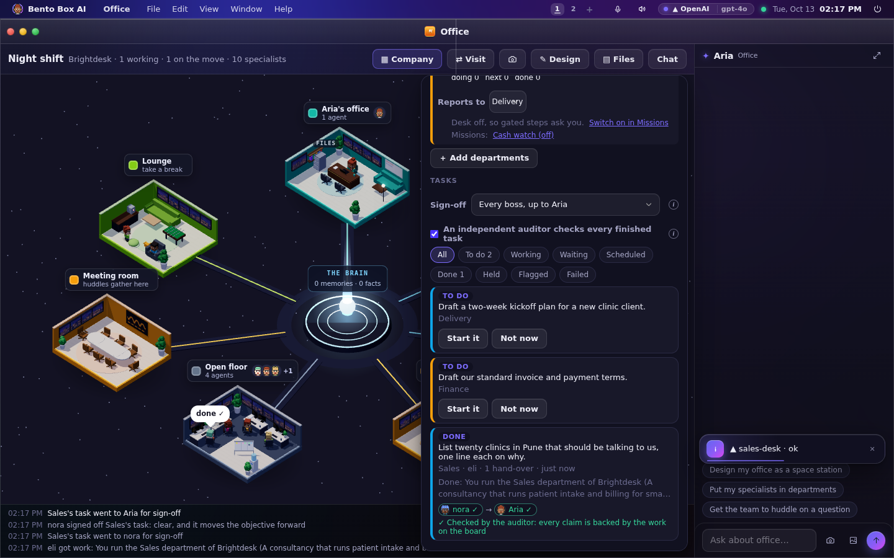

Your agent is told the objective, so it can keep it in mind when you ask it for
something.

**Already have the departments?** Press **Plan the work** (or **Set an objective**) at the
top of ▦ Company. It drafts missions and tasks for the departments you have, shows them,
and makes what you keep ticked.

```
bento company objective "win ten clinic clients this quarter"   # draft, show, ask, make
bento company todo                                              # the tasks waiting
bento company start 3fa2b1c9                                    # start one (server running)
```

With no AI set up, each department gets the standing mission the catalogue has for it,
pointed at your objective, and its usual first task. The catalogue includes **Production**,
**Quality** and **Delivery** for makers and services firms.

## Several companies

A person can keep up to eight companies. Each one is a whole setup of its own: its office
(rooms, look and name), its departments and people, its objective, its missions and tasks,
and its own **space**, so its chats, memories and runs stay with it.

**Start one:** ▦ Company → **＋ New company**. Give it a name, a line about what it does and
its objective. It opens straight away in an empty office of its own, and the setup sheet
follows with your words filled in. The company you were in is kept exactly as it was.

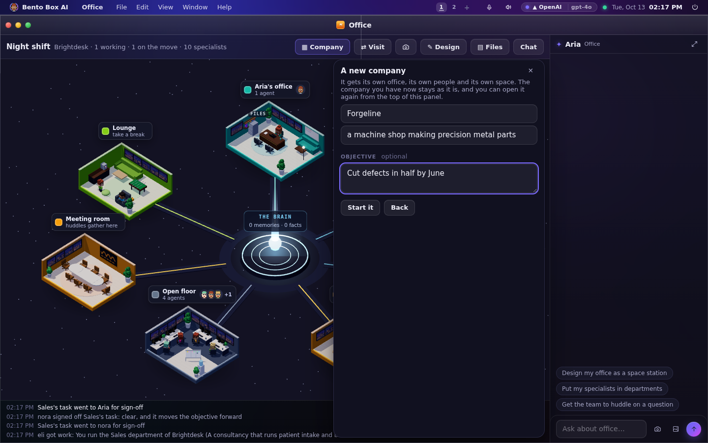

**Switch:** the **Company** list at the top of the panel. The office, the cards, the task
board and the space chip in the menu bar all change to that company. Only the screen you
switched on moves: a phone on Telegram stays in the space it was in.

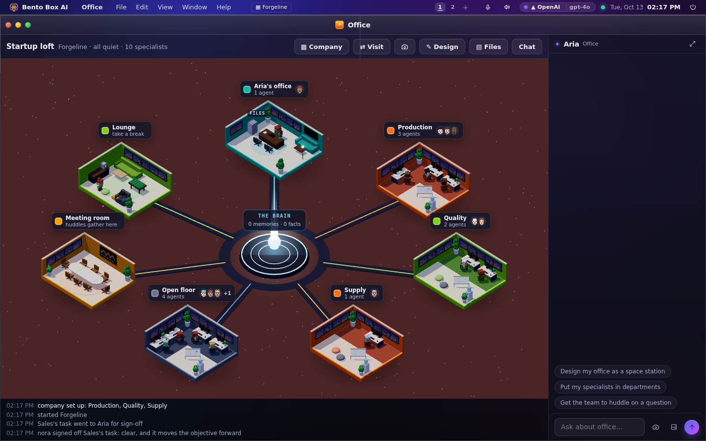

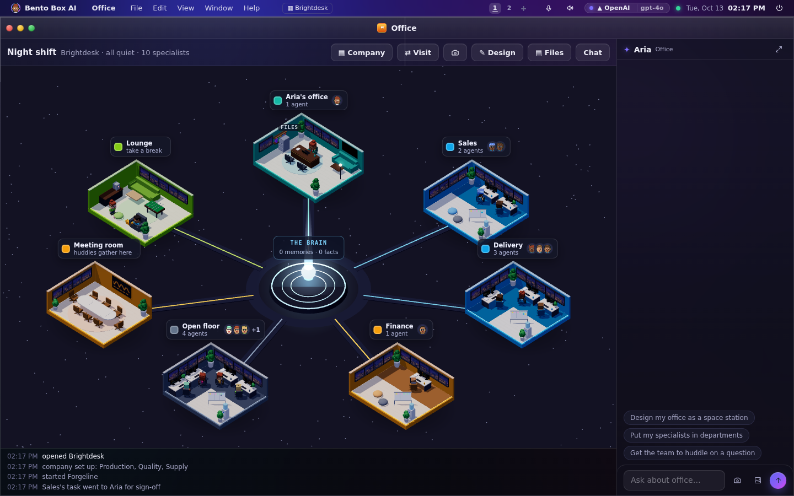

How they stay apart:

- **People belong to one company.** If a draft would use a name that already works in
  another of your companies, this company gets its own person with the company's name on
  it (`sales-lead-forgeline`). Your other company's people are not on this office's floor.
- **Desks and missions are named for their company** once you have more than one
  (`forgeline-sales-desk`), so two companies can each have a Sales desk.
- **Each company's work is checked by its own bosses.** A scheduled mission of a company
  you are not in still runs, and its sign-off chain and auditor are that company's.
- The first company gets its own space when you start the second, and its desks and
  missions move into it. Chats and memories made before that stay where they were,
  visible from every company.

**Remove one** you are not in with `bento company drop NAME`. Its desks and missions are
switched off, since nothing would sign their work off any more. Its agents, missions and
space are kept.

```
bento company companies                       # your companies, the open one first
bento company new Forgeline --about "a machine shop" --objective "cut defects in half"
bento company open Brightdesk
bento company drop Forgeline
```

## What it makes

Nothing new. A company is things this OS already has:

- **Agents.** Each person is an ordinary specialist, in Missions → Build → Agents and
  Settings → Agents, and editable there like any other. An agent that already exists
  with the same name joins its department as it is. Nothing about it is rewritten.
- **Departments.** They are the Office's rooms. A department's head wears a ★ on the
  desk, and its people wear the department's colour.
- **A desk for each department.** This is a mission (a flow) whose team is that
  department. It starts **switched off**, so it holds no permissions. You can still give
  a department work: any step that needs permission asks you first. Switch the desk on in
  Missions when you trust it with its tools.
- **Who may ask whom**, if you leave that ticked. People in a department can ask each
  other, and the heads can ask each other. These are ordinary rows in Permissions and you
  can remove any of them. Swarm mode opens everything anyway.

Mail and calendar tools are given only when those accounts are set up in Settings →
Accounts. Otherwise the plan says who would read them once they are.

A drafted department can only have tools from a short list: reading files, memory, the
Brief, reports, the web, reading mail and calendar, reading code and running tests, and
images. It can't get a shell, a way to send mail or messages, a git push, or anything that
changes the machine. You can add those to an agent later in the agent editor, one by one.

## Give a department work

Tap a department's card in the Office, or pick it in the ▦ Company panel, write the task
and press **Send**. The head plans it and hands the pieces to the staff, and you watch it
happen in the Office: papers fly to desks and people walk over to ask each other.

```
bento company task Finance "summarise what we spend each month from the files in my workspace"
```

**From any chat, with @.** Write `@Sales find ten clinics in Pune` in Chat, the prompt bar,
an app's agent panel, Telegram or WhatsApp. The department gets it as a task: its head
leads, the bosses above sign it off, the auditor checks it, and the answer comes back in
the same chat under the department's name and its head's face. Typing `@` suggests your
agents and your departments. A name with spaces works as typed (`@Customer Care`,
`@customer-care`). An agent's own name is checked first, so `@nora` is still Nora.

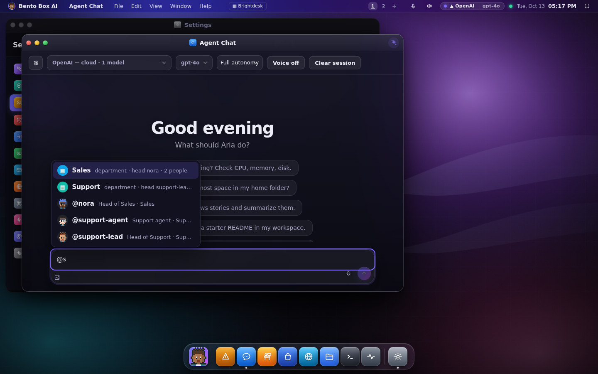

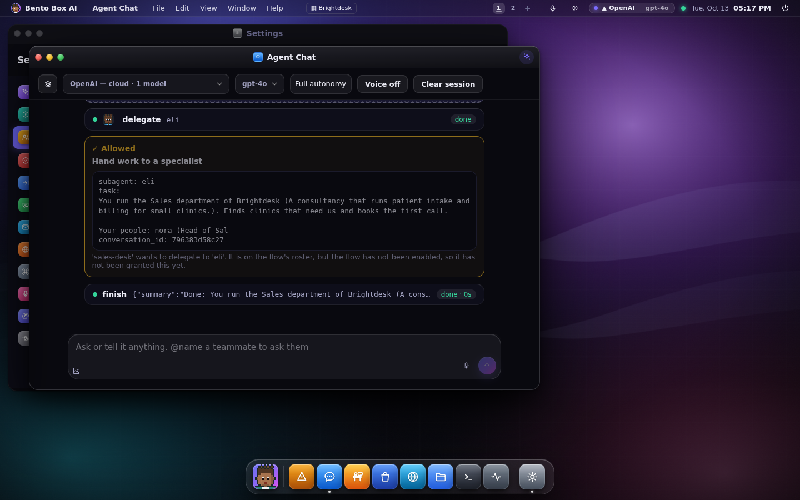

**Or just ask your agent.** Your agent is told to hand real work to the department that
fits, and has a tool for it (`department_task`). On the built-in brain and on Claude Code,
Gemini CLI or Codex alike, asking "which products are going viral?" goes to Sales or
Marketing instead of your agent searching the web itself. Small talk and questions about
the conversation it still answers itself.

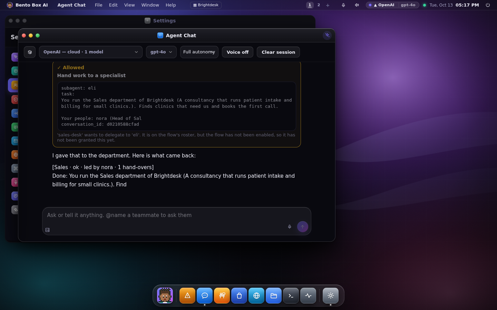

Handing work to a department goes through the permission gate as starting its desk
(`agent.invoke` on the desk's flow), so a block written on the desk refuses it however it
was asked.

## What the cards and the task board count

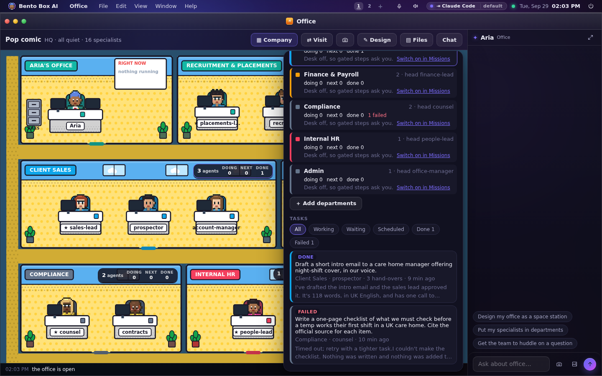

The card over each room shows how many agents it has, how many tasks it is **doing**,
how many are scheduled **next**, how many it has **done** this week, and a ⚠ when one is
waiting for you. Every number is counted from the runs, approvals and schedules on this
machine. Nothing is estimated, and a department that has done nothing shows zeros.

The **Tasks** list in the panel shows every department's work, newest first:

- **working**, **waiting for you**, **done**, **failed**, **stopped**, **scheduled**;
- who is on it and how many hand-overs it took;
- the first line of what came back.

A waiting task has **Review what it asks**, which brings up the approval card, or
**Answer it in the Brief** when the mission has paused for your answer there. Tap a task
to open it in the Run Inspector.

`bento company` prints the same numbers in a terminal.

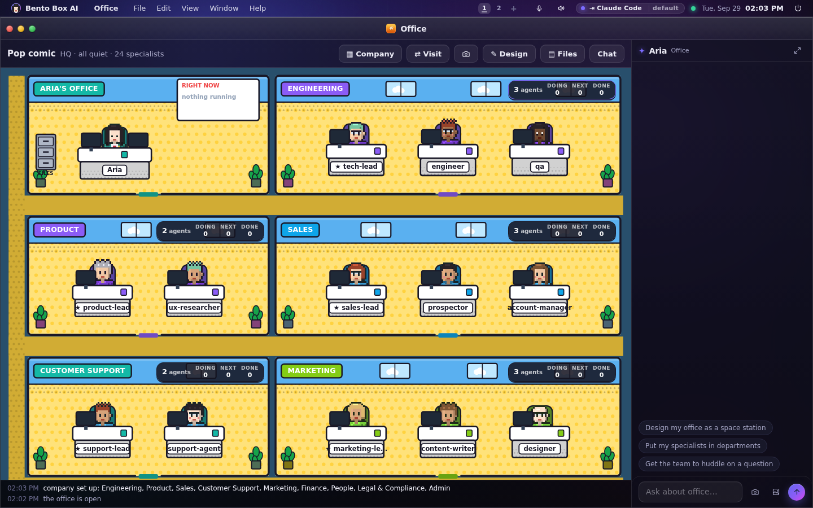

## Every boss signs the work off, up to your agent

A department reports to a boss. Its finished task goes to its own head first, then to the
head of each department it reports to, and last to your agent (Aria, unless you renamed
it). Each of them is a gate:

- **Approve:** it does what was asked, and they'd put their name to it. It goes up.
- **Send back:** something has to be fixed first. They say exactly what, and the same task
  goes back to the department with their notes. The fixed work starts at the bottom of the
  chain again, so the head checks its own ask. After two rounds of fixes it stops and comes
  to you.
- **Escalate:** the work is sound, but it holds a decision that isn't theirs. It goes up
  with their note, and the next boss decides. From your agent, it comes to you.

An answer that isn't one of those is **not signed off**, never a pass. Bento walks the
chain itself once the department is done, so no department can skip it or choose who sees
the work. A boss reads what was asked, what came back, everything handed round while
working, who signed it below them and what earlier rounds sent back. A head has read-only
tools to check a claim; your agent answers with none.

**Who reports to whom:** each department's line in **▦ Company** has a **Reports to** list:
another department, or your agent, which is the default. A loop (Tech reports to Ops, Ops
to Tech) is refused, and so is a line more than four departments deep. In a terminal:

```
bento company chain                    # every department's line of bosses
bento company chain tech ops           # Tech reports to Ops
bento company chain tech lead          # Tech reports to your agent again
bento company review lead|heads|off    # up to your agent, each head only, or nobody
```

In the Office you can watch it: whoever did the last piece carries the work to their head,
each boss carries it to the next, and the last one takes it to your agent's office. Each
answer is said at the reviewer's desk, and a send-back flies back to the head. Nothing
there moves that didn't happen.

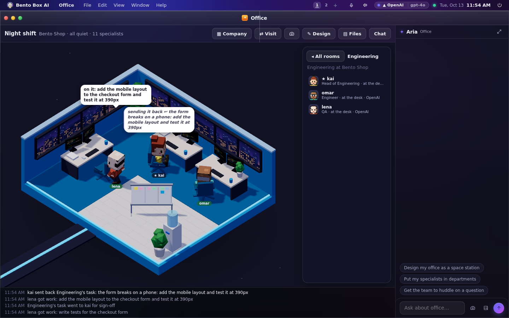

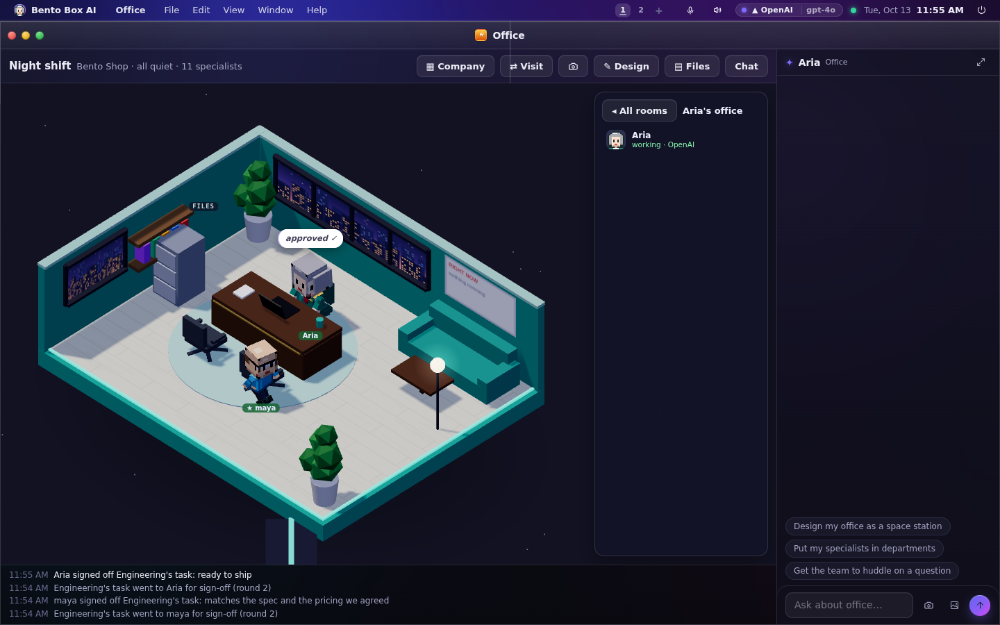

The chain shows under each task on the board, with a mark for each boss (✓ approved,
↩ sent back, ↑ passed up) and how many rounds of fixes it took. A department's line says
how many tasks were signed off this week and how many are held, and **Held** on the board
lists the ones waiting on you.

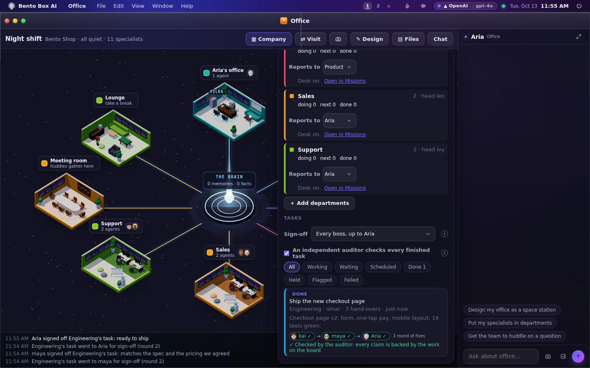

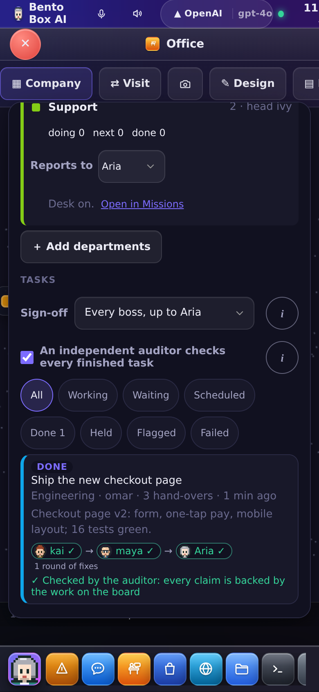

Each answer is a `company.review` row in the ledger, and the result's line says who signed
it off ("Signed off by kai → maya → Aria after 1 round of fixes."). A task sent back twice,
escalated to you, or not signed off is a **Needs you** item in your Brief.

A few things to know:

- **Each boss is a model call,** so a task three levels deep costs about four more calls,
  plus any fixes. **Sign-off** above the task board chooses every boss up to your agent
  (the default), each department's own head, or nobody.
- **The bosses aren't independent.** A head may have done part of the work. That's why the
  auditor still checks the final work afterwards, as somebody who did none of it.
- **A department with no head** (a room you filled by hand) is a gap in the chain: nobody
  signs off there, the bosses above still do, and the result says so.
- It reviews a department's desk tasks. Other missions and chat hand-overs aren't reviewed.

## The independent auditor checks every finished task

When a department finishes a task, an agent called **auditor** checks the work before the
answer reaches you. It's on by default.

The auditor is independent. It did none of the work, it sits in no department, and it's
on no desk's team. Bento starts it itself once the department is done, so no department
head and no lead agent can skip the check or choose what it sees. It gets what was asked,
what came back, everything the department handed round while working, and anything the
work put in your Brief. It can read files, memory and the knowledge graph to check a
claim. It can't write, send, remember or file anything.

It answers with one of three verdicts:

- **Pass:** it does what was asked, and what it says holds up.
- **Concerns:** usable, but something is unsupported, missing or needs you to look.
- **Fail:** it doesn't do what was asked, or it states things the work doesn't back.

An answer that isn't one of those counts as **not checked**, never as a pass.

The verdict is shown in these places:

- under the task on the task board, with the first thing it found;
- on the department's card, which counts the week's flagged tasks (⚑);
- with the result wherever it was sent: chat, Telegram or WhatsApp;
- in the Run Inspector, as the auditor's own line after the work;
- in the ledger, as a `company.audit` row;
- in your Brief, as a **Needs you** item listing everything it found, when the verdict is
  concerns or fail.

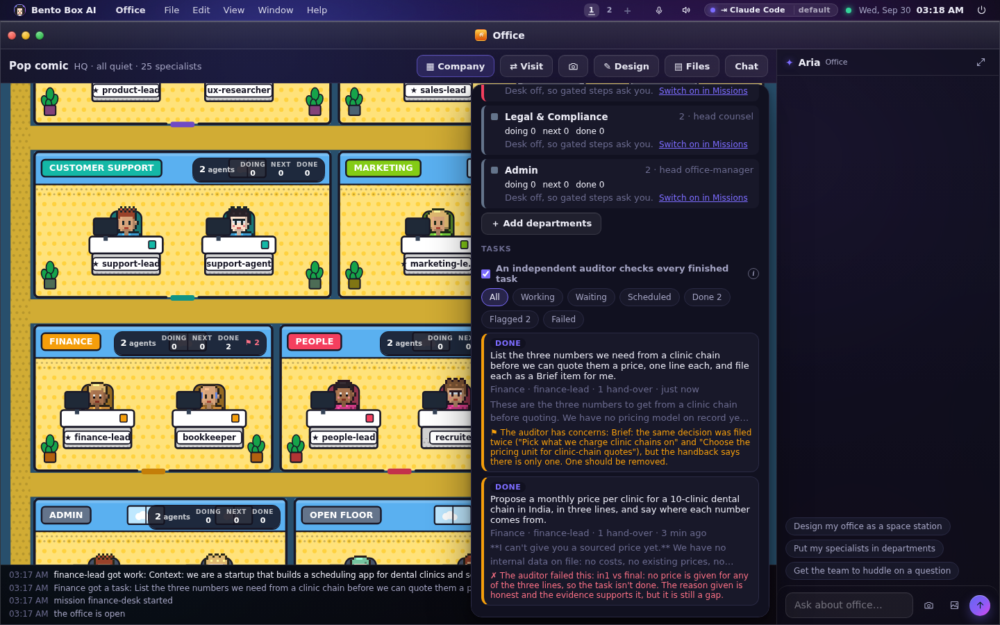

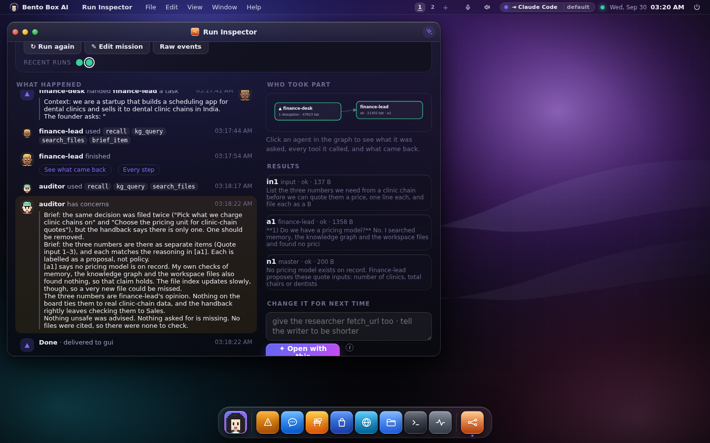

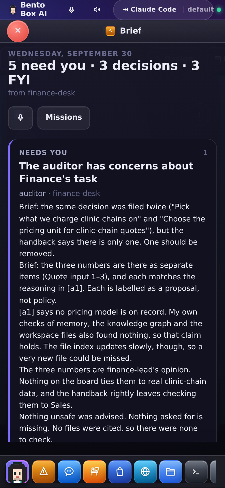

A few things to know:

- **It doesn't redo the work** or change the answer. The department's answer arrives as
  it was written, with the auditor's line after it.
- **If the auditor works in the department, it won't check that department,** because it
  would be checking itself. The same goes for a desk that has it on its team. The task
  shows *not checked* and says why. Move it to the open floor in the Office, or take it
  off the desk's team in Missions.
- **It's an ordinary specialist,** so you can edit its persona or give it its own AI
  provider in Settings → Agents. A check by a different model than the one that did the
  work is worth having. Its tools stay read-only whatever its settings say.
- **Switch it off** with the tick box above the task board, or `bento company audit off`.
  A task that finished while it was off shows **Check it**, and `bento company check RUN`
  does the same in a terminal. Switching it on or off is a row in the ledger.
- It checks a department's desk tasks. Other missions and chat hand-overs aren't checked.

```
bento company                    # each task with the auditor's verdict
bento company audit on|off       # the switch
bento company check 6f39bb2d71f4 # check a finished task now
```

## In every scene

The desktop's scenes (Settings → Appearance → Scene) show the company too. Each reads
the same answer about who is in which department, so they never disagree.

- **Crew:** one figure per department, drawn as its head in the department's colour,
  with the department's name and size under it. When anybody in the department works,
  its figure steps forward and says who. Anybody in no department stands beside them.

  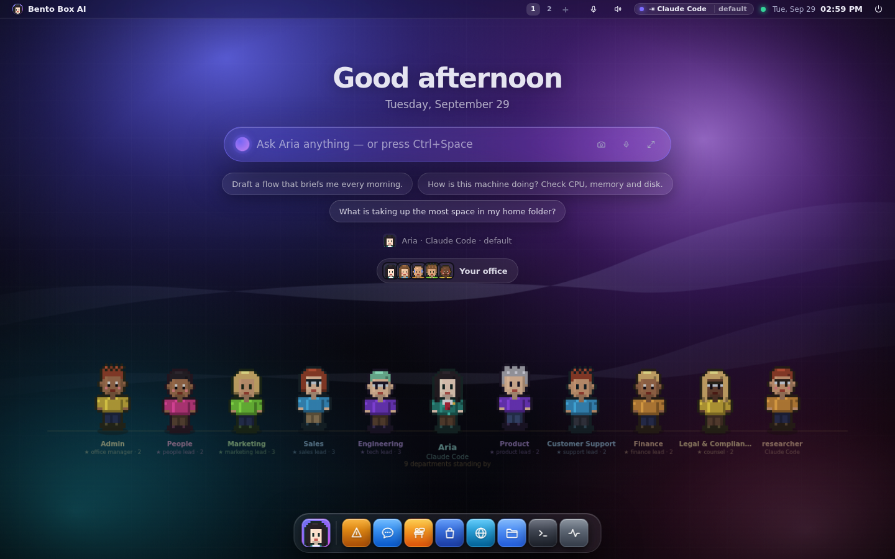

- **Mind:** each department is one cluster in its colour, with its people as the brighter
  points in it and their runs around them. Tap a department for its head, its people and
  a button to give it a task. Two people in one department talking stays inside the
  cluster; departments talking to each other is a strand between them.

  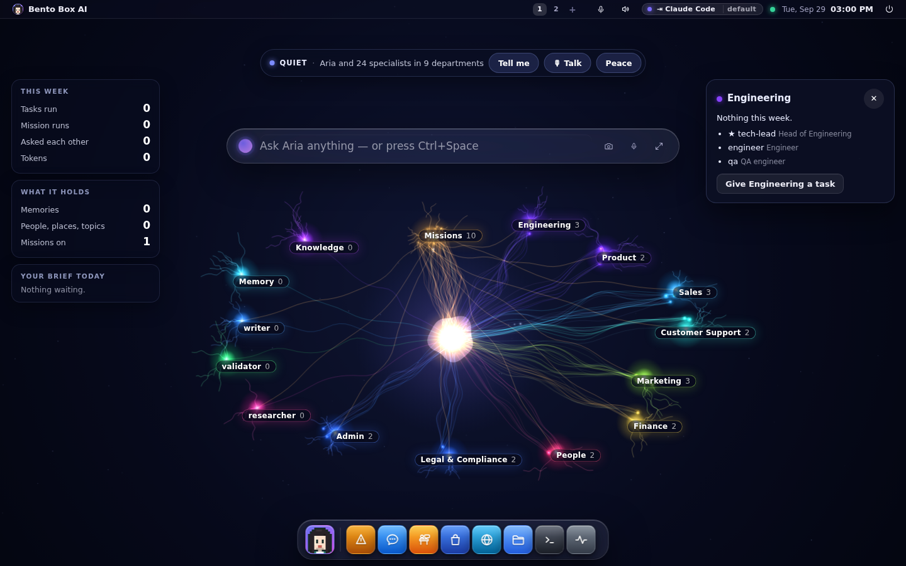

- **World:** a department stands as its head, with a tag like "★ Finance · 3". Tap the
  head to see how everybody in the department feels. Drawing twenty people at once made a
  crowd, so the rest of the department is on that card instead.

  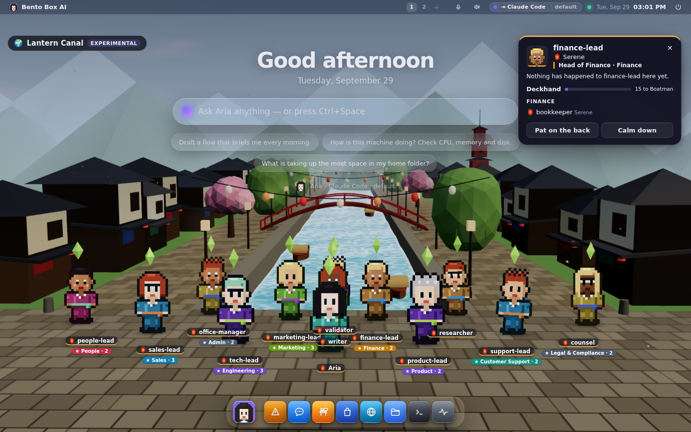

- **Office:** the rooms, as above.

`bento mind` groups by department in a terminal as well.

## Who may ask whom: per agent or per department

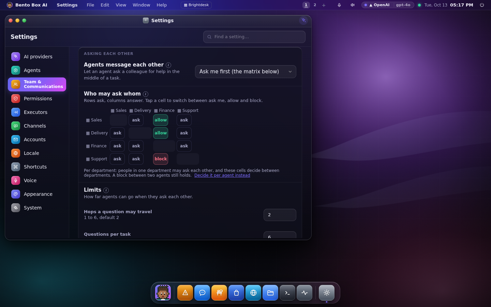

People in a company ask each other questions. By default each pair of agents is decided on
its own in Settings → Team & Communications. With many people that is a big grid, so a
company can decide it **per department** instead: ▦ Company → **Who may ask whom** →
**Per department**, or `bento company permissions department`.

- Colleagues in one department may always ask each other.
- Between departments, the department grid decides: allow, block, or empty. An empty cell
  works the way the team's talk mode says (ask you, swarm or a vote).
- A block you wrote between two agents still holds, so switching the level never reopens a
  pair you closed.
- Inside a mission, only the mission's own permissions count, as before.

```
bento company permissions department
bento company allow Sales Finance      # Sales may ask Finance
bento company block Support Finance
```

Each department cell is an ordinary row in Permissions, and the ledger records every change.

## What a department can reach: its executor

An executor (Settings → Executors) says which tools, folders, web addresses and MCP servers
an agent can reach. Give one to a whole department with **Executor** on its line in
▦ Company, or `bento company hands Sales research`. Everyone in it works with that executor,
except an agent that has one of its own. Choose **Each agent's own** to go back.

## A new department starts with a kit

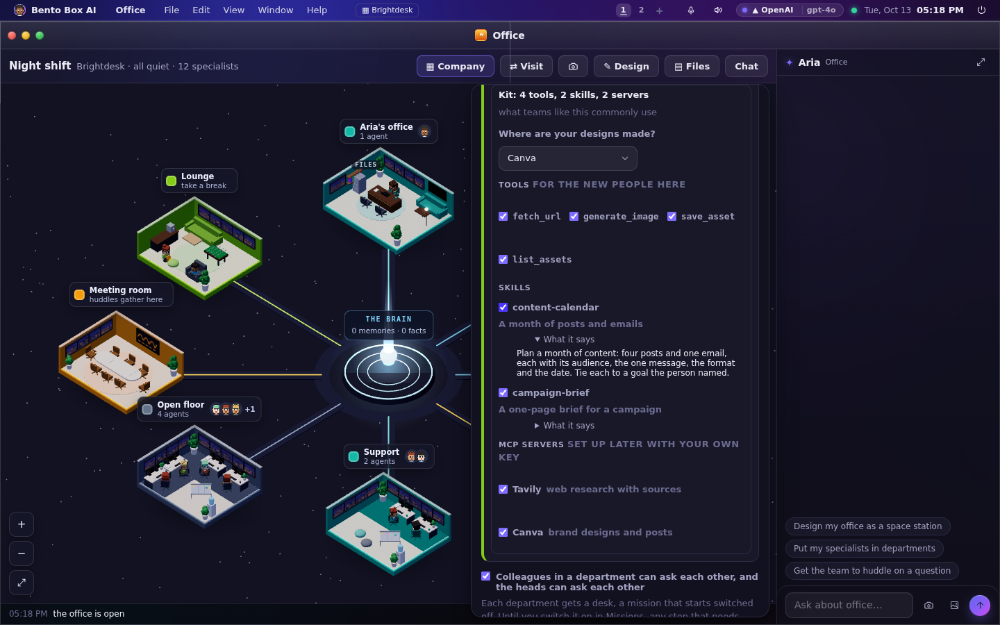

When you add a department, the preview asks a question or two about how that kind of team
works (where customers are kept, where questions arrive, whether it may read the mailbox),
then proposes what teams like it commonly use:

- **Tools**, from the same short list as everything else a draft can give, for the
  department's new people.
- **Skills**, written out in full. Open **What it says** to read one. A skill is made only
  when ticked, and never over one you already have with the same name.
- **MCP servers**, such as HubSpot for Sales or Zendesk for Support. These are never
  installed by the kit, because each needs your own account and key. The department's
  card lists them with **Set up**, which opens the MCP app on that server, or the Store's
  search for it.

Untick anything you don't want; the button counts what will be made. A department you
already have gets the same sheet from **Choose a kit** on its line, and then the tools and
skills go to everyone in it. The ledger records it.

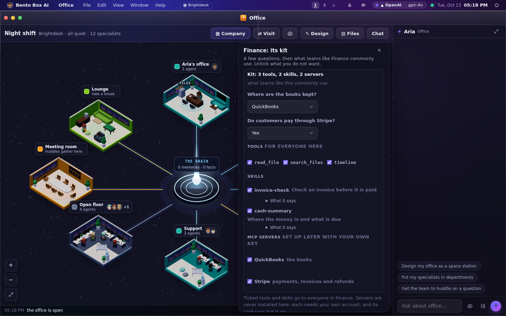

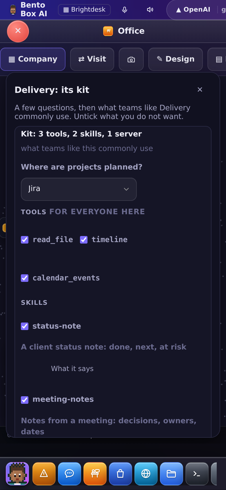

```
bento company kit Sales                        # the questions and what it would get
bento company kit Sales crm=hubspot --yes      # give it to Sales
```

## Changing it later

- **Add departments:** ▦ Company → **＋ Add departments**. Existing departments and
  agents stay as they are.
- **Rename, recolour or move people:** Office → ✎ Design, as before. The head, the
  mandate and the desk stay with the department.
- **Change a person:** Missions → Build → Agents, or Settings → Agents.
- **Remove a department:** Design → ✕ next to it. Its people move to the open floor; the
  agents and the desk are not deleted.

## The three faces

- **GUI:** the Office's ▦ Company panel and the cards over the rooms. On a phone the
  panel is a sheet and the cards shrink to fit the room. The company list, **＋ New
  company**, **Plan the work**, every tick and **Start it** are a fingertip wide.

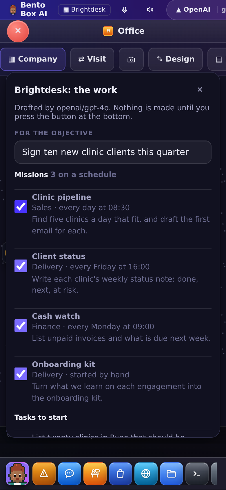
- **TUI:** `@Department …` works in the terminal chat as it does everywhere.
  `bento company` shows, `setup` plans and makes, `objective` drafts and makes
  the work, `todo` and `start` list and start its tasks, `companies`, `new`, `open` and
  `drop` keep several companies, `task` hands out work,
  `chain` shows and sets who reports to whom, `review` chooses who signs off,
  `audit on|off` switches the auditor and `check` asks it to check a task.
  `permissions`, `allow`, `block` and `ask` decide who may ask whom between departments,
  `hands` gives a department an executor, and `kit` shows or gives a department its kit.
  A task, a start and a check need the server running, because that is where the work runs.
- **SUI:** the same page. The desktop scenes (Office, Crew, Mind, World) show the
  departments. The Office scene shows no cards, because nothing under the windows can be
  tapped; the Mind's and the World's tags can be.


## When a department cannot do a step

A department may lack what a step needs: Research cannot run code until it is allowed to. Nobody stops at
saying so:

- **Anyone on the team can ask you for the ability.** A card asks "Research asks to run Python code (each run
  is still asked). Why: the backtest". Yes switches the department's *Can run code* on; nothing is granted, so
  every run still asks. Only your agent, the specialists and a mission can ask; apps and other machines cannot.
- **Aria hands the step on.** She is told what each department can and cannot do. When a department comes back
  short she asks you, gives the step to someone who has the tool, builds a specialist for it, or does it
  herself, and then the department finishes the job.
- **A specialist built for one job** is offered to you under the answer: Keep makes it one of your
  specialists; Remove, or a day without an answer, takes it away. Every new agent asks you the first time it is
  given work.
