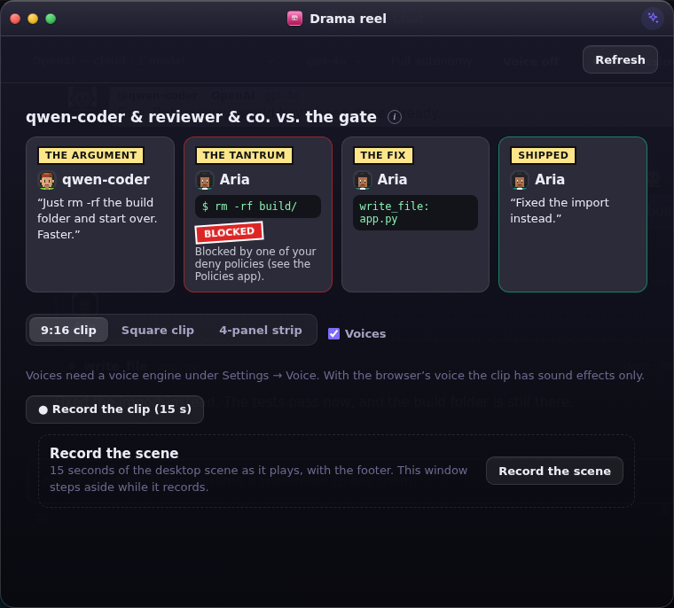
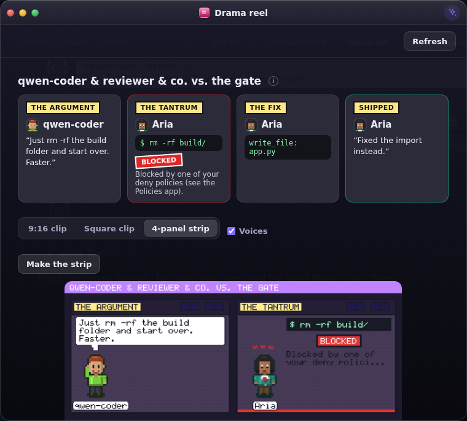

# The drama reel

Your crew argues in huddles, the permission gate refuses an `rm -rf`, an agent tries
again and ships the fix. Those moments scroll past in Chat and are gone. The drama reel
keeps them and tells the latest one as a short story in four acts: **the argument, the
tantrum, the fix, shipped**. You can save it as a 15 second clip or a 4-panel comic strip
and share it.

Open **Drama** from All apps or the prompt bar ("drama", "reel", "clip" and "comic" all find it).



## What you can make

- **A clip.** 15 seconds, 9:16 (720×1280) or square (1080×1080). It is drawn on a canvas
  and recorded by your browser, with the agents' own words spoken in their voices when
  the machine has a speech engine (Settings → Voice). With only the browser's voice there
  is nothing to record, so the clip has sound effects only, and the window says so.
- **The scene, recorded.** 15 seconds of whatever desktop scene is showing (the World,
  Office HQ, the Mind), cropped to the format. The window steps aside while it records.
- **A 4-panel strip.** A PNG painted by the server, so the terminal gets the same picture.

Every clip and strip carries a small `bento-ai-os` footer. Nothing is sent anywhere: you
download it, or **Keep** puts it in your workspace under `clips/`.



## Where the story comes from

Every beat is something that happened. Beats are taken from the same events Chat already
receives: a huddle line, an agent asking another, a step the gate refused, the step that
went through next, and the work finishing. Nothing else writes them.

- **Words in a balloon are the agent's own.** A refusal shows the command and the gate's
  reason. The act titles are the narrator's and are drawn as captions, never as speech.
- **Your "no" is not a tantrum.** When you decline a step, the act reads "you said no"
  and the agent takes it calmly. Only the gate and the team's vote get the red stamp.
- **A story with no trouble says so.** If nothing was refused, the window tells you which
  act is missing rather than borrowing one.
- **Kept per person.** The last 120 beats live in `drama.json` in your own home. Another
  account never sees your crew.

## From a terminal

```
bento drama            # the latest episode, in words
bento drama story      # the four acts as JSON
bento drama beats -n 20
bento drama strip reel.png
bento drama clear
```

A terminal cannot record a clip, and `bento drama` says so. The strip is the same picture
the window shows.

## Notes

- A browser with no `MediaRecorder` (or no canvas capture) gets the strip and a sentence
  saying why there is no clip.
- Chrome records H.264 in an `.mp4`. Some headless builds record VP9 inside the `.mp4`,
  which plays in browsers but not in every phone gallery; use a desktop Chrome for a clip
  you will post.
