# The town

Your office as a town in a place you choose: an island in the sea, a cluster of islands, a city on
canals like Venice, a castle inside its walls, or a town in a forest. Every room is a building, every
department has its district of houses, the Brain is a fountain in the middle, and your agent's place
is the landmark: a lighthouse, a windmill, a bell tower, a castle keep or a watchtower.

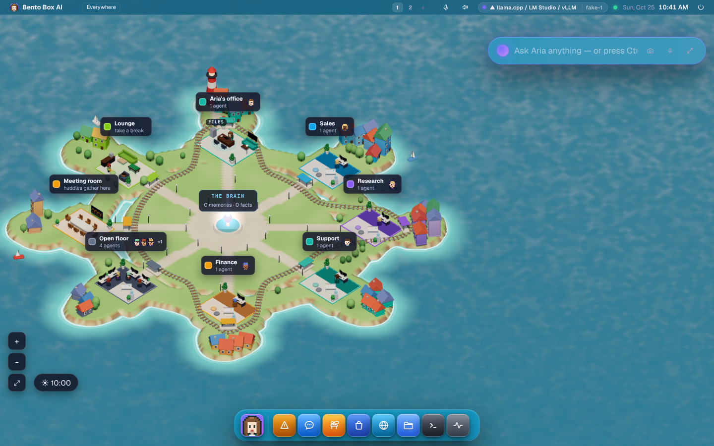

It is the same office as the 3D look, with the same people at the same desks. While a room is quiet
its building is closed. When somebody in it works, walks out or talks, or somebody visits, the roof
lifts off and the walls drop so you can see the office inside. A few seconds after it goes quiet it
closes again.

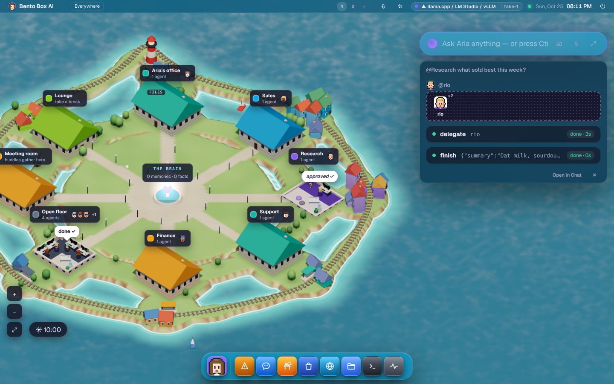

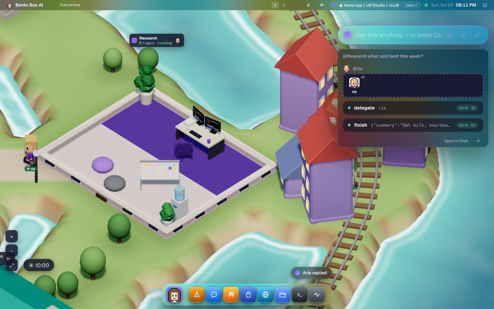

## Where to find it

- **As your desktop:** Bento opens on the Town unless you chose another scene. Settings →
  Appearance → Scene changes it. A Zero opens on Aurora, and a small machine's own screen
  draws only the light scenes. After the update that made the Town the default, a browser
  that had chosen another scene is moved to the Town once, with a toast to keep the old one.
- **Tap what you see:** the Brain opens your memory, FILES opens the Files app, a name puts
  that agent in the prompt bar, and a room's card or its ground takes you inside it.
- **In the Office app:** ✎ Design → Look → "A town", then pick a Setting.
- **From a terminal:** `bento office setting canals` (or island, islands, castle, forest).

## Choose the place

| Setting | What you get |
|---|---|
| **Island** | One island in the sea, a railway round the coast, a lighthouse |
| **Islands** | Small white islands joined by footbridges, a ferry between them, a windmill |
| **Canal city** | A city on canals like Venice, stone bridges, gondolas, a bell tower |
| **Castle** | A town inside round walls and a moat, a gatehouse and drawbridge, the keep |
| **Forest** | Log cabins among pines by a river, a railway through the trees, a watchtower |

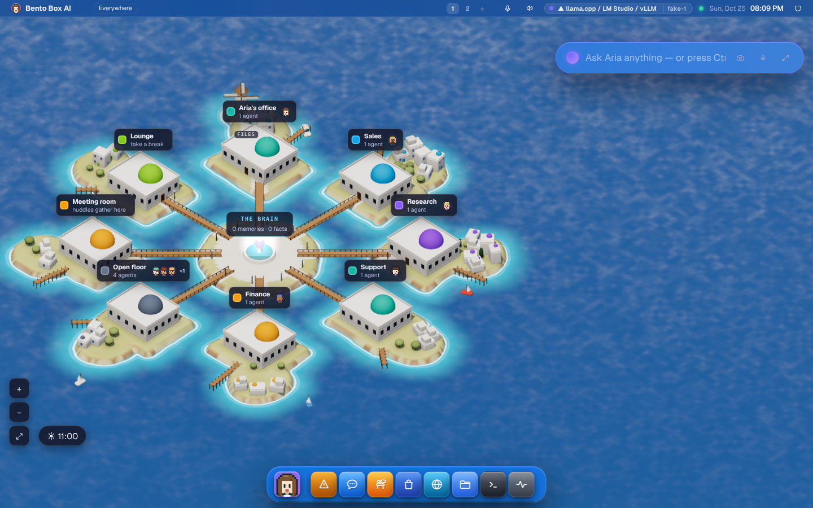

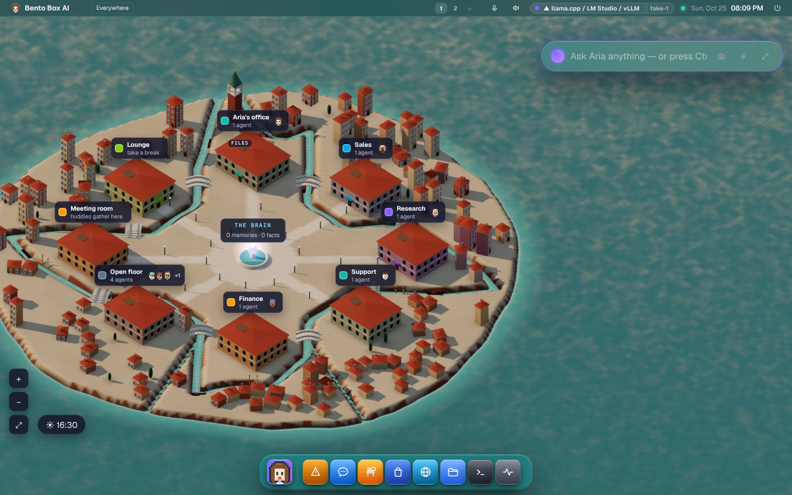

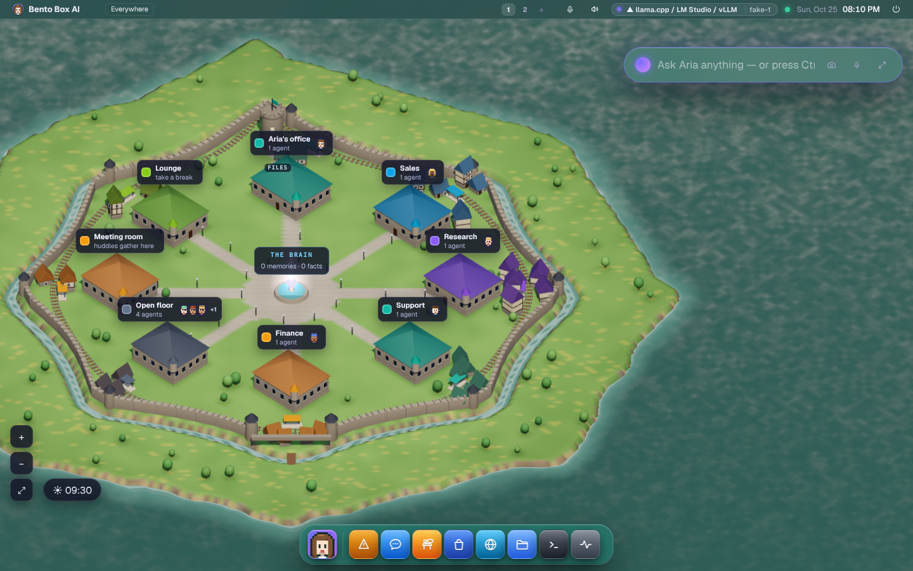

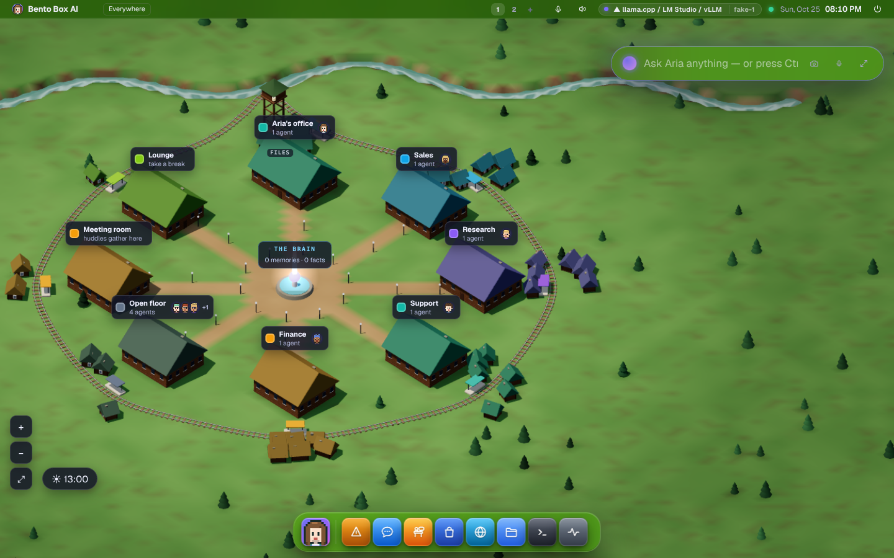

You can also say it in words. In the Office's Design, type "build a Venice like city" or "put us in a
castle" into Describe it, or ask your agent the same thing in chat. Either way it picks one of these
settings and the town is rebuilt. Your districts' houses and trees stay as you set them.

## What moves, and why

Nothing in the town moves for show.

- **Buildings open because something happens in them.** Work, a walk, a visit or a meeting opens a
  room's building. Looking into a room (tap its card, or the camera following the work) opens it too.
- **The carrier runs because work was handed over.** A train on the island, in the castle and in the
  forest, a ferry between the islands, a gondola on the canal. When one room hands work to another,
  it sets off from the first room's stop and goes to the other's. With nothing handed over it waits
  at your agent's stop.
- **Windows light up at night.** So do the street lamps and your agent's landmark.
- **The water ripples, the boats rock and the windmill turns.** That's scenery, like the office pet.

## Time of day

The town is lit for the real time where you are. The clock in the bottom corner lets you drag it to
any hour, and **Now** takes it back to the real one. This is kept in your browser only, so it changes
nothing for anybody else and nothing your agents do.

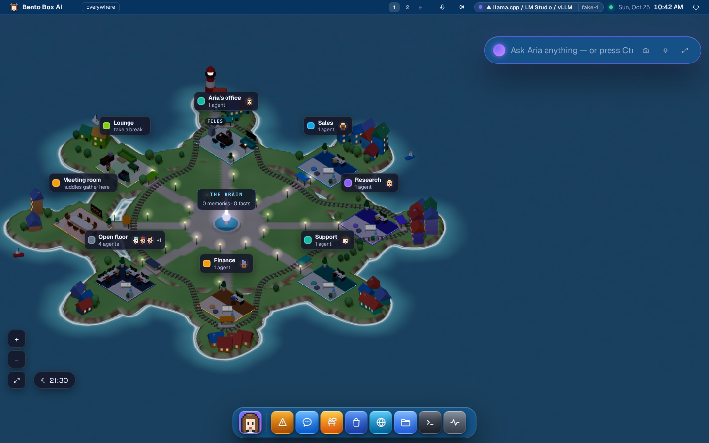

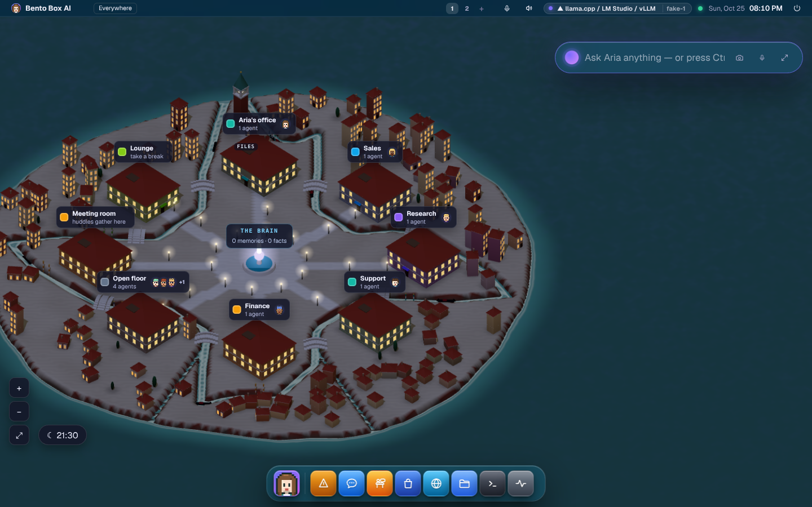

## Build it your way

In the Office, open ✎ Design. With the town look on you get:

- **Setting:** Island, Islands, Canal city, Castle or Forest.
- **Houses for each district.** Tap − or + to shrink or grow it, up to 12. Until you choose, a
  district has four houses and two more for each person in the department, so a bigger team is a
  bigger district.
- **Railway or boats on or off.**
- **Trees:** few, some or lots.

Houses are scenery. Who works where is still decided by the departments' people, which you set in
the same panel or in the Company panel.

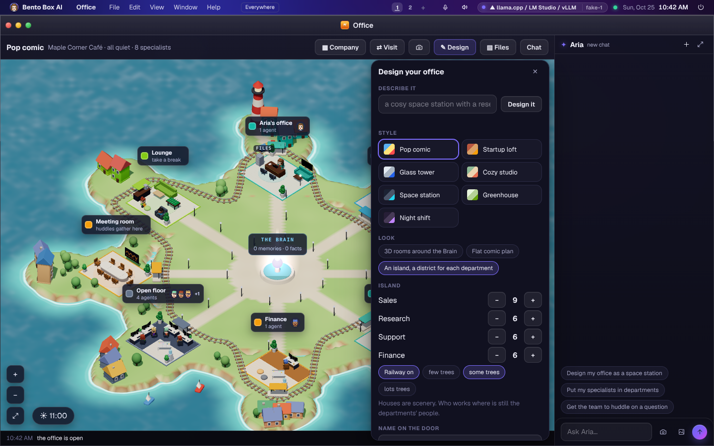

Your agent can build it too ("make it a castle and plant lots of trees"), through the same settings.
Every change is a line in Permissions → Ledger, whoever made it.

## From a terminal

```
bento office setting                       # the settings, and which one is yours
bento office setting castle                # move the town (it turns the town look on)
bento office island                        # the districts and their houses
bento office island houses Sales 9         # grow a district (0 to 12)
bento office island train off              # no train or boats
bento office island trees lots             # few, some or lots
```

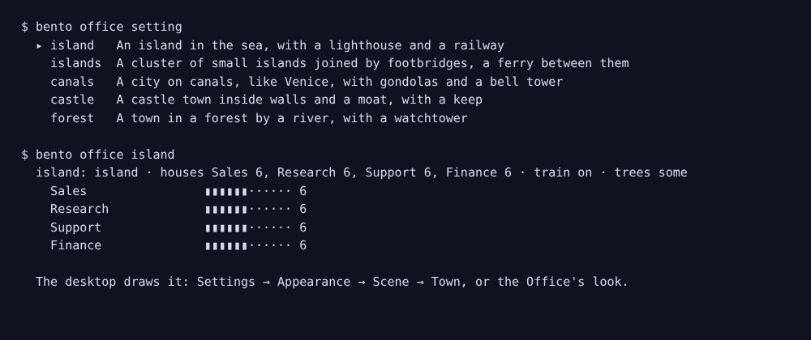

A terminal shows the plan, not the picture.

## On a phone

The town fits a phone held upright, and every control is big enough for a finger: zoom, the whole
town, the clock, and the builder's − and + buttons.

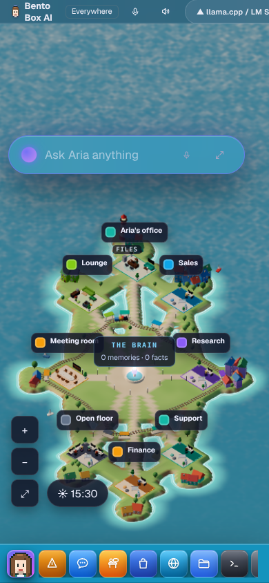

## What it costs

The land, houses, trees, walls and track are one mesh, the windows two more, the water one plane,
and each room's building three meshes so it can open. It draws from the Office's own loop: at most 30
frames a second while something moves, and none while it is covered or the tab is hidden. At rest
the water ripples at 12 frames a second on a real graphics card and 6 on software rendering, which
also gets no shadows.
