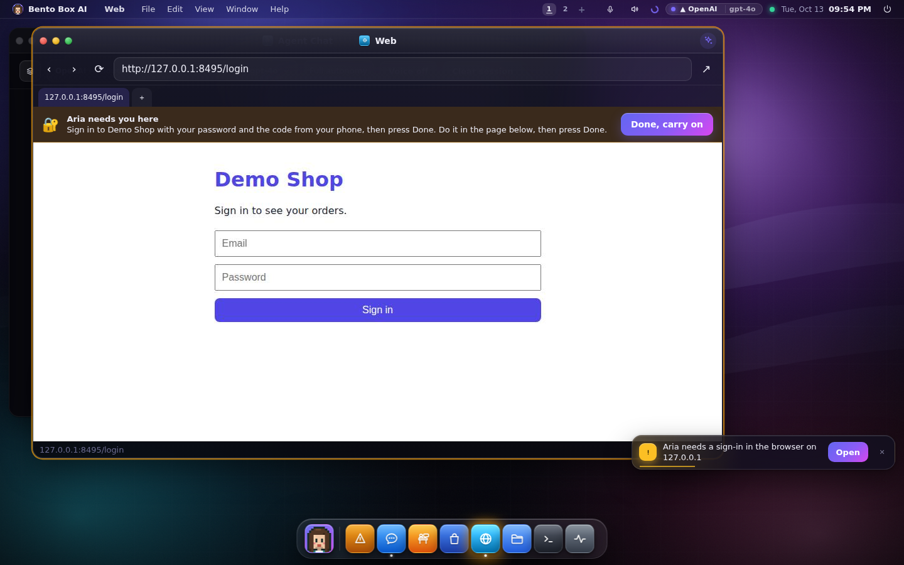
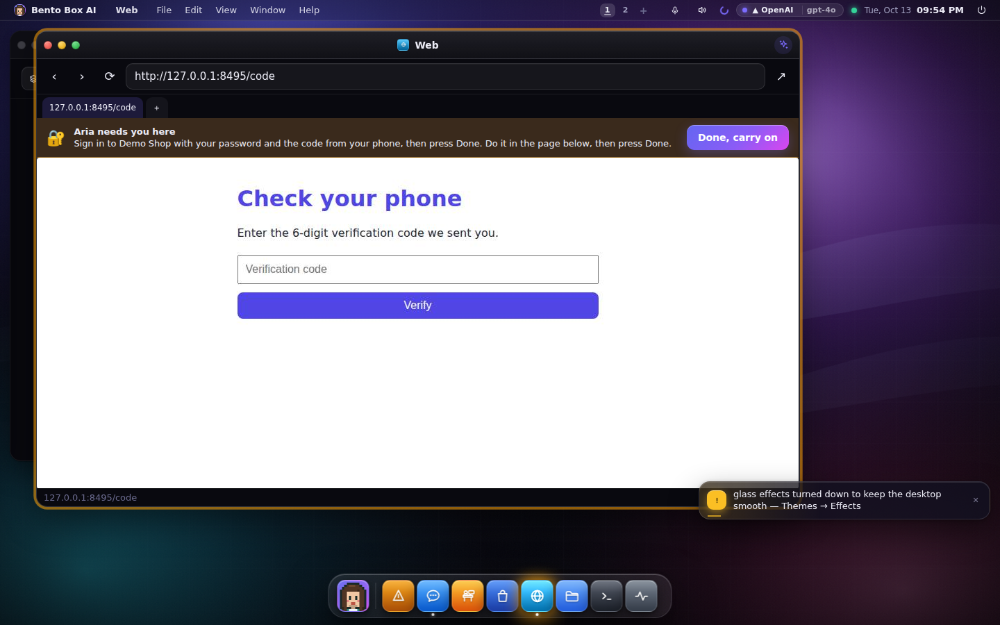
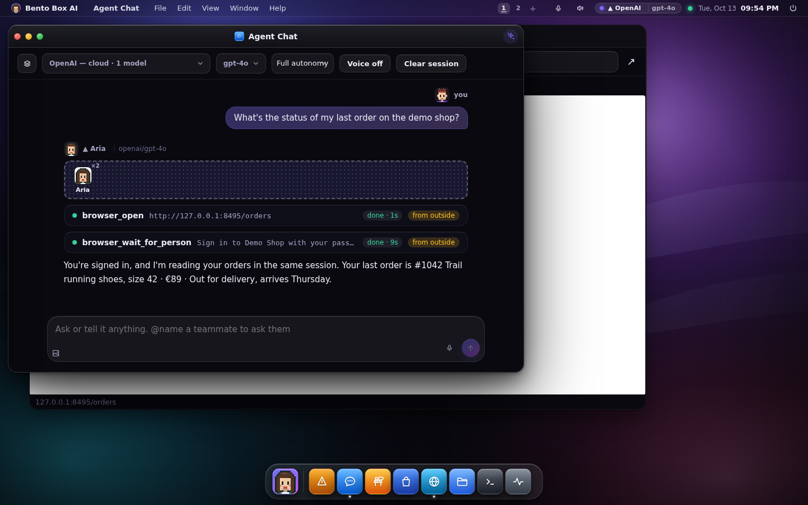
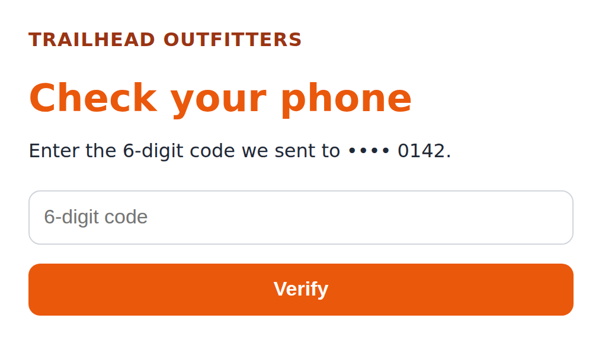
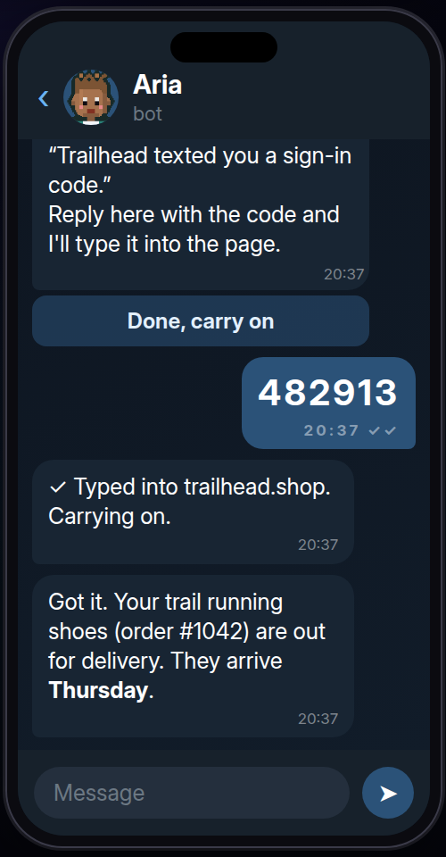
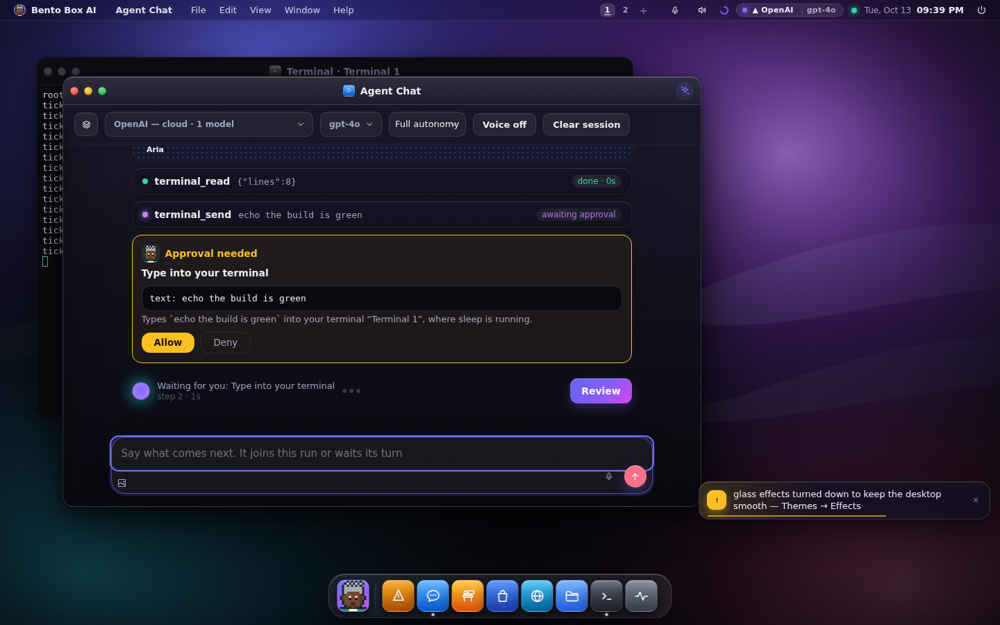
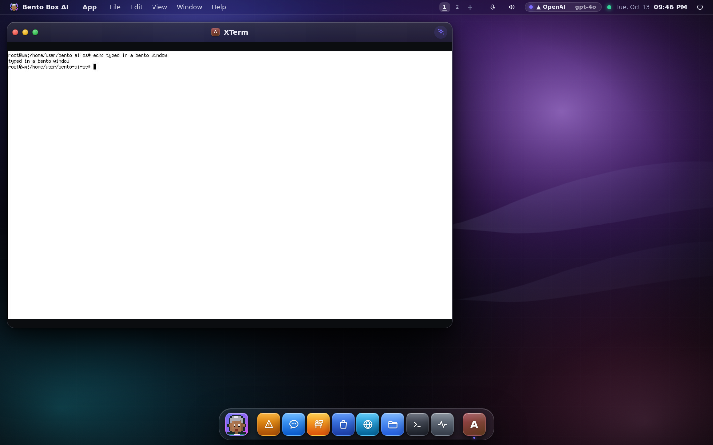

# Live windows: your browser, your terminal and your apps, shared with your agent

Some windows on the Bento desktop are not pages. They show a real process running on
this machine, and you and your agent both use it, at the same time if you like:

- **Web** is a real Chromium, signed in where you signed in. Your agent reads and clicks
  in the same tabs you see.
- **Terminal** sessions keep running when you close the window. Your agent can read one
  and type into it.
- **An installed app in a window** (an editor, a file manager, xterm) runs on this
  machine and is drawn inside a Bento window, so you can use it from a phone too.

## The browser, and the part only you can do

Ask your agent about something behind a sign-in ("what's the status of my last order?")
and it opens the site in the shared browser. When the page wants a password, a code from
your phone or a CAPTCHA, the agent stops. The Web window pulses, a toast says what it needs,
and a bar across the page says it in the agent's words.



You sign in in that window, as you would in any browser. Type the code when it asks.



The agent notices when the sign-in page has gone, or you press **Done, carry on**. It then
reads the page in the same tab, with your session, and answers.



### When you're on your phone

If you asked from Telegram or WhatsApp, the agent asks you there. It sends a picture of the
page and what it wants. For a code, reply with the code: the agent types it into the code
field, submits it, and carries on in the same session. The Web window shows "Typing the code
from your phone", never the digits.





*The chat above is redrawn from the messages the bot sent in a test run against a stand-in for Telegram.*

- **The code is never kept.** A reply that answers the page goes into the page and nowhere
  else: it is not saved in the conversation, not written to the log, and not seen by the model.
- **Only the chat that was asked can answer.** The wall is asked of the chat whose turn met
  it, while that turn runs. A message from anyone else, or anything that isn't a code,
  goes to the agent as usual.
- **A password is never taken from a chat.** Chat history would keep it. For a password or a
  CAPTCHA the phone is told to sign in on a screen and tap **Done, carry on** (on WhatsApp,
  reply "done").

Things to know:

- **Only web pages.** The browser opens http and https and nothing else, so a page cannot
  be used to read `file:` paths or browser settings.
- **Clicks and typing are asked for per site.** Reading a page is safe. Clicking,
  typing or pressing a key on a site is `browser.act` on `site:<host>`, so a grant can be
  for one shop and not your bank. An agent's hands (Settings → Executors) can be limited
  to a list of web addresses, and the browser keeps to it.
- **Untrusted words don't spend your session somewhere else.** Anything the agent read
  marks the turn. A click on the same site as everything it read is allowed. Once it has
  read anything else (another site, a mail, a fetched page), the next click asks you.
- **Nobody here, nobody waits.** If no screen has Bento open and you didn't ask from your
  phone, the agent stops and tells you what is needed instead of waiting.
- The browser keeps its own profile in your home (`browser/profile`), apart from any
  browser you use yourself. It closes after 20 idle minutes and opens again on use.

## Terminal sessions that stay

Close the Terminal window and the shell keeps running. Open the Terminal again and you
are back in the same session, with what it printed while you were away. The window's
menu lists every session and starts new ones.

Your agent can read a session (`terminal_read`) and type into one (`terminal_send`), and
a line of its own shows in the window when it does. A line it types is judged like a
command: it only reads, or it asks you. If something other than the shell has the
keyboard (an editor, ssh, a `[y/N]` prompt), typing into it always asks you, at every
autonomy level, and the card says what is running.



From another computer, `bento terminal attach` joins the same session over SSH:

```
bento terminal                 # list sessions and what each is running
bento terminal attach          # the newest one (or an id, a name, or "new")
bento terminal end t1a2b3      # end one
```

Ctrl+] leaves the session running.

## An installed app in a window

In the Apps launcher, tick **In a window** and open an app. It starts on this machine in
its own invisible display and is drawn in a Bento window you can click and type in.
Without the tick it opens on this machine's own screen, as before. From a phone or
another computer an app always opens in a window when it can, because that is the only
way to see it there.



Your agent can list and open them too (`app_windows`, `app_window_open`), look at one
(`app_window_look`) and click or type in it (`app_window_act`). Opening and acting ask.

It needs Linux and either:

- **X11:** `Xvfb`, `xdotool` and `ffmpeg` (offered as *Native apps in a window* and
  *ffmpeg* in the installer), or
- **Wayland:** `sway`, `grim` and `wtype`.

Where neither is there, the launcher says what to install in place of the checkbox. Each app gets a
display of its own, so it never appears on your own screen. waypipe and PipeWire are not
used: waypipe needs a compositor on this side anyway, and PipeWire screen capture asks
you to pick a window every time.

## The three faces

- **Desktop (GUI):** the Web window, the Terminal and its Sessions menu, the launcher's
  *In a window*. All of it works from a phone: the stream fits the window, a tap is a
  click, and the keyboard button opens the phone's keyboard.
- **Terminal (TUI):** `bento terminal attach` is the same session. `bento windows` lists
  the browser's tabs (and whether it needs you), terminal sessions and app windows. A web
  page or an app is a picture, so a terminal lists them and says to open them on a
  screen. On a machine with no screen at all, Telegram or WhatsApp is where a code page
  reaches you.
- **Session (SUI):** the same windows. When the browser needs you, the desktop also comes
  to the front, above native windows.

## For an agent on Claude Code, Gemini CLI or Codex

A chat forwarded to an agent CLI gets these tools through the same door as its team
(`mcp__bento__browser_open` and the rest), each call through this OS's permissions. Its
own web fetch sees the anonymous web. For a site you are signed in to, it uses yours.
