# Network: the machines on your network

*Settings → Network* lists every machine Bento knows on your network, whether it runs Bento or
not. From each row you can install Bento on it, secure it, and remove what ties it to this
machine. A machine waiting to be set up shows under *New machines* in the same tab, and the
other ways to add one (Make a Zero, the SD card, keys, the standard setup) are folded under
*Add a machine*.


It's admin only, because it reaches other machines. Bento looks only at this machine's own
private network, and anything it runs on another machine is shown to you before it runs.

## The list

One row per machine. A Pi that was heard without Bento, then installed, set up and linked is
still one row, matched by its network card's address, its IP and its certificate. Each row says:

- what it is (board or maker), its address, and when it was last heard;
- whether Bento runs there (*No Bento*, *Bento, waiting*, *Bento*, *Bento, linked*), and once
  it has been checked, how secure it is (*2 of 4 in place* or *secured*). That is always what
  Bento measured on the machine the last time it logged in, never a note that a run finished;
- whose it is, for a Zero that belongs to an account.

Each row has one button for the thing it most needs: *Install Bento*, *Secure it* (or
*Security* once checked), or *Set it up* for a Bento machine waiting under New machines. The
rest (Secure it when Install is the button, Disconnect, Rename, Hide) is behind **⋯**.

**Look at the network** knocks on SSH and Bento's port across this machine's own private
networks. A Raspberry Pi that joins the network says its name and you get a toast.

A machine doesn't need SSH open to be found. One that refuses the knock is there, and knocking
makes this machine ask the whole network who is at each address, so even a Pi with a firewall
that drops everything shows up. Its row says SSH is off, and how to turn it on. Raspberry Pi
Imager leaves SSH off unless you tick *Enable SSH*. After a scan, Bento also asks the network
over mDNS what each machine calls itself, so a Pi shows its own name.


Bento listens for new Pis whatever its brain. Before, only a machine that could lead a community
listened, which a hub on Claude Code can't, so it heard no Pi at all. A Pi that was already on
when Bento started has nothing new to say, so press **Look at the network** to find it.

## Install Bento

Open a row and press **Install Bento**. Type the user you set in Raspberry Pi Imager and its
password, and press **Check it**. Bento logs in, says what the machine is, and shows the exact
command it will run there. Press **Install Bento there** to run it. The machine comes up with a
key this one made for it, so it's set up here the moment it's heard.

New Raspberry Pi OS has no `pi` user. Use the name you typed in Imager's settings.

**Its agent's name** is what you call that machine's agent, like *Chef* or *Fridge*. **Open on its
screen** (on by default) makes Bento open full screen on that machine when it starts, so you can
plug a screen in and talk to it. It adds `--screen` to the command shown. See
[One agent on screen, and the kiosk](small-screens.md#open-on-its-screen-at-start).

When the login is refused, the reason stays under **Check it**:

- **The user name or password was refused.** Check both against what you set in Imager.
- **That machine takes SSH keys only.** Imager's *Allow public-key authentication only* turns
  passwords off. Add this machine's key there (*Set machines up → This machine's SSH key*) and
  flash the card again, or flash it with password authentication on.
- **This machine's key is not on that machine.** You left the password blank; type it.


### While it installs

Once you press **Install Bento there**, the form turns into the install: the step it's on, out
of seven (six without its screen), and how long it's been going. The steps are read from what the
installer prints, so the bar moves when the machine does. **What it printed** shows the raw lines.
A Pi takes 10 to 20 minutes, and you can close Settings while it runs.

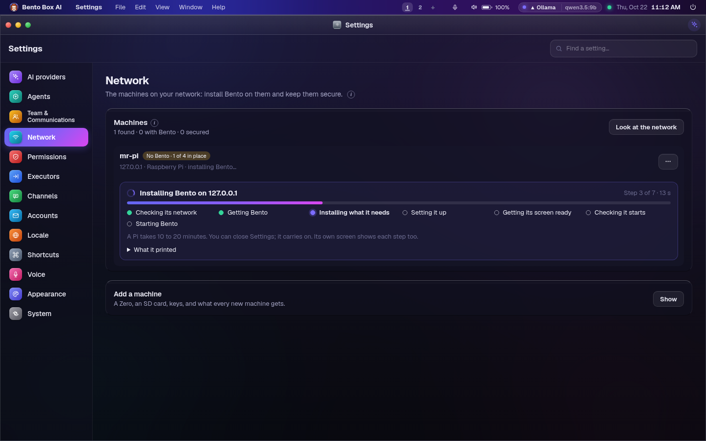

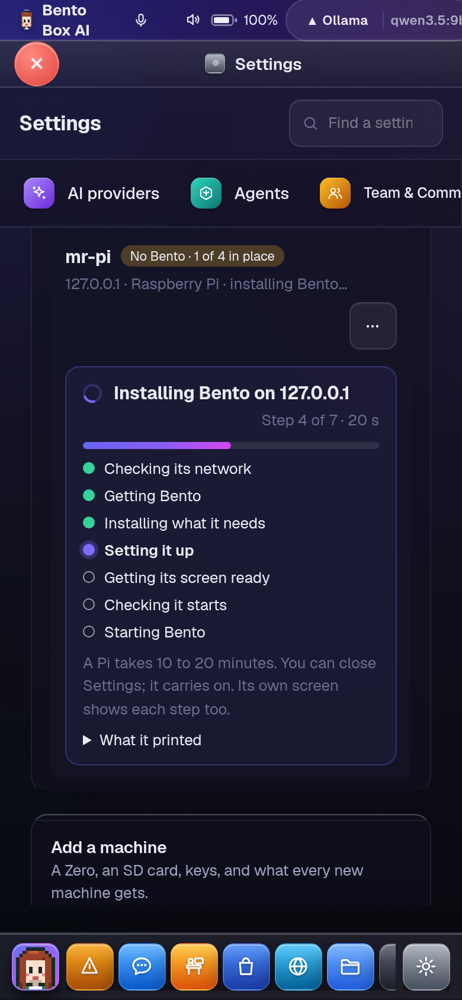

If it stops, the card says why in the installer's words, including what git or apt said just
before it gave up (a clone cut off by a weak Wi-Fi reads *clone failed (fatal: early EOF)*). The
form is back underneath to try again.

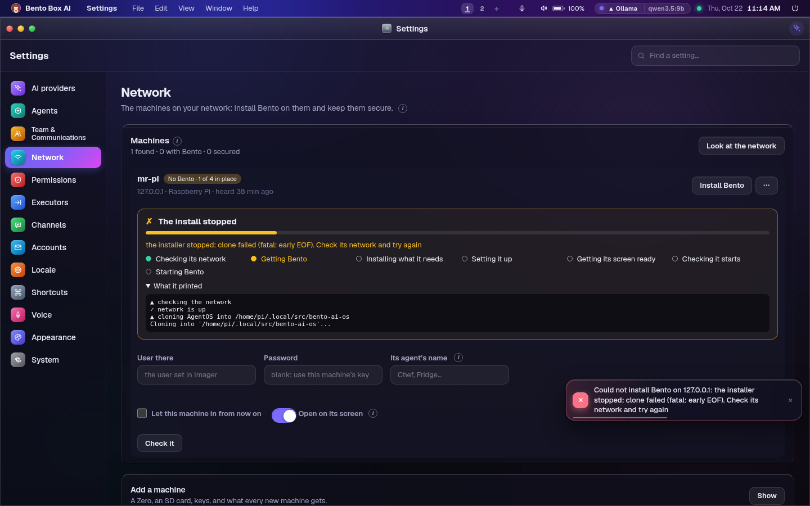

With **Open on its screen** on, the machine's own screen shows each step too. On a Pi with the
desktop it's a full-screen page that becomes Bento's Office once Bento answers; with no desktop
it's the console. A failed install leaves its reason up for five minutes, then gives the screen back.

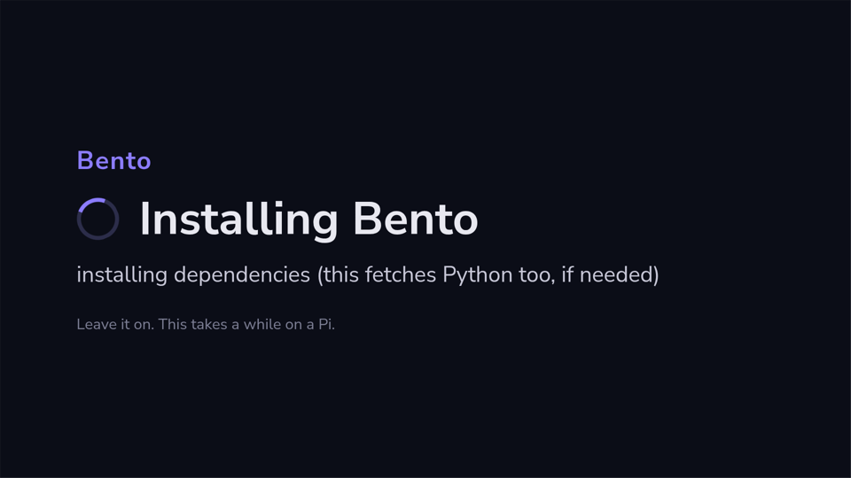

`bento network install` prints the same steps as it reaches them.

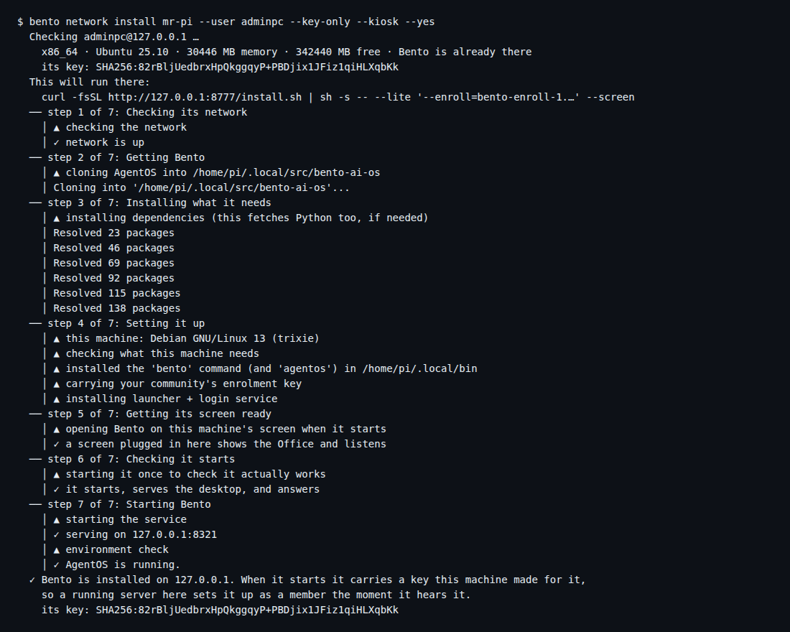

A fresh install fetches Bento without the docs' screenshots, about 14 MB instead of 205 MB. The
pictures are for reading the guides on GitHub; nothing on the machine shows them.

### When it's done

Once it's installed, Bento sets the machine up by itself: the install gave it a key that only
works once. Everything is chosen here, in the Install form, so the machine asks nothing on its
own screen. It may be in another room, or another building. Until it's set up, its screen says
which Bento is setting it up and when it last heard from it.

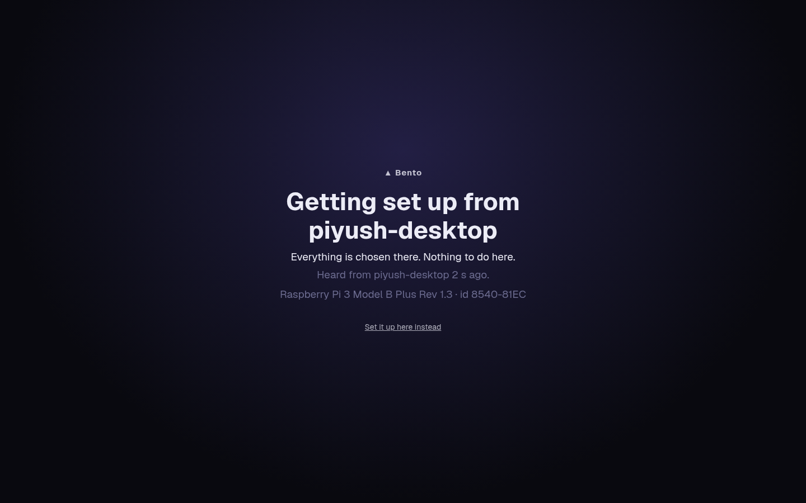

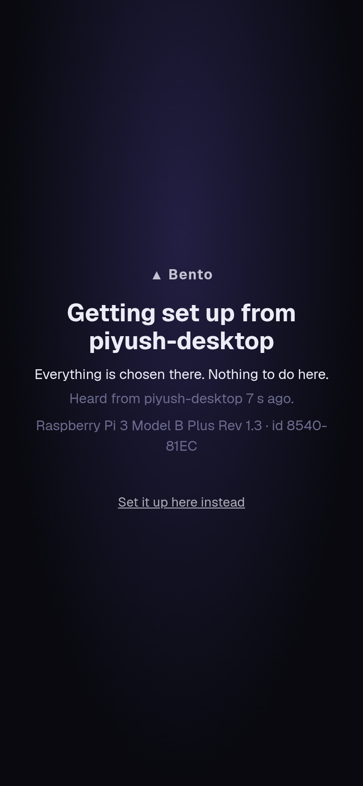

At the Pi's terminal, `bento setup` says the same and how to set it up there instead.

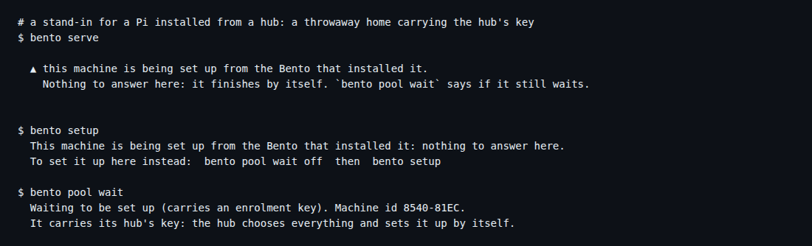

Bento asks the machine directly as well as listening for it, so a firewall on this computer
can't leave it waiting to be heard. If a machine still says *Waiting to be set up*, press
**Look at the network**.

With **Open on its screen** on, Bento opens full screen there and again at every start.

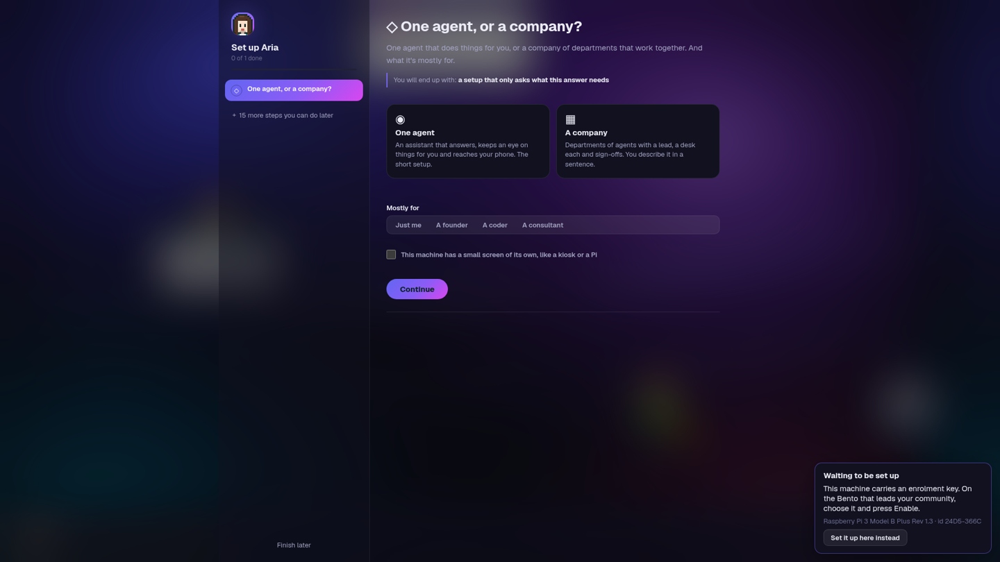

Letting the page use the microphone without asking needs root. On a Pi whose `sudo` asks for a
password, Bento still opens on the screen, and the page asks for the microphone the first time.
Run `bento screen on` at a terminal on the Pi to allow it ahead.

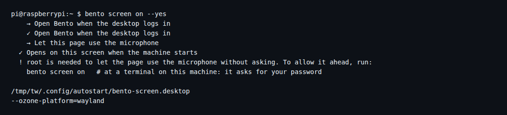

## Secure it

Open a row and press **Secure it**. Type the user there (the one set in Imager) and its
password, and press **Check it**. Bento logs in, reads which of the four steps are already in
place, and changes nothing. Each step that isn't shows why it matters and, under *What runs
there*, the exact command it will send.


| Step | What it does |
|---|---|
| Log in with this machine's key | Adds this machine's SSH key, so Bento can reach it with no password |
| Turn off password logins | A guessed or default password no longer gets anybody in, and root can't log in over SSH |
| Turn on a firewall | Only SSH and Bento answer, and only from your network and Tailscale |
| Install security updates by itself | Installs `unattended-upgrades` and switches it on |

**Paste your own SSH key first.** Once password logins are off, only keys get in, and that
includes you on your own computer. Put the one line from `~/.ssh/id_ed25519.pub` on your computer
in *Your own SSH key*, and it's let in before anything else runs. Without it, the confirmation
says your own password login is about to stop.


Untick any you don't want, press **Secure it**, and confirm. The steps run in that order, and
three things keep it from locking Bento out:

- **Passwords go off only after the key has worked on its own.** Bento logs in again with the
  key alone first, and stops if that fails. After the change it waits until the key gets in
  again, because SSH restarts itself for a moment when it reloads.
- **The firewall undoes itself unless Bento can still log in.** It's loaded with a 90-second
  timer, and only a new login through it stops the timer. It also refuses to go on when the
  login doing it comes from an address the firewall would drop. If you reach the machine over
  SSH from the internet, that stops working; the step says so.
- **The firewall is its own table** (`table inet bento` in nftables, loaded at boot from
  `/etc/bento-firewall.nft`). Your own rules, and Docker's, are left alone.


### Locked out after Secure it

If you secured a machine without your own key, your password no longer gets you in, but Bento's
key still does. Open the row, press **Security**, type the user and press **Check it**. Then:

- **Add my key**: paste your own public key first. Bento logs in with its key and adds yours.
- **Turn password logins back on**: Bento removes its own file from `/etc/ssh/sshd_config.d`
  and reloads SSH. The rest of SSH's settings stay as they were.


Installing Bento there still works with the password you always used: when it's refused, Bento
tries its own key before saying no.

On Raspberry Pi OS the first user needs no password for `sudo`. Where it does, the password
you typed is handed to `sudo` on its standard input, and never on a command line.

## Disconnect

**Disconnect** removes what ties that machine to this one. Each tie is its own tick:

- **a link**: your agents and its agents stop asking each other, and the permissions that named
  the link go (the same as *Remove* in Team & Communications);
- **its place in your community**: it stops thinking with this machine's brain;
- **this machine's SSH key on it**: Bento can no longer log in there without a password.


Bento stays installed on the other machine, and nothing else there is touched. Taking the key
off is refused when it's the only key there and password logins are off, because nobody could
log in over SSH afterwards and a Pi with no screen would need reflashing. Add your own key or
turn password logins back on first.

## Hidden machines

**Hide** (behind ⋯, or on a row under New machines) moves a machine to **Hidden** under the
list. Heard again, it stays there and you get no toast. Nothing about it is forgotten: open
Hidden and press **Show again**, and it's back as it was, with its name and security. A Bento
machine hidden from New machines goes back to waiting to be set up.


The count at the top is of the machines listed, not the hidden ones.

## A reformatted machine

Bento remembers each machine's SSH key the first time it logs in, and refuses a machine whose
key has changed, because that is also what a machine pretending to be yours looks like. A Pi you
reformatted or reinstalled has a new key, so *Check it* stops there and shows both keys: the one
Bento remembered and the one the machine shows now. If you did reformat it, press **It was
reformatted: forget the old key**. Bento asks once more, forgets it, and checks again, and the
new key is remembered from then on.

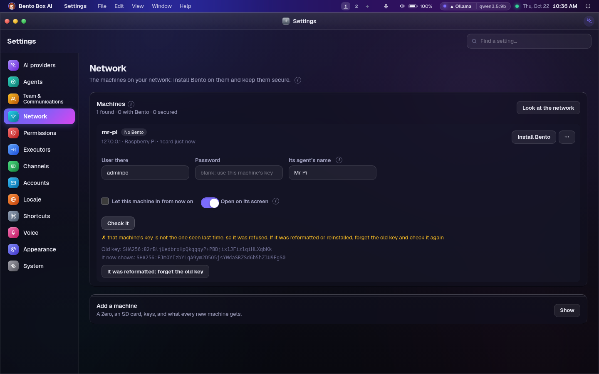

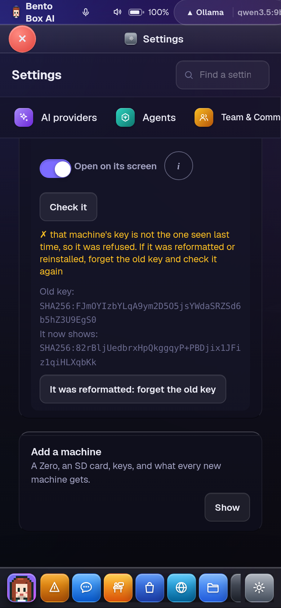

In a terminal the refusal names the command, `bento network rekey MACHINE`, which shows both keys
and asks before it forgets.

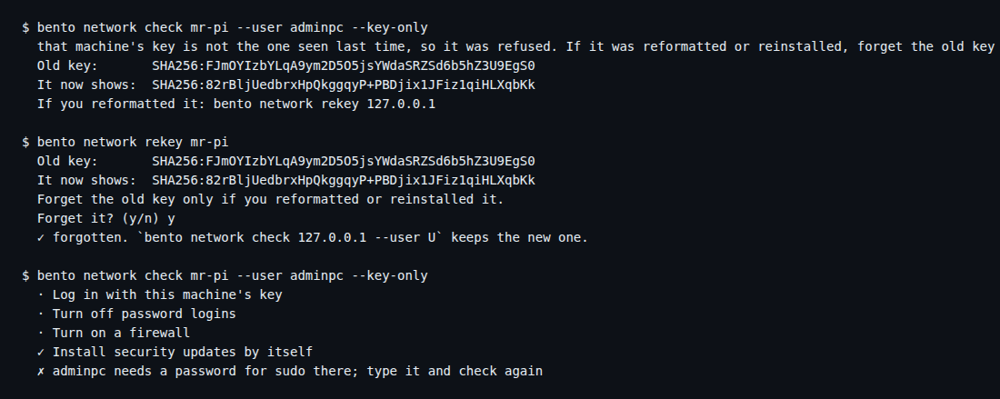

Only Bento's own list of keys changes (`~/.agentos/pki/known_hosts`, kept as it was in
`known_hosts.old`). Your own `~/.ssh/known_hosts` is left alone.

### Controls, and removing Bento

Every machine with Bento has **Controls**. Type the user there and press **Read its switches**:
Bento logs in (with this computer's key if it's there, or the password you type) and reads
what's on. Nothing changes until you press a switch.

- **Bento running**: its background service. Off stops Bento there and closes it on its screen;
  on starts it again, back on its screen if that switch is on.
- **Open on its screen**: Bento full screen on its display, now and at every start. Off closes it
  now. Its desktop may still open Bento as an ordinary window at login, if it was installed that way.
- **Listening**: the kiosk face, the Office with the microphone on.
- **Big code to the hub**: whether it may hand heavy Python here (below). This one is a
  permission on this computer, so it needs no login.
- **Update Bento there** runs `bento update` on it and reads the version after.

Each switch shows the line it runs under *What runs there*, and after it runs, the state is
read again: the tab says what is true, not what was asked for. What was read is kept in the
list with when, under the machine's name.

**Remove Bento** stops it, takes the program off (the service, the launcher, the screen entry and
the code), and ends its link and its place in your community. Its memory and settings in
`~/.agentos` stay on it, so **Install it again** picks up where it was. This computer's SSH key
stays too; Disconnect takes that off.

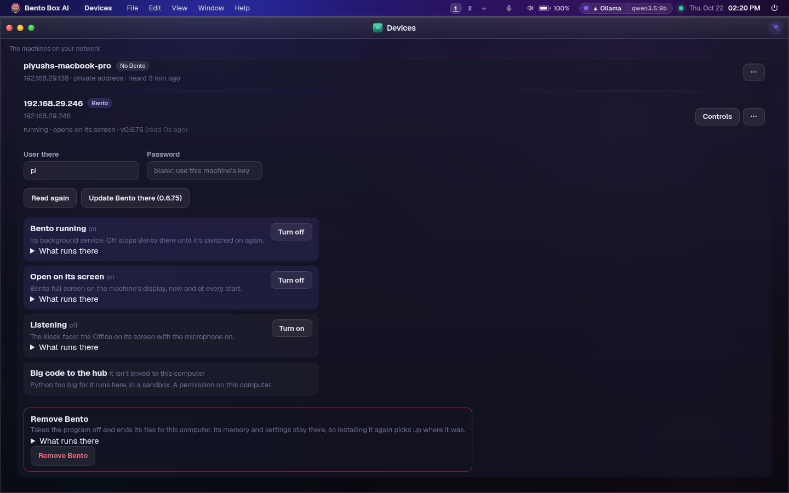

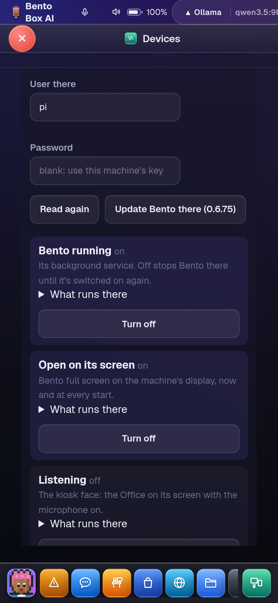

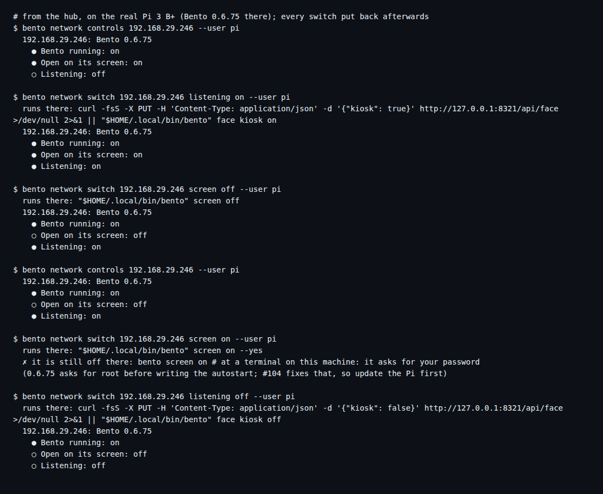


The **Devices** app in the dock is the same list in a window of its own, with a map above it:
this computer in the middle with your agent, each machine with Bento around it with its own
agent, and the rest of the network as small dots. A solid line is a link or your community; a
dashed one is Bento with no tie to this computer yet. A green ring is running. Tap an agent to
open its machine's Controls.

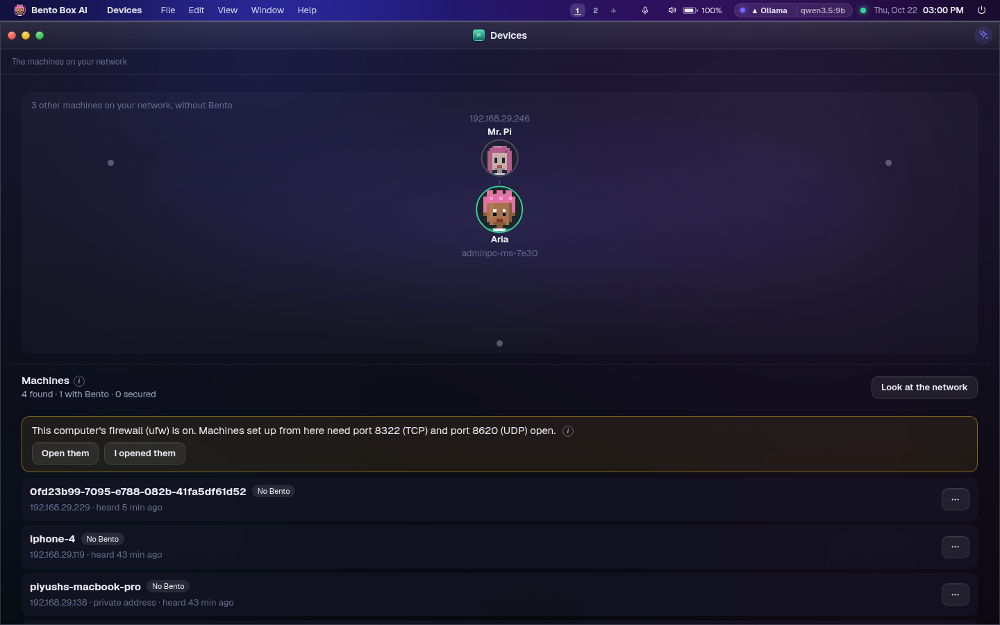

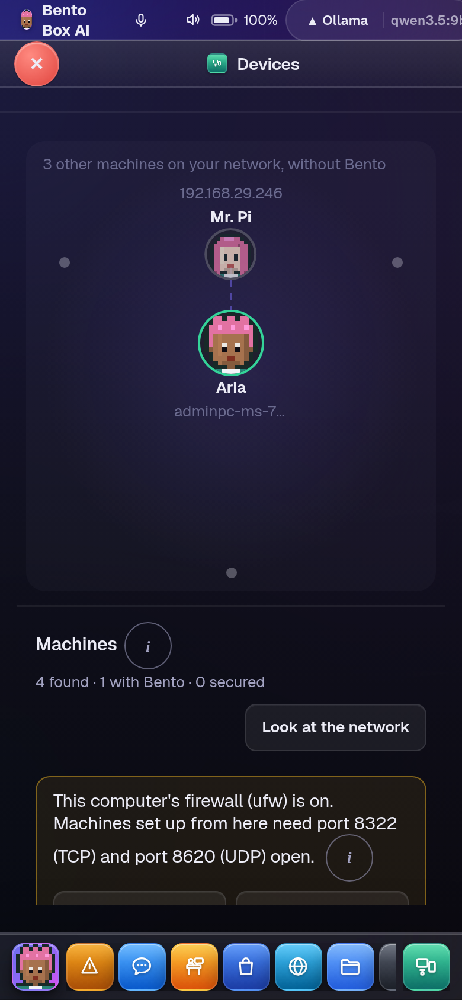

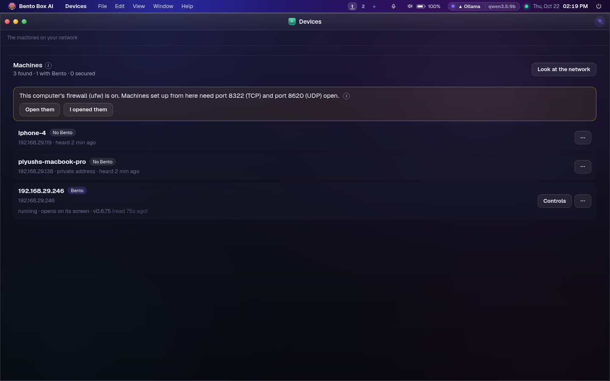

### Its agent's look

Controls has its agent's look: pick skin, hair, style, outfit, shirt and trousers, or describe
it in words and its own designer picks. It changes on that machine (its screen and its Office)
and on the map here.

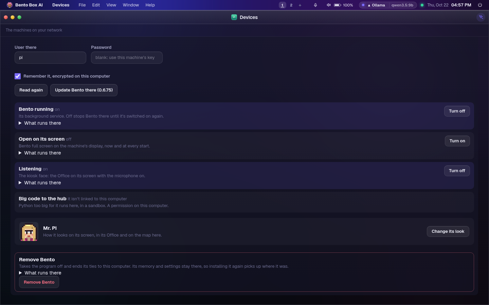

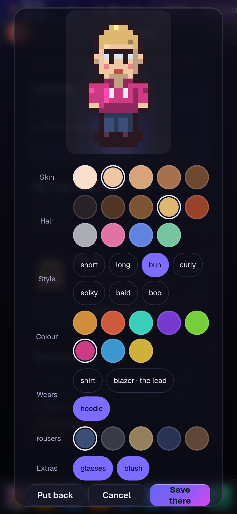

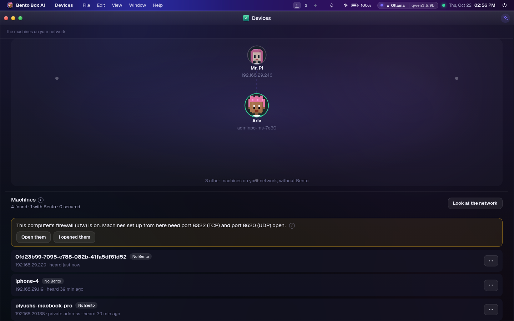

### Passwords

A password you type for a machine can be remembered: tick **Remember it** and, once it has
logged in, it's kept in this computer's vault, encrypted. Leave the box blank next time and it's
used. It changes only when you type a new one and tick **Replace the saved one**, and **Forget
the saved one** removes it. Nothing ever shows it again, here or anywhere else.

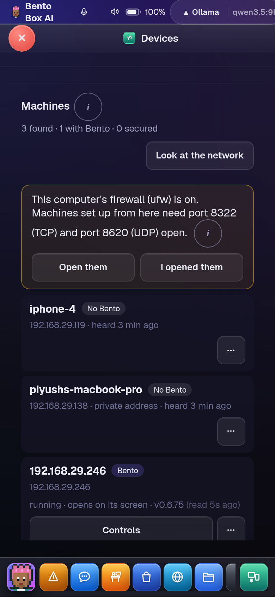

### Code too big for it

A Pi runs small code itself. When an agent's Python on a machine set up from here runs past a
minute or needs more than 512 MB, Bento hands it to this computer and brings the answer back.
An agent can also send heavy work straight here (`where: "hub"`).

Only the code and the one folder it names come over. Here it runs in a sandbox of its own: no
network, nothing of this computer visible but its system files, 2 GB of memory, 15 minutes,
lower priority than everything else, one run at a time. The files it made or changed go back
into that folder on the Pi, and the sandbox's folder is deleted. A computer without bubblewrap
runs none.

Setting a machine up allows it, as a grant in *Permissions* (`team:<machine>/*`, `code.run`).
Revoke it there to stop it; the Pi then gets a sentence saying so. Every run is a ledger row.


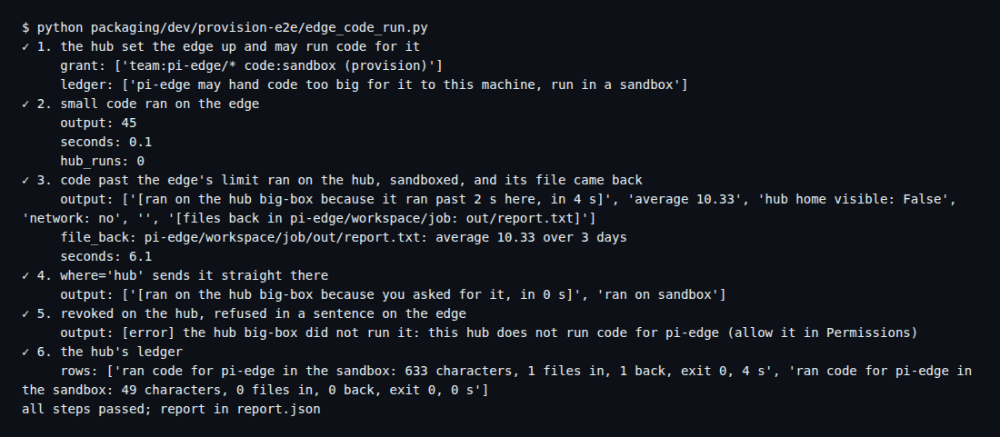

### This computer's firewall

Machines set up from here reach this computer on two ports: 8322 (TCP) to join and hand work
over, and 8620 (UDP) to be heard. When ufw or firewalld is on, the tab says so with **Open
them**, which asks for your password. Bento can't read the rules without root, so if you
opened them yourself, press **I opened them**.

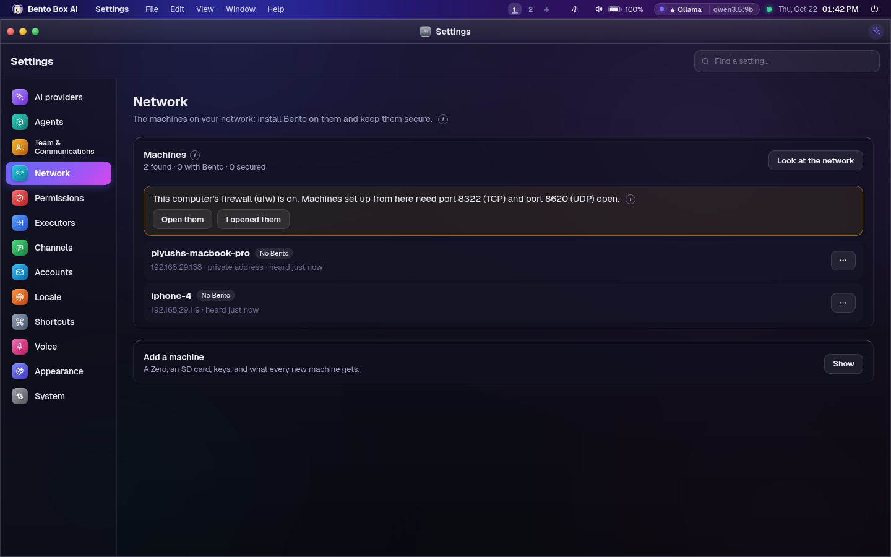

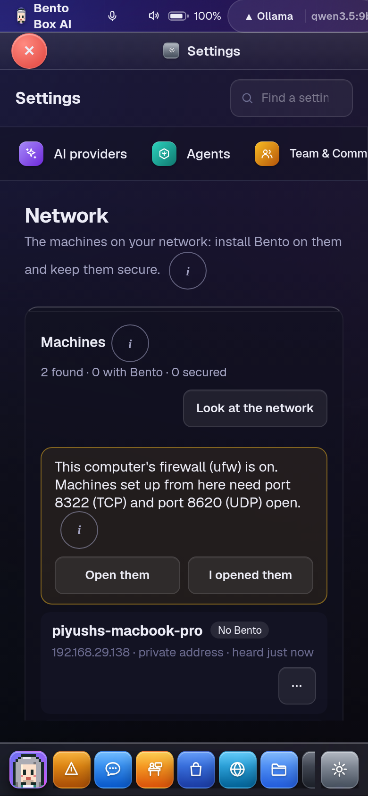

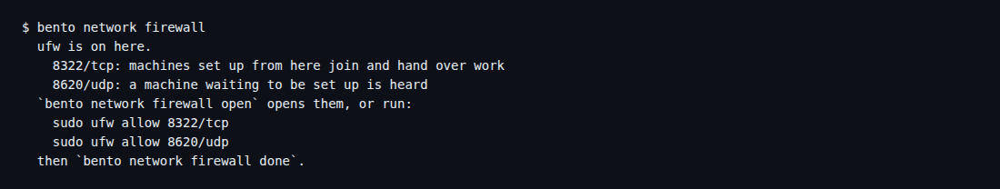

## From a terminal

```sh
bento network                                   # the list, with each machine's ties
bento network look                              # look at the network, as the tab's button does
bento network install 192.168.1.40 --user ada   # checks it, shows what runs, asks, installs
bento network install pi-kitchen --user ada --authorize   # and lets this machine's key in
bento network install pi-kitchen --user ada --agent-name Chef --kiosk   # named, and opens on its screen
bento network check 192.168.1.40 --user ada     # which steps are in place; changes nothing
bento network secure 192.168.1.40 --user ada    # shows what runs, asks, then runs it
bento network secure pi-kitchen --user ada --your-key ~/.ssh/id_ed25519.pub
bento network letin pi-kitchen --user ada --your-key ~/.ssh/id_ed25519.pub   # locked out: add your key
bento network letin pi-kitchen --user ada --passwords-on                     # or passwords back on
bento network secure pi-kitchen --steps key,passwords
bento network disconnect pi-kitchen --what key  # or community, or link:NAME
bento network label 192.168.1.40 "Kitchen Pi"
bento network hide 192.168.1.40                 # to Hidden (forget does the same)
bento network show 192.168.1.40                 # back on the list
bento network rekey pi-kitchen                  # it was reformatted: forget its old SSH key
bento network firewall                          # this computer's firewall, and the ports to open
bento network firewall open                     # open them (asks for your password)
bento network controls pi-kitchen --user pi     # read its switches
bento network switch pi-kitchen screen off --user pi    # running, screen, listening or code; on|off
bento network update pi-kitchen --user pi       # bento update there
bento network remove pi-kitchen --user pi       # Bento off it; its data stays
```


`install` uses the SSH port the scan found, and an address that isn't on the list yet works too.
`secure` and `letin` use the key in `~/.ssh` on the machine you type them on when you don't name one.


A password is read without echo, or from standard input with `--password-stdin`. A link is
ended by the running server, so the terminal points you to the tab or `bento link remove`.

## The three faces

- **Desktop:** *Settings → Network*. On a phone the actions reflow into two columns of full-size
  buttons.
- **Terminal:** `bento network`, as above.
- **Session UI:** the same page; nothing here touches the compositor. A Zero has no Network
  tab: its network is its hub's business.

## The ledger

Every step is a row: `device.scan`, `device.check`, `device.secure`, then `device.secured` or
`device.secure_failed`, `device.disconnect`, `device.forget` (hidden), `device.show`, `device.rekey` (an old SSH key
forgotten), `network.firewall`, `provision.code` (a machine may hand code here) and `edge.code`
(one run, with what went in and came back), `device.controls`, `device.switch`, `device.update` and
`device.remove`.

## What was tested, and what wasn't

- `tests/test_network.py`, with a stand-in `ssh` playing a Pi whose state changes as each step
  runs: what runs is what was shown; the password never reaches a command line; `sudo` gets it
  only when it needs it; passwords go off only after a key-only login; every later login uses
  the key; a slow SSH reload is waited for; the firewall is kept only by a new login; the key
  can't be taken off when it's the only way in; the list folds every source into one row.
- `packaging/dev/network-e2e/run.py`, against a real machine: a container with a real OpenSSH
  server, `sudo` and nftables, user `pi` with a password, and an SSH configuration with no
  `Include` line, as Buster ships it. Bento found it, checked it and secured it. Then, measured
  from outside: a password login was refused, the key got in, a port nobody allowed (9999)
  stopped answering while SSH still did, and 95 seconds later the firewall was still on.
  Disconnect refused to take the only key off, then took it off once another key was there.
  The run found that SSH briefly refuses logins right after it reloads; Bento now waits for it.

Not tested: a real Raspberry Pi, and Raspberry Pi OS's own `systemctl reload ssh`. The container
has no systemd, so the reload there came from the `ssh` init script.
