# The Office

The **Office** app is a playground where you watch your agents work. It comes in two
looks: rooms in 3D around a glowing Brain (the default, below), or a flat comic-strip
office:

- your agent sits in the corner office, behind the mission board;
- each specialist has a desk in a department;
- huddles happen in the meeting room;
- there is a lounge with a sofa, a coffee machine and an office cat.

The chat is the column on the right, so you ask for something there and see it happen
on the left.

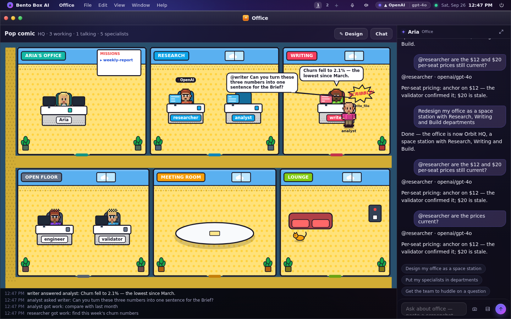

Open it from the dock, the app deck (Essentials), or ask your agent to "open the office".

## In 3D: rooms around the Brain


Each department is a room on a ring, with your agent's office at the top, the meeting room
and the lounge beside them, and the Brain in the middle. Paths run from the Brain to every
room's door, and people walk along them when they go to see each other. When an agent saves
or looks something up in memory, a spark runs from its room to the Brain and the Brain
pulses. The card over the Brain counts what it holds: your memories and the facts in the
knowledge graph.

It looks like an office at work, not a classroom:

- **People face their work.** Desks stand against the back walls, under windows onto a
  city, so you see people from behind with two screens over their shoulder. A screen is
  bright and its code scrolls while that person works. Someone between tasks turns their
  chair a little into the room, so you can see who it is.
- **People are little 3D figures** that turn the way they walk, towards whoever they came
  to see, and to the middle of the meeting table. They're the same characters as in Chat,
  seen from the front, the side and behind, and the chair turns with whoever sits in it.
- **Your agent's desk faces the door**, with a laptop, two chairs for visitors, a sofa
  under the mission board, the files and the bookshelf. Somebody reporting stands between
  the visitors' chairs.
- **Each department has a working side and an open side**: carpet under the desks, the
  team's board with sticky notes, a water cooler and plants. The lounge has a coffee bar,
  an arcade, a foosball table and bean bags.

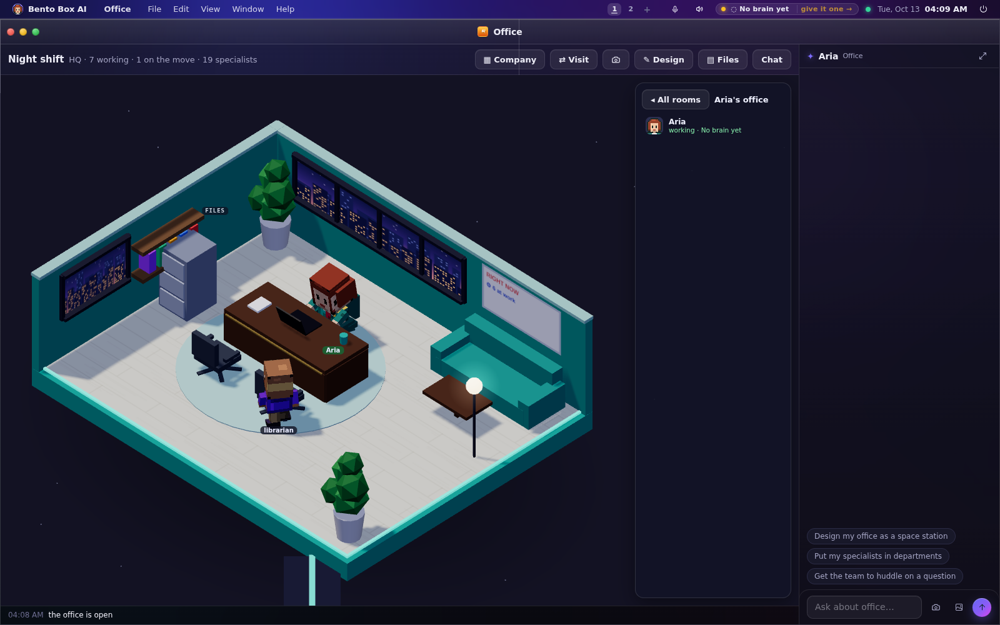

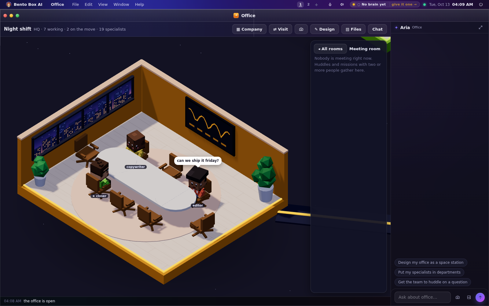

A big team doesn't turn into a crowd:

- **A room has four desks. Everyone else is on its card.** "Engineering · 7 agents · 3
  running" with their faces. Who has a desk follows the work: the head of the department
  first, then whoever is working or waiting for you. When somebody without a desk gets work,
  they walk in from the door and sit down, and an idle colleague gives up their desk.
  Somebody working never loses theirs, so a busy room doesn't turn into people walking in
  and out.
- **Names are on the cards, not over every head.** Only people on the move have a name tag.
- **Tap a room or its card to look inside.** The camera moves in, every desk is named, and
  the list beside it has the whole department, desk or not, with what each one is doing.
  Tap a name to ask them in the chat. **◂ All rooms**, Esc or a double tap goes back.
- **The ring takes the shape of your window.** Wide windows spread it out, a phone stands
  it up, and the camera always fits the whole office. Scroll to zoom and drag to look around.
- **Zoom right in.** Scroll, or use **＋ − ⤢** in the corner, to go from the whole office
  down to one desk. **⤢** brings the whole office back.

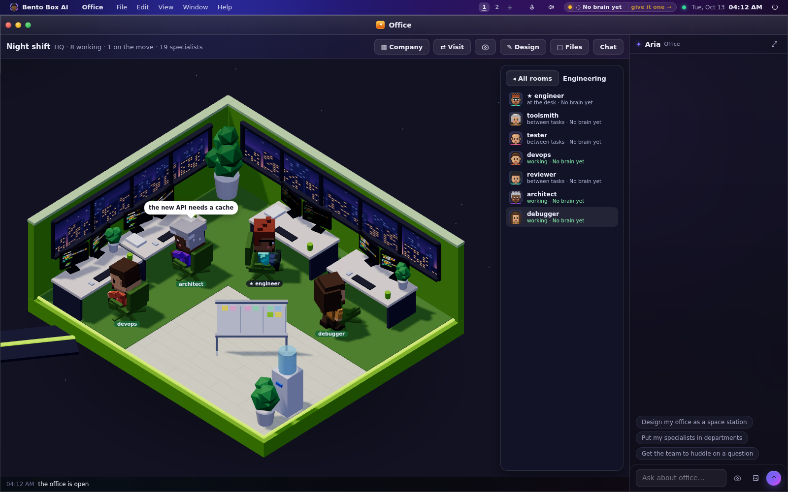

Everything that moves here moves for the same reasons as in the flat office (next section):
the same walks, papers, balloons and bursts, drawn in 3D. The faces are the same characters
as everywhere else. On a screen with no 3D graphics the office is drawn flat and Design says
why. Switch looks in **✎ Design → Look**, or with `bento office look 3d` / `flat`.

**Office HQ** is the same office as your desktop: Settings → Appearance → Scene → *Office
HQ (3D)*. It fills the screen and is always 3D, whatever look the Office window uses. Tap a
room's card to look inside, and tap a name there to open the Office with a message to them
started. Scroll over the desktop, or use **＋ − ⤢**, to zoom.

On a wide screen the prompt bar and its answers sit in a column on the right, and the office
fits in the space on the left, so what you ask and what happens are side by side. When one
department starts working, the camera moves to its room and comes back to the whole office a
few seconds after it finishes. If you zoom or pan yourself, it stays where you put it until you
press **⤢**.

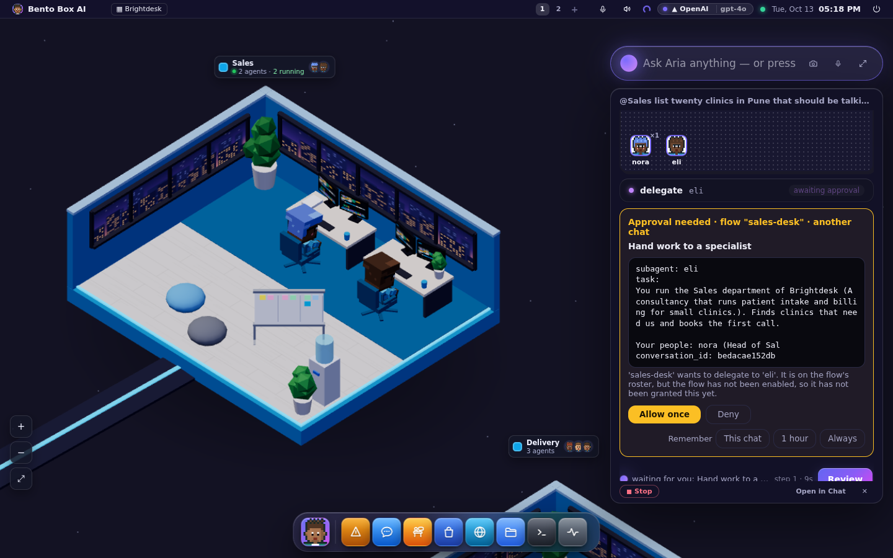

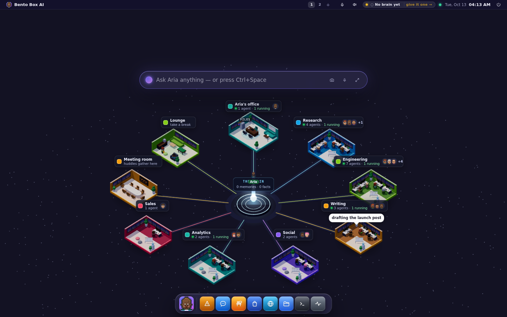

Opening the Office window while Office HQ is your desktop moves the 3D office into the
window, and closing it gives it back. (It used to stay dark: the desktop kept drawing it.)

## What moves, and why

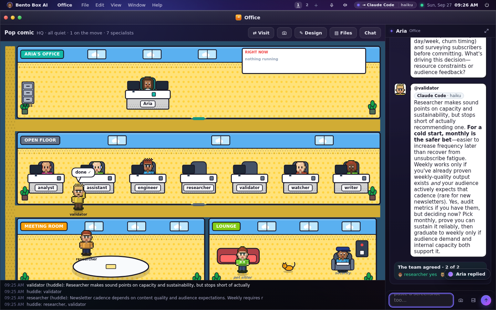


Everything in the office moves because something really happened on this machine.

| You see | Because |
|---|---|
| Your agent **gets up, carries the work over** to a specialist's desk, says what it wants and walks back | Your agent handed that specialist a task |
| A **paper flies** from the mission board to a desk, and a **!** pops over the specialist | A mission handed that specialist work (a mission's lead has no desk to walk from) |
| The **monitor lights** in the department's colour and the specialist **types** | Its run started; a tag above its head names the AI provider it is answering on |
| A **comic burst** ("FETCH!", "SCRIBBLE!") with the real tool name under it | It called that tool |
| One agent **gets up and walks** across the office to another's desk, asks in a speech balloon, waits for the answer, says thanks and walks back | It asked that colleague something (the team's permission matrix let it) |
| Agents **gather round the meeting table**, the one talking in a balloon | A huddle started |
| The specialist **walks the result back** to whoever gave it the work, says "done ✓ here it is" and goes back to its desk | The work your agent handed over is finished |
| **"done ✓"**, and the paper flies back to the board | A mission's step finished |
| Two or more specialists **sit round the meeting table**, the mission's name on a card | One mission has them working at the same time. Each goes back to its desk when its part is done |
| An agent **walks to your agent's office and raises its hand**, "? needs you: write_file · 3 min" | It's waiting for you to allow a step. The minutes count up until you answer, then it goes back to work |
| A red **✗ timed out** sign under an agent's desk | Its last step failed or ran out of time. It stays until that agent runs again |
| A paper flies into the **filing cabinet** and a red badge counts up | An agent saved a file. Tap the cabinet to see them all ([files.md](files.md)) |
| The whiteboard in your agent's office reads **RIGHT NOW**, and a red **×2** sits by your agent's head | Several things are running at once: each mission gets a line, then an App Studio build ("building an app"), then how many chats your agent is in, then how many specialists are at work |
| Your agent sits at its desk with a **"…"** balloon for the whole of a chat or an App Studio build | It is answering, or building. This includes work that started before you opened the Office, and a build keeps the desk lit when a chat ends beside it |
| An agent **hops** and answers in a balloon ("You rang? Point me at a question and I'll dig.") | You tapped it. Each agent has its own opener, and the rest comes from what its description says it is for. Tap again for another line. |

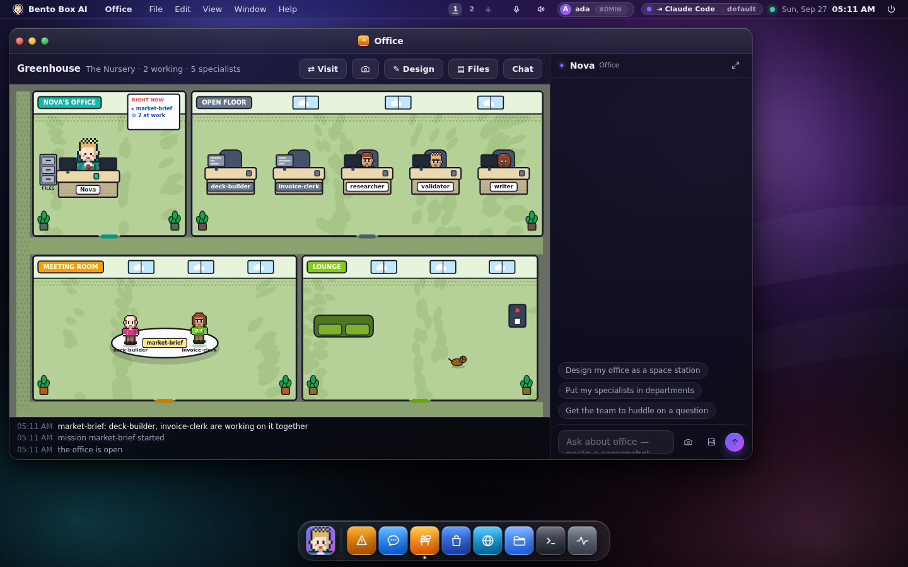

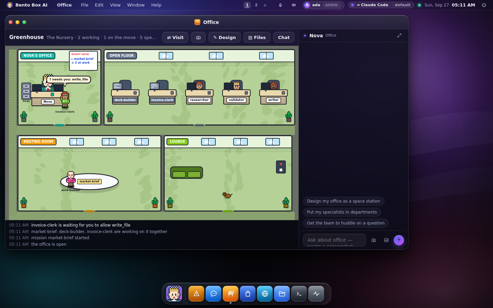

No walk takes longer than about three seconds, however big the office, because a walk
that finishes long after the thing it shows has happened is showing you the past. If
your agent is already away from its desk (asking someone, or in a huddle) the work
flies over on paper instead.

When nothing is happening, everyone sits at their desk, breathing and blinking. **They do
not wander about for show.** An office where everybody strolls around would look busy
when nothing is running, and this OS never shows activity that is not real. The pet
wanders. It is decoration, and it is clearly not an agent.

The lounge has two regulars who are not agents either. A security guard sits in the
armchair reading the paper, looking up over it now and then. A pet sitter plays fetch
with the office pet: the dog brings the ball back, and a cat bats its yarn back instead.
Their name tags are grey and under their feet rather than on a desk, tapping them asks
nobody anything, and they never walk about. Switch the lounge off and they go home. With
no pet there is no pet sitter.

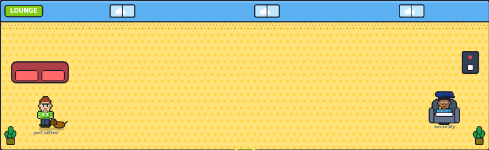

Under the picture, a four-line log says the same things in words ("analyst asked writer:
…"). A screen reader reads that log. It is also the quickest way to catch up after
looking away.

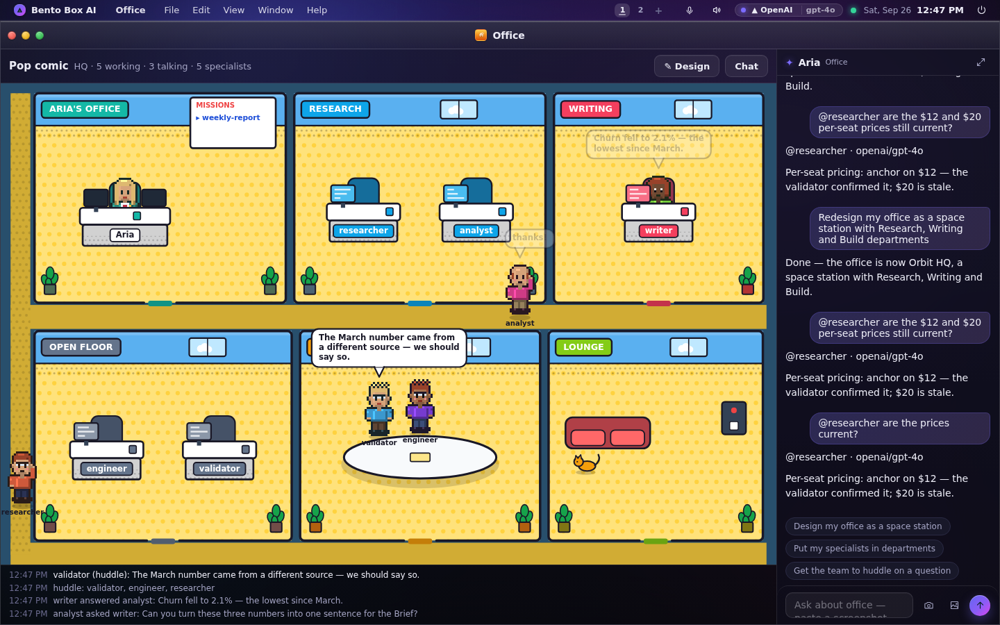

This is a real run, not a replay. You type into the chat, "redesign my office as a
space station". The agent calls `set_office` and the office repaints. Then you ask
`@researcher` about prices. It walks to the validator's desk in Build, asks, and gets
the answer.

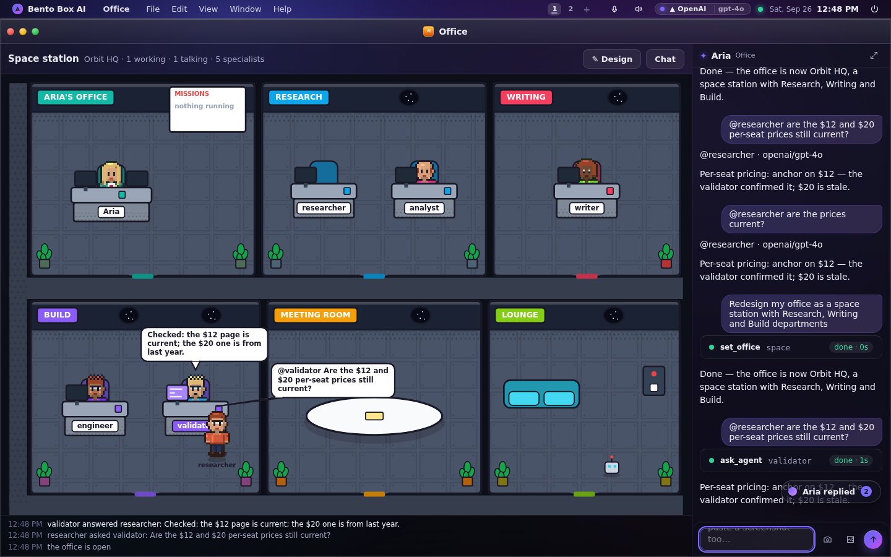

## In setup: your crew and your office

The setup arc has a step for it, right after "Build a specialist": **Meet your crew and
set up the office**. It gives everyone a stored character: you, your agent and every
specialist, each with a tap for a new look. You pick the office's style and the name on
its door, and see a preview of it with your crew inside before anything is saved, or
describe it in a sentence and let your agent choose. The
preview is the same picture your phone gets from `/office`. The step is ticked by
evidence: an office somebody created, from here, the Office's Design, the agent or
`bento office`.

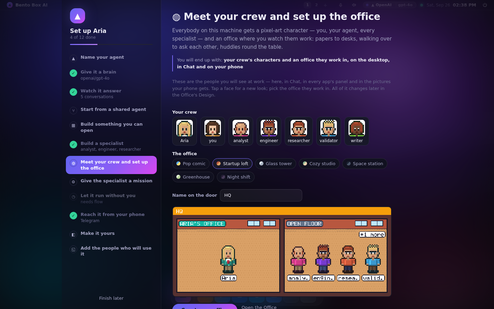

`bento setup` walks the same step in a terminal. It shows the faces in half blocks (or
describes them without colour), lists the seven styles, asks for the name, and runs the
same code as the wizard.

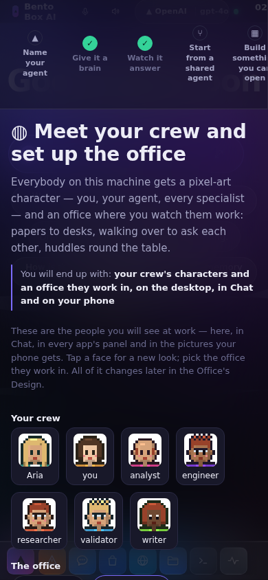

## Everywhere else: the play strip

A turn happens in more places than the Office. **Chat, the agent panel in every app, and
the prompt bar's card** each get the playground at the size of a line, which we call the
play strip. It shows:
- the faces of whoever is working on that turn;
- a **!** when work lands on somebody;
- a comic burst for each tool call, with the real tool name beside it;
- a short balloon when one agent asks another.

When the turn ends, the strip stays as a still record of who took part and how many steps
each took. A plain reply with no tools and no colleagues gets no strip at all.

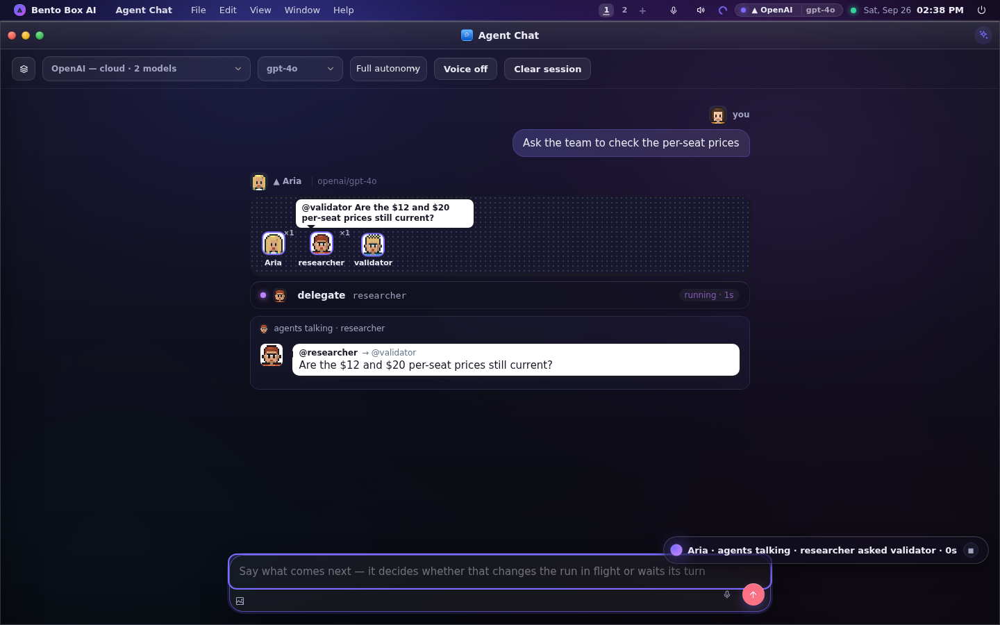

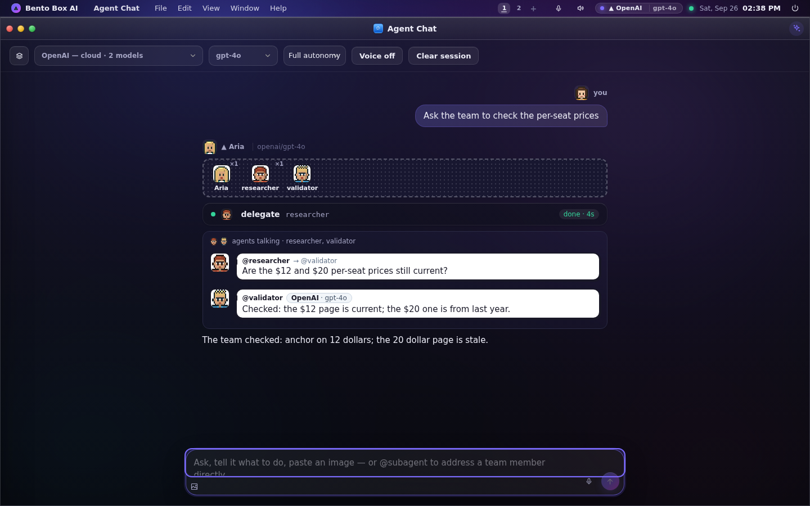

It follows the same rules as the Office: every mark is an event, fed by the same seam, with
the same faces and the same words. Agents talking to each other in Chat are now comic
balloons beside their faces. When the agent's hands touch an app window, the window gets
the same burst in its corner.

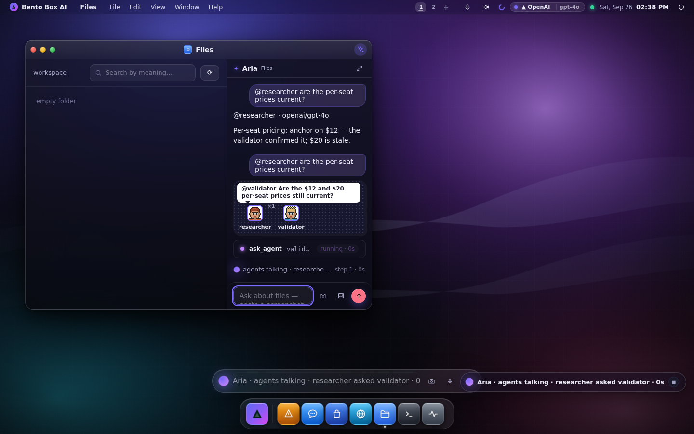

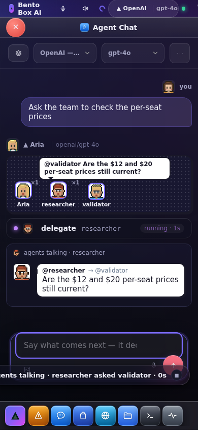

## Where to find it

- **The home screen** has a *Your office* button under the greeting, with your crew's faces
  on it. One tap opens the Office.
- **The dock** has the Office beside Chat. It was added once, for everybody who had already
  arranged their dock; remove it and it stays removed.
- **Settings → Appearance → Office** holds the look: style, name on the door, pet, and
  *Describe it*. Departments and who sits where stay in the Office, where you can see the
  desks.
- **Setup** asks for it in the crew step (below), and you can describe it there too.
- **As your desktop.** Settings → Appearance → Scene → *Office* draws the whole office
  under the greeting, behind your windows, so you can see who is working without opening
  anything. It is the same office: opening the Office app takes it over and closing the
  app hands it back. You can't tap the desktop picture, so the *Your office* button is
  still the way in. It stops drawing while a window is maximised or full screen, and a
  terminal has no wallpaper, so `bento office` is its answer there.

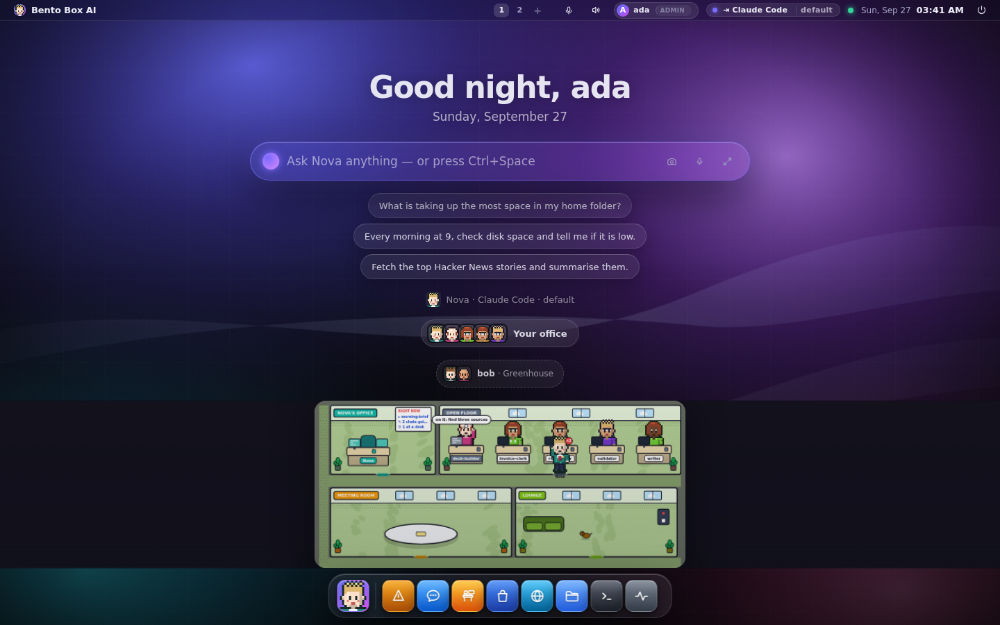

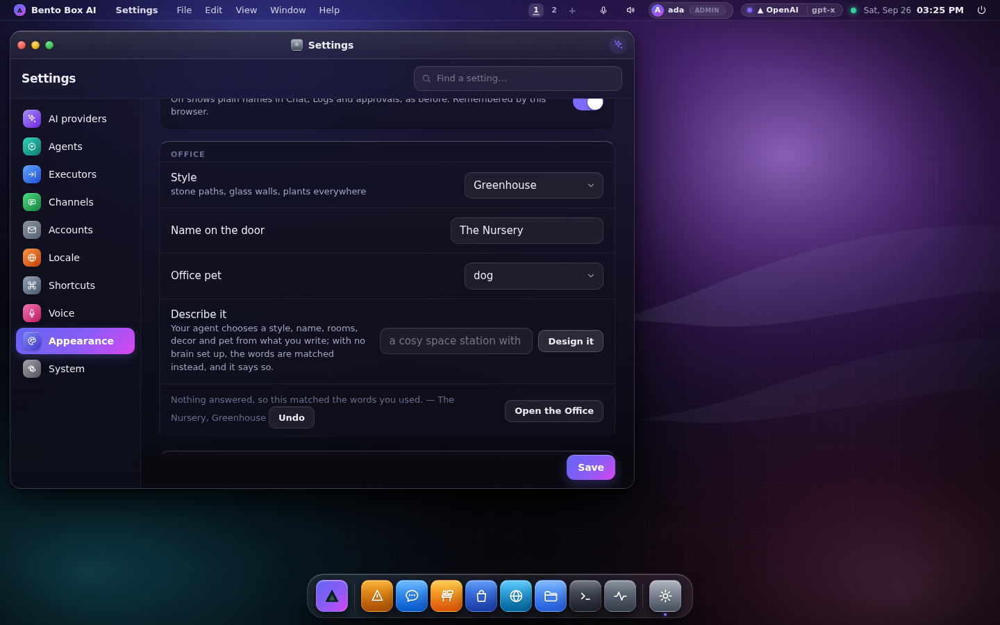

## On your phone: Telegram and WhatsApp

Telegram and WhatsApp can't run the Office, so they get it as **pictures**, drawn on this
machine in your office's style with the same characters. Both channels behave the same:

- **When agents talk during a turn you started from your phone**, the reply is followed by a
  comic strip of that exchange: one panel per line, in order. Every word is also in the
  photo's caption. The picture's lettering is a small pixel font, so a line in another
  script, or mostly emoji, shows "(below)" in its balloon and you read it in the caption.
  A turn in which nobody talked sends nothing extra. `telegram.comics: false` (or
  `whatsapp.comics: false`) in the config switches the strips off.
- **`/office`** sends the office right now: each room, its people, a BUSY tag over whoever
  has a run open, and what that run is doing. The caption is the same roll call in words.
- **Snap** (the camera button in the Office's bar) sends that same picture to your phone
  without you asking from it: Telegram, WhatsApp, or both, whichever are set up. With
  neither set up, it says which to set up and offers the picture itself instead.
  `bento office snap [telegram|whatsapp]` does the same from a terminal.

On WhatsApp the picture follows the channel's own rules. Over Meta's Cloud API it is
uploaded first and sent by its media id (that API will not take an image from this
machine any other way), and the 24-hour window applies to a picture exactly as it does to
text. A linked device (WhatsApp Web) has no window, and the picture goes over the same
bridge as your messages.

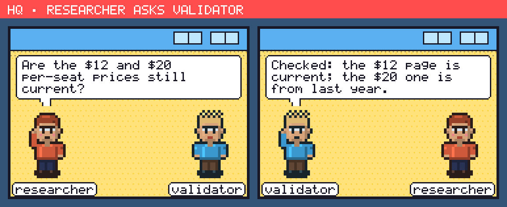

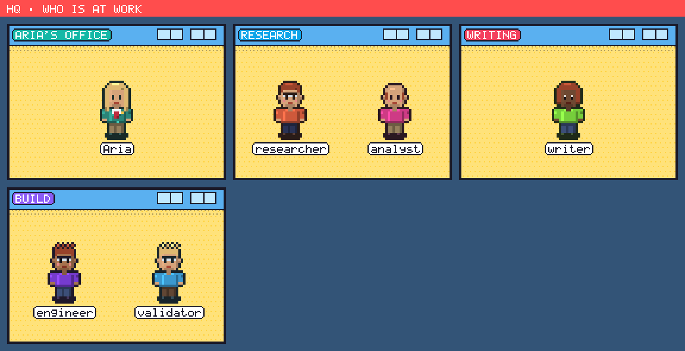

"Busy" is only ever a run that is open right now. A run left open by a crash more than an
hour ago doesn't count, and an agent with nothing open is shown as free. `bento office`
prints the same roll call. A terminal can't see a chat turn running inside the server,
so it says that about your agent instead of calling it free.

The pictures need nothing extra installed. They are drawn with the Python standard
library, like the characters themselves.

## Make it your office

Press **✎ Design**:

- **Describe it** in words, e.g. "a cosy greenhouse called The Nursery, with a cat". This
  machine's brain chooses from the same fixed set as everything below and the design is
  applied at once, with **Undo** beside it. When no brain is set up, or it does not answer,
  your words are matched against the choices instead, and the line says so rather than
  claiming your agent designed it. Anything invented (a pet called "unicorn") is dropped
  and named. It goes through the server, not the chat, because a chat forwarded to Claude
  Code has no way to change the office. The same box is in Settings → Appearance → Office,
  in the setup step, and in the terminal as `bento office design WORDS`.
- **Look**: *3D rooms around the Brain* (the default) or the *Flat comic plan*.
- **Style**: *Pop comic* (the default), *Startup loft*, *Glass tower*, *Cozy studio*,
  *Space station*, *Greenhouse* or *Night shift*.
- **Name on the door.**
- **Departments**: up to six, each with a name and one of eight colours.
- **Who sits where**: pick a department for each specialist. A specialist you do not
  place sits on the **Open floor**.
- **Shared rooms**: the meeting room (where huddles gather) and the lounge, each on or
  off.
- **Decor**: plants, coffee, a whiteboard (the mission board), a bookshelf, an arcade
  cabinet, posters.
- **Office pet**: a cat, a dog, a robot, or none.

Changes show at once. The office is yours alone: on a machine with accounts, every
person has their own office. Every change you make is a row in the Audit log
(`office.write`).

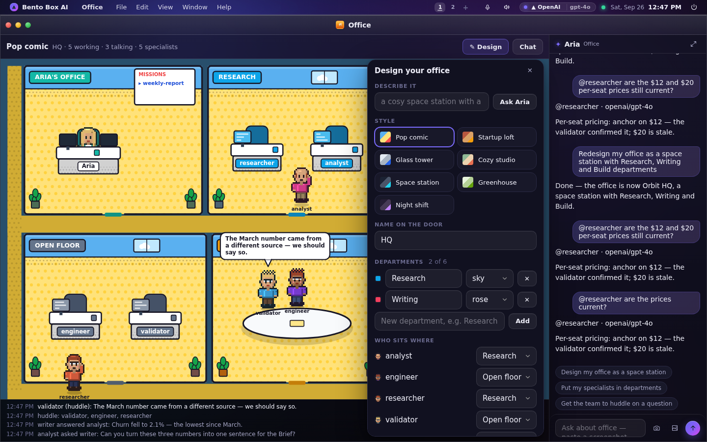

Only real specialists can be seated. Put in a name that nobody on this machine has and
it is left out, and the office tells you which names it dropped. A specialist that is
deleted leaves its department. Its empty chair has no name on it.

## Visiting a linked team's office

If your team is linked to another (another Bento, or another account on this machine — see
[the team guide](team.md#linked-teams)), press **⇄ Visit** in the Office's bar and pick
the team. Their office is drawn here, in their style, with their lead and **only the agents
their side lets this link ask**. Everybody else in their office is not shown, not even by
name, because a link grants nothing until a cell allows it. Each person shows as busy or
free; what they are working on is never sent, and neither is whether their lead is busy.

Press **Ask** beside someone to start a chat with them. Chat opens with
`@researcher ask analyst@office: ` already typed: one of *your* specialists carries the
question, under your matrix, and their side answers under theirs. It is never sent for you.
With no specialist of your own there is nobody to carry it, and the message says so, with
the button to make one.

Linked teams show up in two more places:

- **The home screen** has a chip per linked team with the faces of the people you may ask.
  A tap opens the visit.
- **The Crew scene** (Settings → Appearance → Immersive → Scene) has them standing at the
  right edge of the stage, a little smaller, each tagged with their team.

A visit is a call to the other machine, so each team is asked at most once every five
minutes, and the answer is kept only for you: two people here who each link a team called
`office` never see each other's. From a terminal: `bento office visit LINK`, and the TUI's
Office tab lists linked teams under your own roll call.

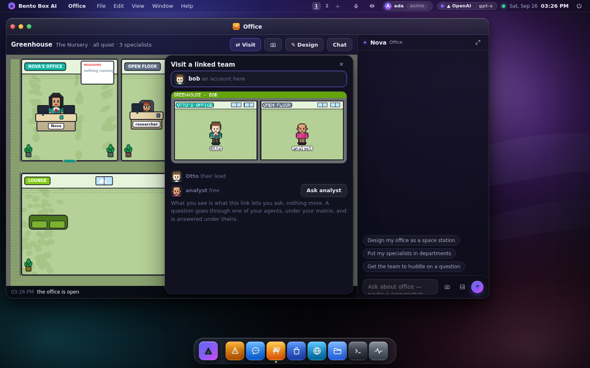

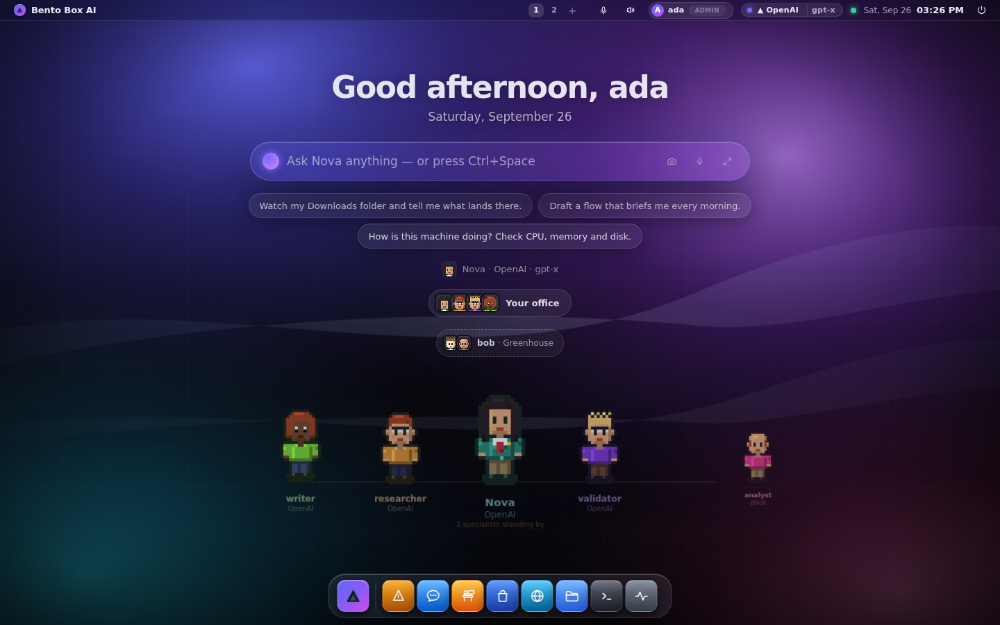

## Your agent can redesign it

"Make the office a cosy greenhouse and put the researcher and analyst in a Research wing"
is enough. The agent's `set_office` tool picks from the same fixed set of styles,
colours, decor and pets as the designer. If you ask for something outside that set, it
is refused with the list of choices.

`set_office` has its own permission (`office.write`), separate from the permissions for
real work. You can allow your agent to redecorate and still refuse it everything else,
or the other way round.

## From a terminal

There is nothing to animate in a terminal, but the office is a plan too, and
`bento office` shows it, says who is at work right now, and edits it:

```
$ bento office
HQ — Pop comic (bright halftone floors, bold ink, primary colours)

  Aria's office            your agent
  Research                 researcher, analyst  [sky]
  Writing                  writer  [rose]
  Open floor               engineer, validator

  also: meeting room, lounge · decor: plants, coffee, whiteboard · pet: cat · look: 3D rooms around the Brain

$ bento office styles
$ bento office style space
$ bento office move analyst Research
$ bento office move analyst            # back to the open floor
$ bento office dept-rm Writing
$ bento office meeting off
$ bento office decor plants arcade
$ bento office pet robot
$ bento office look flat               # the comic floor plan; `look 3d` for the rooms round the Brain
$ bento office design a space station called Orbit with a dog
$ bento office picture office.png      # the roll call as a PNG, for a box with no screen
$ bento office snap                    # that picture to Telegram / WhatsApp
$ bento office visit office            # a linked team's office, in words
```

It works with the server stopped. The desktop shows the change the next time it loads
the office. To follow live work in a terminal, use `bento flow runs` and the chat TUI.
The TUI (`bento tui`) has an **Office** tab (press `o`) with the plan, the roll call, your
linked teams, a *Snap to my phone* button and a *Describe it* box.

A linked WhatsApp device is held by the running server, so `bento office snap` sends to
it only through the server (the Office's Snap, or `/office` from your phone). The terminal
says that instead of trying.

## On a phone

The rooms stack one per row and the office scrolls. The chat is a sheet behind the
**Chat** button. Tap a person to start a message to them (`@name`) in that sheet.
Every control in the designer meets the touch-size floor.

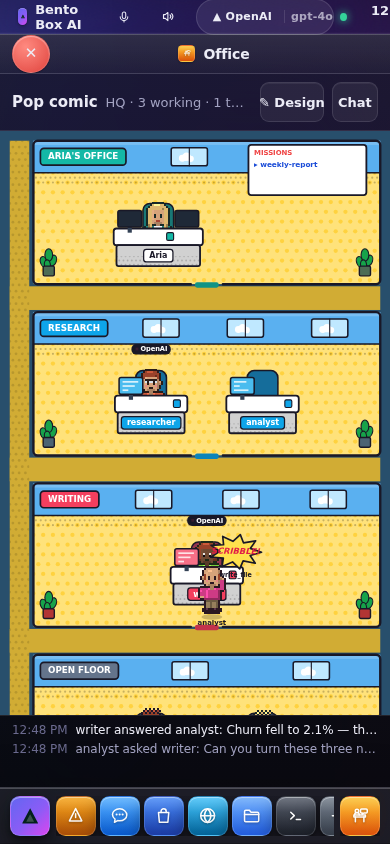

## What it costs

The Office draws on one canvas. The rooms are painted once into a hidden layer and
copied each frame, so a frame costs about a millisecond. Measured in Chromium with six
agents:

| State | Frames per second | Time per frame |
|---|---|---|
| At rest | about 5 | 1.1 ms |
| Five agents working, one walking | 15 (at most 30) | 1.35 ms |
| Window minimised, on another desktop, or covered | 0 | — |

With reduced motion turned on, the office draws one still frame per event: people appear
where they are going instead of walking there.

The 3D office loads its 3D library only when that look is on. Its furniture is merged into
a few dozen shapes when the plan is built, a person is six small shapes shared by everybody,
and the words are ordinary page text over the picture. It uses the same frame budget as the
flat office. Measured in Chromium with software rendering (no graphics card), nine rooms
and twenty agents:

| | sprites (before) | 3D people (now) |
|---|---|---|
| CPU time to send a frame | 3.3 ms | 3.4 ms |
| Whole frame, waiting for the picture | 140 ms | 152 ms |
| Draw calls | 151 | about 300 |
| Triangles | about 16,000 | about 26,000 |

Software rendering is limited by filling pixels, so the whole frame barely moved; on a
graphics card all of it is small.

Software rendering, phones and the kiosk get no shadows and a lower pixel ratio.
