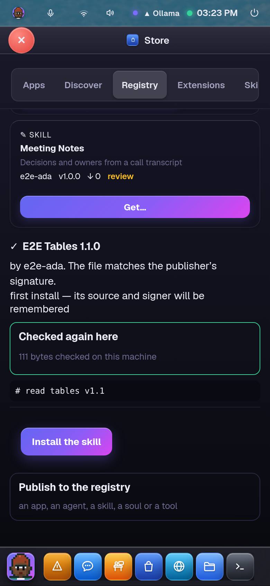
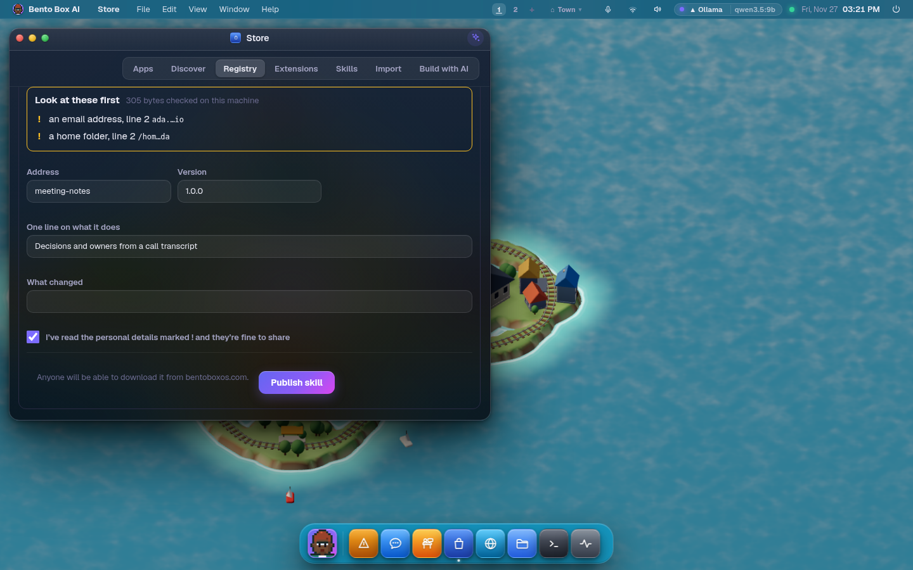
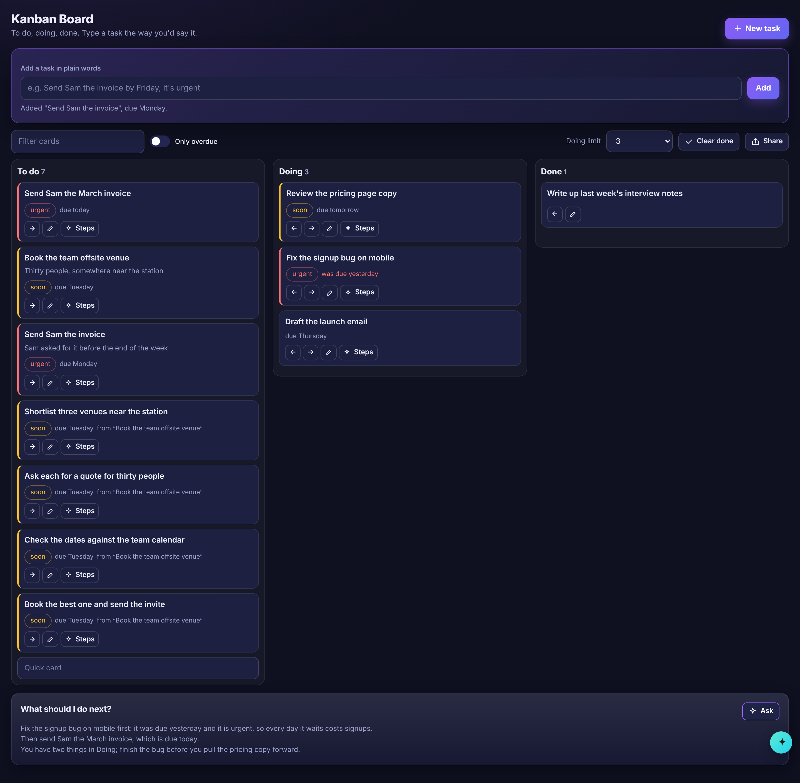

# The Bento Registry

The Bento Registry at [bentoboxos.com/registry](https://bentoboxos.com/registry/) lists apps,
agents, skills, souls and tools that people have published from their own Bento.

Anyone can browse and install without an account. Publishing needs one, so every listing has
somebody behind it.

## Installing

In the desktop, open **Store → Registry**. Search, filter by kind and press **Get…**.

From a terminal:

```
bento registry browse [words] [--kind skill]
bento registry versions skill/meeting-notes
bento registry get skill/meeting-notes[@1.2.0]
```

Your Bento downloads the file and checks three things before it shows you anything:

- the file's hash matches what the registry recorded;
- the publisher's machine signed exactly those bytes;
- the publisher's key is the one you saw the last time you installed from them. The first install
  remembers it; a different key later is a loud warning.

It then reads the file again for anything secret or personal, as it would before publishing.

What happens next depends on the kind:

| Kind | What installing does |
|---|---|
| App | The Import consent screen: its permissions, a fresh security scan, then your yes |
| Agent | The fork preview: everything arrives switched off and nothing is granted |
| Skill | Added under its own name. A skill you already have is never replaced |
| Soul | Saved as a file beside your agent's soul. Your agent keeps its own until you choose |
| Tool | An MCP server added switched off, with any keys left for you to fill in |

Each install is a `registry.install` row in the ledger.



## Publishing

You need three things, and the Store's Registry tab walks you through them:

1. **Sign in with your email.** You get a code (no password). In a terminal:
   `bento registry login you@example.com`.
2. **Choose a publisher name.** It's shown on your listings. Your email never is.
   `bento registry handle ada`
3. **Register this machine.** It makes a signing key in your home
   (`registry/machine.key`, readable only by you) and sends the registry the public half.
   `bento registry register "Ada's laptop"`

Then:

```
bento registry report skill "Meeting Notes"           # read it, send nothing
bento registry push skill "Meeting Notes" --version 1.0.0 --summary "Decisions and owners from a call"
bento registry push app my-app.agentapp.json --version 1.1.0   # an app goes from its package file
bento registry push agent                                # this agent's team, skills and flows
bento registry push soul
bento registry push tool github
```

### The report



Before anything is sent, Bento reads the exact bytes that would go:

- **A credential stops it.** An API key, a token, a private key, or a field called `password`
  with a value. There's no way to publish it anyway; take it out of the skill, app or soul it was
  pasted into, and check again.
- **Personal details are shown to you.** An email address, a phone number, a home folder, a
  private network address, a local machine name, a link carrying a key, your login name, your
  machine's name. You tick that they're fine to share, or change the thing and check again.
- **An app is scanned** with the same static scan the Import door runs, and its permissions are
  listed.

The desktop publishes the bytes it reported on, looked up by the report's hash. The page never
sends the package itself, so what you read is what goes.

### Versions

Every publish is a new version, numbers with dots like `1.2.0`. Versions only move forward, and
every version stays downloadable. The name in the address (`skill/meeting-notes`) belongs to
whoever published it first.

## Bento's own apps

Five productivity apps are published as **bento**: Focus Sessions, Habit Tracker, Kanban Board,
Meeting Notes and Daily Planner. Each has a widget view, keeps its data in the app's own store,
has an AI feature (a session plan, a habit coach, tasks typed in plain words, meeting minutes,
a drafted day) and the ✦ assistant. In the Store their listings carry a **Bento** mark.



Their source is in `agentos/sampleapps`, and their packages are in `registry/apps`, so you can
also install one from the file through **Store → Import**. From a terminal:

```
bento studio samples          # what they are, and whether each passes the checks
bento studio samples build    # rebuild the packages after changing an app
```

### Publishing them as bento

The name **bento** is kept for the registry's admins (along with a few others that read as
Bento itself), so only an admin's account can take it. On the machine that publishes:

```
bento registry login you@example.com
bento registry handle bento
bento registry register "Bento release machine"
bento registry push app registry/apps/focus-sessions/focus-sessions.agentapp.json --version 1.0.0
bento registry push app registry/apps/habit-tracker/habit-tracker.agentapp.json --version 1.0.0
bento registry push app registry/apps/kanban-board/kanban-board.agentapp.json --version 1.0.0
bento registry push app registry/apps/meeting-notes/meeting-notes.agentapp.json --version 1.0.0
bento registry push app registry/apps/daily-planner/daily-planner.agentapp.json --version 1.0.0
```

Each push shows the report first and asks you to type `publish`. Without `--summary`, an app's
listing takes the sample's own one line (any other app takes the first sentence of its
description).

## What the registry checks

The registry is a Supabase project (`packaging/registry-cloud`). Reading is open to anyone through
row-level security. Every write that matters goes through one function, `publish`, which checks
again, whatever the Bento said:

- the person is signed in and has a publisher name;
- the signing key belongs to a machine registered to that person and not revoked;
- the signature matches every byte;
- the file's format matches its kind;
- nothing in it looks like a credential (the same rules as `agentbundle._LEAK_RULES`; a test fails
  if the two lists differ);
- the version is newer than every published one;
- at most 10 publishes an hour and 30 a day per account, 2 MB a file.

A listing reported by three people is hidden until somebody looks at it. Downloads are counted once
per address, per version, per day; only a salted hash of the address is kept, for that day.

## Machines and keys

- **Stop this machine publishing** (`bento registry revoke`) marks its key revoked. What it already
  published stays signed by it, and an installing Bento says the key was revoked since.
- `bento registry register --new-key` retires the old key and registers a new one.
- An account can register up to 10 machines.
- **Sign out** forgets the session. The registry session's refresh token is kept in the vault,
  never in a file.

On a machine with accounts, each account signs in with its own email and keeps its own key in its
own home. From a terminal, `bento registry` acts as the machine's own home.

## Setting up the registry project

These are one-time steps for whoever runs the registry, not for people using it.

1. Apply `packaging/registry-cloud/migrations/*.sql` in order.
2. Deploy `functions/publish` and `functions/download` with JWT verification off: `publish` checks
   the session itself, and `download` is public.
3. **Authentication → Email Templates → Magic Link**: include `{{ .Token }}` so the email carries
   a code. Bento signs in with the code, because a headless machine can't open a link.
4. **Authentication → SMTP**: set your own sender before launch. Supabase's built-in sender is
   limited to a few emails an hour.
5. Add your account's id to `public.admins` to see and unhide reported listings. That also lets it
   take a reserved publisher name such as `bento` (migration 003); nobody else can.
