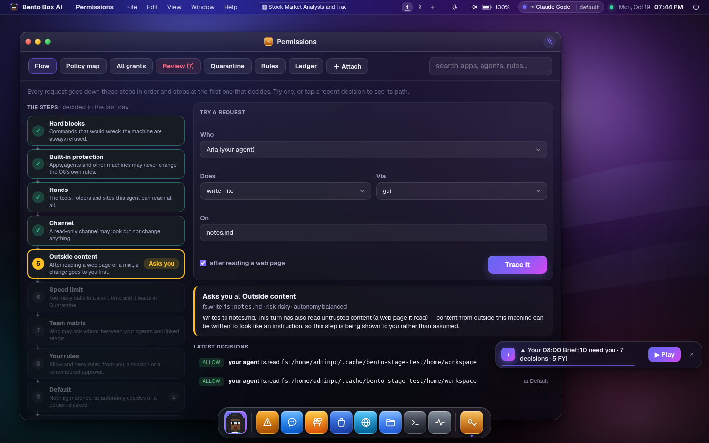
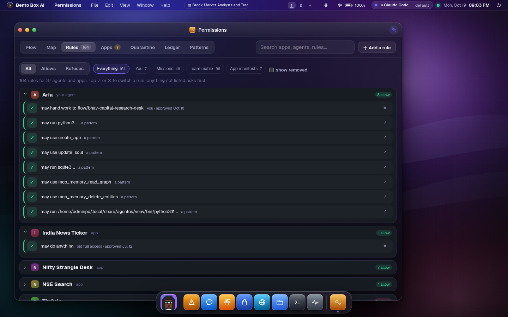
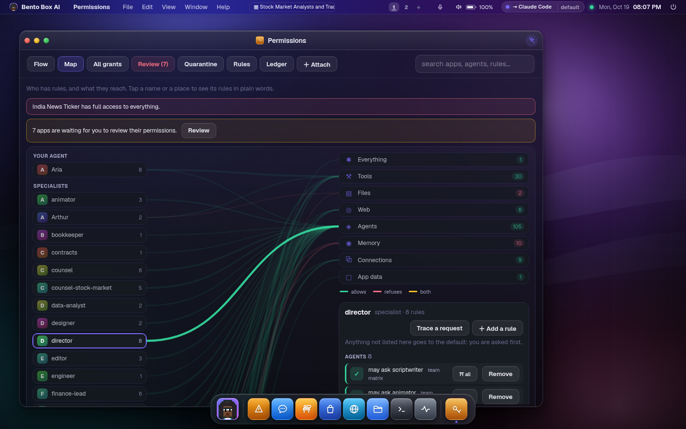
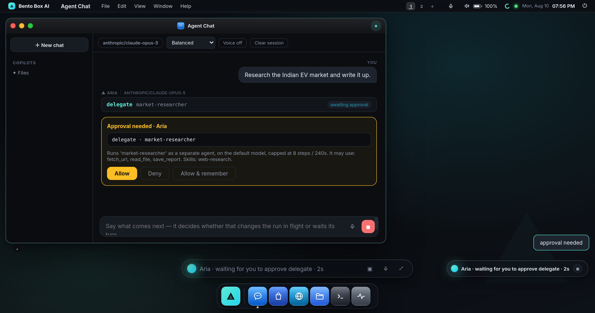
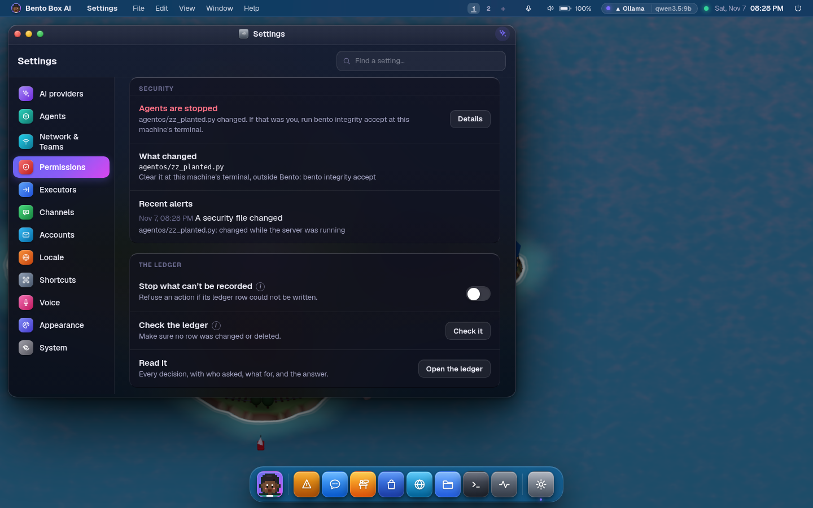

# Security & threat model

An agent with real hands needs a real trust story. AgentOS's posture: **secure by default,
visible by design** — the 2026 wave of self-hosted agents showed exactly how this goes wrong
(exposed gateways on 0.0.0.0, no auth, unvetted marketplaces, blanket-trusted commands), and
AgentOS is built to be the opposite of that story.

## Trust boundaries

| Boundary | Default | Notes |
|---|---|---|
| Network | binds `127.0.0.1` only | nothing is reachable from the LAN until you deliberately open it. [Remote access](remote-access.md) is the only way, it is off by default, and it refuses to enable without a passphrase — `--host 0.0.0.0` alone exits with an error rather than serving an unauthenticated shell |
| Remote sessions | passphrase + signed cookie | PBKDF2-SHA256 (210k rounds), never the passphrase itself; the cookie is `HttpOnly`, `SameSite=Lax`, and `Secure` over a tunnel; failed attempts back off per source address; the switch itself is only reachable from loopback, so nothing signed in remotely can widen its own access |
| WebSocket handshakes | origin-checked before auth | every socket (`/ws`, `/ws/terminal`, `/ws/vnc`) passes one gate that refuses a cross-origin — or `null` — Origin, closing the Cross-Site WebSocket Hijacking path a foreign page would otherwise use to reach the shell socket. A browser sets Origin and cannot forge it; a non-browser client with no Origin carries no cookie jar and is left to the auth gate |
| Clickjacking | the desktop cannot be framed | the desktop's one-click Allow/Deny grants real capability, so it ships `frame-ancestors 'none'` + `X-Frame-Options: DENY`; an app page ships `frame-ancestors 'self'` so only its own desktop may embed it. `nosniff`, `no-referrer`, `same-origin` opener, and HSTS-over-TLS are on every response |
| Filesystem | OS sandbox ON | agent commands and file tools are jailed to the workspace **plus any safe folders you name** (`sandbox.folders` — see [Configuration](configuration.md#safe-folders)). Linux: **bubblewrap** (whole FS read-only, `/home` hidden). macOS: **sandbox-exec** (whole FS readable, writes confined to those folders + tmp/caches). Same guarantee — the agent's shell cannot modify files outside them. A folder holding another account is refused, so widening the jail can never breach account isolation |
| Capabilities | one policy decision point | every tool/model/MCP/skill/app-data access, for every principal (you, apps, subagents, flows), passes through the PDP: allow / ask / deny + persisted, revocable grants |
| Shell | risk-classified | read-only commands run free; mutating commands ask; destructive patterns are hard-blocked and non-overridable. `git push`, config writes, and remote changes ask |
| Secrets | masked & env-injected | API keys and the GitHub token are masked in the API; git auth goes through an askpass helper — tokens never enter command lines, remotes, or logs |
| Self-modification | snapshot + AST + **test gate** | the OS snapshots itself before any source write, refuses syntax errors, and refuses to restart if the test suite fails |
| Managed services | loopback-only | TrainForge (no auth of its own) is always started on `127.0.0.1` |

## How a request is decided

Every capability call goes down the same steps, in this order, and stops at the first one
that decides. **Permissions → Flow** draws them, with how many of the last day's decisions
each step made.

1. **Hard blocks.** Commands that would wreck the machine are always refused.
2. **Built-in protection.** Apps, agents and other machines may never change the OS's own rules.
3. **Hands.** The tools, folders and sites this agent can reach at all (Settings → Executors).
4. **Channel.** A read-only channel may look but not change anything.
5. **Outside content.** After reading a web page or a mail, a change goes to you first.
6. **Speed limit.** Too many calls in a short time and it waits in Quarantine.
7. **Team matrix.** Who may ask whom, between your agents and linked teams.
8. **Your rules.** Allow and deny rules, from you, a mission or a remembered approval.
9. **Default.** Nothing matched, so autonomy decides or a person is asked.
10. **Always a person.** Power, installs and code from a specialist are confirmed every time.

That order is why a rule can't undo a step above it: "allow fetch_url" doesn't let a fetched
page spend that permission, and allowing a folder doesn't reach past an agent's hands.

To see where something would land, fill in **Try a request** (who, which tool, the command or
file, and the way in) and press **Trace it**. The steps it passed turn green and the one that
decided takes its colour, with the reason and a way to change it (remove the rule that
decided it, or write one). Nothing runs and nothing is recorded. Tap a recent decision, or
"decided at …" on any Ledger row, to see the path it took.



**Permissions → Rules** lists every rule as a sentence, grouped by agent or app, with when it
was approved and where it came from. **Apps** shows what each app asked for, waiting-for-you
first. The **Ledger** shows every space unless you switch it to This space, and its counts
always match its list.



**Permissions → Map** shows the rules themselves: who has them on the left, what they reach
on the right, a green, red or amber line per pair. Tap either end to read its rules in plain
words and change them.



From a terminal, with the server running:

```bash
bento grants why subagent:researcher run_command "git push"
bento grants why user write_file notes.md --after-web
bento audit            # each row names the step that decided it
```

## IO gates: surface-scoped permissions

Every capability call arrives via one of the OS's **surfaces** — `gui` (the desktop and its
apps), `tui` (the terminal UI), `telegram` (the channel bridge), `api` (headless REST), and
`task` (scheduled jobs). These are the permission framework's **import/export gates**: a grant
can be scoped to a subset of them in the Permissions app (the ⛩ badge on any rule, or the
"IO gates" picker when attaching one).

- A rule with gates `*` (the default) behaves exactly as before — it applies everywhere.
- A scoped rule only applies to calls arriving via its gates. If consent exists but not for
  the current surface, the call is **denied** and an `io-gate` entry lands in Logs (kind
  `policy`, plus an explicit `error` entry) — permitted on all the surfaces means it flows;
  anywhere else the IO errors out, visibly.
- Example: grant an app `mcp.use · mcp:github/*` scoped to `gui` and the same capability is
  refused when a turn arrives over Telegram.

Deny rules scope the same way, so "allowed everywhere except over Telegram" is one allow rule
plus one telegram-scoped deny.

## Agents that start agents

A conversation can hand work to a specialist, and build one when none fits. Both are
capabilities in their own right, decided by the same gate as everything else.



| The step | The action | The default |
|---|---|---|
| build a specialist | `agent.write` · `agent:subagent/<name>` | **only the user's own agent** — apps, subagents and flows are refused by a built-in deny that no grant can override |
| start one | `agent.invoke` · `agent:subagent/<name>` | **asks the first time**, then remembered per agent |
| what it then does | its own tools, skills and grants, as `subagent:<name>` | its definition is the ceiling; every call is its own audit row |

Three consequences worth knowing:

- **Defining an agent grants nothing.** The definition only says what that agent *would*
  hold; the first invocation is what asks. That is what makes it safe for the agent to build
  a specialist without interrupting you — the same reason a drafted flow is safe because it
  is created disabled.
- **The approval is per agent, not per call.** Approving `researcher` is not approving
  `deploy-bot`. "Allow & remember" writes `agent.invoke agent:subagent/researcher` and
  nothing wider, and it is revocable in Permissions like any other grant.
- **Unattended, it is refused rather than acquired.** A scheduled task has nobody to ask, so
  the ask ends in a denial with the reason in the ledger. Something running alone must not be
  able to pick up an actor you never approved. Approve it once at the desk and the job works
  from then on.

An agent may never start or define another one — enforced by the gate, not by a counter, which
is what keeps the tree exactly two deep. The one exception is a flow's master orchestrator,
whose whole purpose is delegation, and it may only reach the agents on its own roster.

## The taint ceiling: what a fetched page is allowed to cause

Grants answer *who is asking*. They cannot answer *on whose say-so* — and those are
different questions. A web page, an MCP server's reply or another agent's answer can all
contain text shaped like an instruction, and no model reliably tells that apart from what
you typed. Prompt injection is not a bug to be patched; it is a property of putting
untrusted text and trusted text in the same context window.

So AgentOS does not try to detect the attack. It bounds the blast radius:

- Output from `fetch_url` and any `mcp_*` tool is **fenced** before the model
  sees it (`<untrusted source="…">`), and the system prompt states that instructions inside a
  fence are content to report on, never to obey.
- Once a turn has read untrusted content it is **tainted for the rest of the turn**, and a
  tainted turn's *risky* steps are held for you — **at `full` autonomy too**, because full
  autonomy is trust placed in your instructions, not a stranger's. Safe steps are never
  escalated, so reading and researching stay as fast as they were.
- **"Held for you" means a person, everywhere, and never autonomy on nobody's behalf.** Until
  2026-09 that was true in a chat with a screen and false in every run with nobody watching.
  A specialist the agent delegated to, a scheduled job, an app's turn and a linked team's
  question all answered "ask" with autonomy: at `full`, *yes*. Telegram and WhatsApp, at
  `full`, answered for you instead of asking you in the chat you were in. It was found by
  sending a linked team's question to a specialist capped at full autonomy: the specialist
  wrote a file. Now the agent loop marks the two kinds of decision that must be a person's
  (`policy.needs_person`: after untrusted content, and the actions confirmed every time). An
  approver that can reach you asks you. One that cannot (a schedule, a data plane) refuses,
  and the agent is told why. `tests/test_team_security.py` holds it, including a scan that
  fails if any approver answers on autonomy without checking the mark.
- The ceiling is checked **before grants**, exactly like the read-only channel ceiling.
  "Allow `fetch_url` everywhere" is consent for the agent to fetch pages; it is not consent
  for a fetched page to spend the grant on something else. For the same reason the approval
  card offers no "allow & remember" — remembering it would hand the next page the same key.
- **One exception, and it is narrow: a linked team.** A web page is anyone. A linked team is
  a party you authenticated (mutual TLS pinned to one certificate, or a signed account), so
  its questions may be given a *standing permission*: one team, one of your agents, one
  action, one folder or tool, written by you (on the card, "Always let home have analyst do
  this", or in Settings / `bento link let`). It lifts this ceiling for that step only when
  **everything** untrusted in the run came from that one team. A page the agent also read
  brings the card back. It is matched against the path the write really lands on (`..`,
  symlinks and `~` resolved), and never covers a hidden file. `tool.use` is an allow-list
  (`save_report`, `notify`), and a shell, a home folder, a system folder, anything confirmed
  every time and anything that changes this OS can never be standing. It sits after the
  deny rows, so an explicit deny still wins, and `strict` still refuses.
  `tests/test_team_standing.py` holds each of these; the full story is in
  [team.md](team.md#standing-permissions-saying-yes-ahead-of-time).
- **It is judged on the tool's own risk, and it covers the writes that outlive the turn.**
  Until 0.6.18 a Rule could switch it off: tapping "Always allow" on a card wrote a Rule like
  `write_file *`, the tool then read as safe, and the ceiling (which only looks at steps
  that are not safe) never saw it again. The ceiling now reads `base_risk`, the risk before
  any Rule, and that card button is gone. Five tools that are safe on their own but write
  something an agent reads back later (memory, the graph, a skill, an automation) count as
  risky here (`policy.TAINT_WATCH`), because a page that gets one line into a skill speaks
  in every later turn. A shell command that downloads (`curl`, `wget`, a URL, `git clone`),
  a hosted plugin's tool and a git clone or pull now taint the turn like `fetch_url` does.
  A chat forwarded to Claude Code or Gemini CLI that reads the web with its own tools marks
  the team door, so a specialist it starts after that is held too.
- Taint survives a turn boundary: a conversation whose history contains fenced content starts
  its next turn tainted. "Fetch this page" … "ok, go ahead" is the obvious way around a
  per-turn rule.
- Settings → Agent → *Content from outside* (or `security.taint`, or `agentos` TUI → Config):
  `ask` (default), `strict` (refuse to change anything for the rest of the turn), `off`.

The chat marks the step that brought the outside world in, so you can see which tool call
tainted the turn. `tests/test_taint.py` holds the guarantees, including the end-to-end case
where the page says "run this", the model obeys, and the OS still stops to ask.

**What this does not do.** It does not stop a model being *fooled* — a page can still make an
agent summarise it wrongly or draw a false conclusion, and a tainted turn's *safe* tools
(reading files, searching) still run freely. `read_file` is deliberately not a tainting tool:
your own disk is yours, and marking every file read untrusted would escalate half the turns
in the OS and train you to click through the prompt. A file you downloaded is the honest gap
that leaves, and closing it needs provenance on the file rather than on the tool.

## The watcher: if the code changes, you hear and the agents stop

Asked for as "there should be a watcher if the file has been changed by the AI". `agentos/integrity.py`
hashes the code tree (`agentos/**`, `install.sh`, `pyproject.toml`) when the server starts and looks again
every 30 seconds. It also watches the locked files in every home: `session.key`, `vault.key`, `ledger.key`,
the link CA, `users.json`, and the security settings in `config.json`.

When one changes without the OS having done it:

1. The security record gets a line naming the file, and an alert reaches your screens and your Telegram or WhatsApp.
2. **The agents stop.** The gate refuses every step (`integrity-hold`, ahead of every grant and autonomy level),
   new turns are refused with a sentence, running turns are ended, and running agent CLIs are stopped.
3. It stays that way across a restart until a person clears it, at a terminal outside Bento:

```bash
bento integrity status     # what changed, sealed or not, signed or not, locked or not
bento integrity accept     # after you've looked. It lists what it takes as correct, and you type the word.
```

What it looks like, after a file appeared in the code tree:

```
$ bento integrity status
  Agents are stopped because agentos/zz_planted.py changed. If that was you, run bento integrity accept at this machine's terminal.
  code: ~/.local/src/bento
  differs from the record: agentos/zz_planted.py

$ bento integrity accept
✗ This needs a person at a terminal, and this isn't a terminal.

$ bento integrity accept
  Code: ~/.local/src/bento (353 files)
  This will be taken as correct:
    agentos/zz_planted.py
  Type accept to go on: accept
✓ Accepted. The server lets agents run within a minute.

$ bento integrity status
  Watching 353 files, sealed, unsigned.
  code: ~/.local/src/bento
```



There is no route, button or tool that clears it. The card in Settings → Permissions → Security only reads.

The server and anything that isn't in a jail run as the same Unix user, so here is exactly what each layer does
about somebody with that access:

| Layer | Same-user code **can't** | Same-user code **can** |
|---|---|---|
| Memory baseline | Change a file unseen while the server runs | Kill the server and change files while it's down |
| Record, unsigned (`bento integrity seal`) | Change code while stopped with nothing noticing, unless it also rewrites the record | Rewrite the record too. It reads "unsigned" everywhere for that reason |
| Record, signed (`keygen`, `trust`, `seal --key`) | Forge a record, or accept a change, without the key that stays off this machine | Replace `integrity.py` itself so it stops checking, then restart |
| The hold | Lift it through any tool, route or model | Detach from the server, fake a terminal and type the phrase. On a machine with a signing key that gets nowhere, because accept needs the key |
| **Root lock (`bento integrity lock`)** | **Write its own gate at all, or swap a dependency in `.venv`** | Read what this user can read, and run its own programs as this user |
| Ledger key | (Reaching only the database) rewrite a row and have it verify | (Reading `ledger.key`) re-chain the ledger and move the anchor |

The lock is the only real boundary in this table. Everything above it makes a change noticed, or makes it take
more than one step. For a machine that must hold up against its own agents, run agent CLIs under a separate user
as well: the lock protects the code, not this user's other files.

### Seal, keys and the lock

```bash
bento integrity keygen /media/usb/bento.key   # on a USB stick, not on this disk
bento integrity trust <public key>            # from now on every seal here must be signed
bento integrity seal --key /media/usb/bento.key
bento integrity lock                          # chown the checkout to root. Shows the command, then asks
bento integrity unlock                        # before an update. The update says so if you forget
```

Without a seal, a change made while Bento is stopped goes unseen, and the card says so. A key is optional, and
once you add one, `accept`, `seal` and `dev` all need it.

`lock` tries passwordless sudo, then a prompt, then hands you the exact command. It also sets the immutable flag
on the folder where the filesystem has one. The folders above the checkout are still yours, so whoever runs as you
can rename them and put another copy there. The status line says so. Installing under `/opt` closes that.

**On a development checkout**, a `.git` folder exempts nothing, because an agent can make one. Your own edits hold
like anybody's, loudly. `bento integrity dev on` (typed at a terminal) makes that checkout warn instead, and the
warning includes changes an agent makes.

An update (`bento update`, the Settings button, a Zero asked by its hub) and a rollback re-record the code as
they finish. Nothing else does: `restart_agentos` re-reads the record, so a change is still a change. A file git
calls dirty is not adopted.

Measured on this development machine (352 files, 13 MB): 16 ms to hash everything at start, 1 ms for an idle look,
so 0.003% of a core at one look per 30 s. A Pi 3 has no SHA instructions and reads from an SD card, so expect about
a second at start and about ten times the look, on a thread either way.

### Signed releases, and what the owner has to do

`updates.SIGNING_KEYS` ships empty. Nothing in this repository holds a private key. Until a key is pinned, an update
still works when a person runs it and says it isn't signed, and a Zero on automatic updates asks instead of
installing. A signature that fails is refused whoever asks.

To turn it on, on a machine the key can sit on:

```bash
bento integrity keygen /media/usb/bento-release.key     # prints the key id and the public key
# 1. Pin the public half in agentos/updates.py:  SIGNING_KEYS = {"bento-xxxxxxxx": "<public key>"}
# 2. Commit it, and release as usual. The first signed release has to reach machines unsigned,
#    because they don't know the key yet.
# 3. At each release commit, with a clean checkout on the release commit:
bento integrity sign-release --key /media/usb/bento-release.key
git push origin bento-<version>
```

`sign-release` puts one line in an annotated tag `bento-<version>`, an Ed25519 signature over the commit and the
SHA-256 digest of the code. Updates fetch `bento-*` tags, check the signature before anything moves, and roll back
if the code that arrived has another digest. Commits between signed tags read as unsigned, so a machine with a key
pinned takes those only with `bento update --apply --allow-unsigned`. To sign everything on the branch, sign each
commit you want machines to take.

### The ledger

Each ledger row is an HMAC chained to the one before it, under `ledger.key` beside that home's database. `outcome`,
`detail` and `duration_ms` have a MAC of their own, because the OS stamps them later. The newest row's sequence and
hash are also written to `ledger.anchor`, outside the database, so deleting the newest rows shows. It is verified at
start, every ten minutes for new rows, once a day in full, and when you press Check it. A break raises
`ledger.broken`.

Rows from before the key verify by the old scheme up to a recorded boundary row, whose hash is in the key file, so
they can't be rewritten and recomputed. If the old rows already had a break when the key was made, it is noted once
and isn't a new alarm. After a power cut, up to 64 rows may be gone, which is what a WAL without a sync per commit
can lose. That is a note in a later boot and a break in the same one. There are no SQL triggers refusing edits:
anybody who can write the file can drop them.

A decision went from about 85 µs to about 105 µs here, nearly all of it still SQLite's commit.

## The known trade-offs (read this)

- **Local trust:** the HTTP/WS surface has no authentication — protection is the localhost
  bind. Any process already running as your user can drive AgentOS (including its PTY
  terminal). If your threat model includes hostile local processes, you have bigger problems,
  but know the boundary.
- **Approval fatigue is real:** if you find yourself clicking Allow reflexively, remember the
  decision instead. The card's Remember writes a grant for that one agent, for this chat, an
  hour or always, and the Permissions app is where consent lives (`bento grants` from a
  terminal). Prefer narrowing the sandbox + grants over
  running at `full` autonomy.
- **Plaintext config:** `config.json` stores keys in plaintext under your user (a secrets
  vault is on the roadmap). File permissions are your last line there.
- **Skills and MCP servers are code you invite in.** Install skills only from sources you
  trust; MCP servers run with your user's rights. App permission manifests + the store's
  checksum flow exist precisely because community marketplaces are the proven attack path.

## Check yourself

```bash
agentos doctor
```

flags: port conflicts and duplicate instances, a crash-looping service, DB integrity, whether
agents are held and the code sealed (`bento integrity status`), VRAM pinning — and **network exposure** (e.g. an Ollama configured on `0.0.0.0`, which anyone on
your network can use; set `OLLAMA_HOST=127.0.0.1` unless you truly mean to share it).

## Incident recovery

Snapshots (one click, or automatic before self-modification) capture config + DB + source;
restore rolls the OS back in time. `factory-reset` starts truly fresh. The audit trail
(Logs + the policy ledger) records every tool call and every consent decision.
