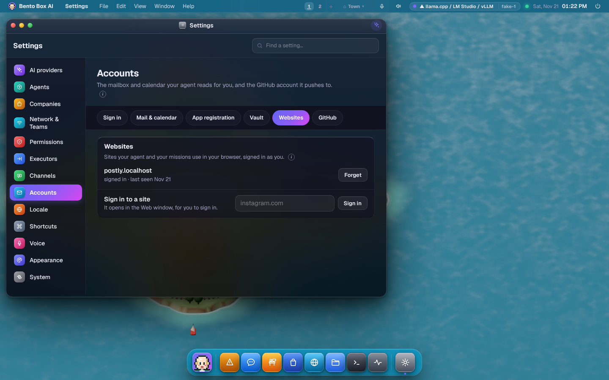
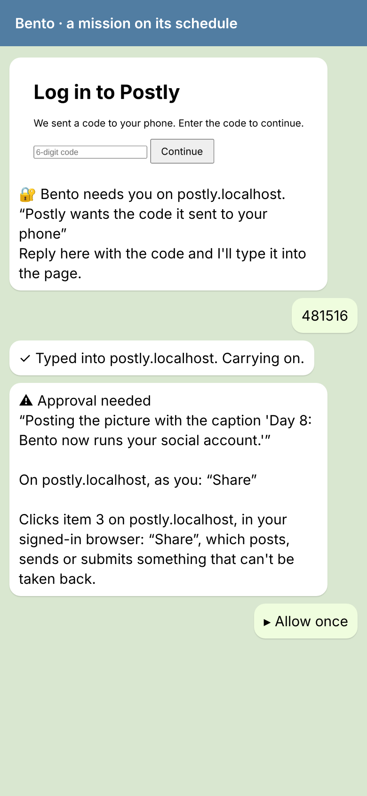
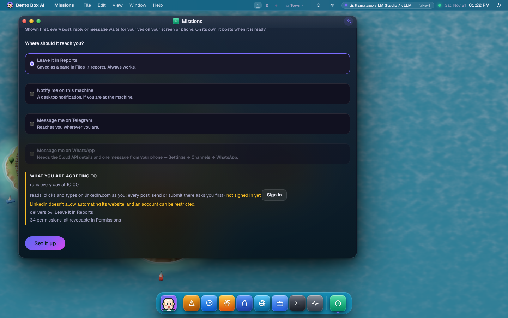

# Websites you're signed in to

Your agent can work on a website as you: post on your social account, fetch invoices from a
supplier's portal, keep an eye on a page that needs a sign-in. It does this in the shared browser
(the Web window), signed in with your own session. Nothing about your password is kept by Bento.
The site's own cookie is, in the browser's profile on this machine.

Three things hold, whoever is asking:

- **You sign in, the agent never does.** A password, a code or a CAPTCHA is yours. The agent stops
  and asks you, on this screen or on your phone.
- **Posting, sending or paying asks you first.** Reading and clicking around a site is one
  permission. Pressing the button that publishes something is another, and by default it asks you
  every time, at every autonomy level.
- **A mission names its sites.** A mission can only use the sites its definition lists, and the
  consent screen says what it may do on each.

## Getting started

1. Have a phone channel set up (Settings → Channels → Telegram), so a mission can ask you when
   you're away. Not required, but a mission without one can't reach you for a code.
2. Sign in to the site once: Settings → Accounts → Websites, type `instagram.com`, press
   **Sign in**, and sign in in the Web window.
3. Add the mission: Missions → Run → **Run my social account**. Name the site, say what the
   account is about, keep **Show me each one first**, and press **Set it up**.
4. Press **Run it now** to watch the first one. The post waits for your yes.

From a terminal, the same thing:

```
$ bento sites signin instagram.com
$ bento job add social-account --site instagram.com \
      --about "Bento, an AI desktop you own. Short, friendly, one picture a day." \
      --at 10:00 --publish ask --deliver telegram
$ bento job run social-account
```

## Sign in once

Settings → Accounts → **Websites** lists the sites your browser is signed in to. Type a site and
press **Sign in**. It opens in the Web window for you to sign in; when the sign-in page goes away,
Bento notes the site as signed in.



**Forget** signs the browser out of that site: it clears the site's cookies and storage, so the
next visit starts signed out.

You can also just ask in chat: "sign in to my Instagram". The agent opens the site and hands you
the sign-in page. From a terminal:

```
$ bento sites
  instagram.com                signed in, last seen 21 Nov 2026
$ bento sites signin linkedin.com
$ bento sites forget linkedin.com
```

## What asks you, and what doesn't

| What the agent does | Permission | Asks you? |
|---|---|---|
| Opens a page, reads it | `browser.read site:<site>` | As your autonomy says |
| Clicks, types, scrolls, uploads a picture | `browser.act site:<site>` | As your autonomy says |
| Presses Post, Share, Send, Submit, Pay, Delete… | `browser.commit site:<site>` | Yes, every time |

What counts as posting is read off the page, not from what the agent says it is doing. When the
agent clicks something, Bento looks up that button's own label on the page it last read. A label
like "Share", "Post", "Send" or "Pay" makes the click a commit. So does pressing Enter after typing
in a message box, and a click on something Bento can't see. A search box is not.

The card says what the button is and quotes the agent's reason:



There is no "remember" for a commit made by your agent in chat. A mission can be set to post on its
own (below), and that permission lives only inside that mission.

## A mission on a site

Missions → Run has three recipes that work on a signed-in site:

- **Run my social account**: drafts a post a day from what you tell it about the account, with a
  picture, and posts it. Instagram by default; any site you're signed in to works.
- **Fetch from a portal**: signs in to a supplier's or bank's portal on a schedule and saves what
  you name (invoices, statements) into your files.
- **Watch a page behind a sign-in**: checks a page every so often and tells you when it changes.

Each asks which site, and the social one asks how to publish: **ask me first** (the default) or
**on its own**. The consent screen says what you're agreeing to, whether the site is signed in yet
(with a **Sign in** button if not), and any warning about the site:



The work is done by an operator specialist with the browser tools. A mission you describe in your
own words gets its sites the same way, through `permissions.sites` in its definition.

### When nobody is at the screen

A mission runs on its schedule, often when you're away. When it meets a sign-in page or a code, it
asks your phone (Telegram, or WhatsApp) with a picture of the page. Reply with the code and it is
typed into the page for you; the code never reaches the model or the chat history. An approval to
post arrives the same way, with Allow and Deny. With no phone set up, nobody can be asked, so the
mission files what it needs in your Brief under "needs you" and goes on without it.

## Sites that don't like automation

Instagram, Facebook, LinkedIn, X, TikTok, Threads and Amazon say in their terms that they don't want
their websites driven by software, and can restrict an account that is. Bento still lets you do it,
because it's your account. It says so on the consent screen and when you sign in, and the mission
is told to keep a human pace: a few actions a minute, no bulk following or liking.

For Instagram, the official road is Meta's Graph API with a Business or Creator account. It's
planned as a second way in for the social recipe; it isn't built yet.

## The three faces

- **GUI**: Settings → Accounts → Websites, the Web window, Missions.
- **TUI**: `bento sites`, `bento job add social-account --site … --about … --publish ask`. Signing in needs a screen or a phone:
  on a headless box the wall goes to your phone.
- **SUI**: the same as the GUI. The Web window is a page; the browser behind it runs headless.

## How it's built

`agentos/cdpbrowser.py` keeps the signed-in record (`sites.json`, beside the browser profile) and
decides what a click commits (`commit_of`). `policy.person_rule` turns a commit by anyone but you
into a question, and `flows.clean_sites` / `declared_grants` turn a mission's sites into its
permissions. The live run is `packaging/dev/sites-e2e/run.py`: a stand-in social site with a code
sign-in, a scripted brain and a stand-in Telegram.
