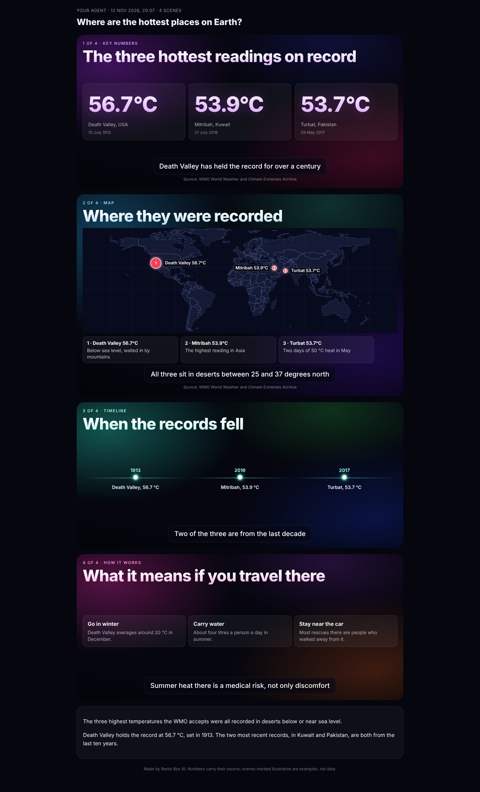
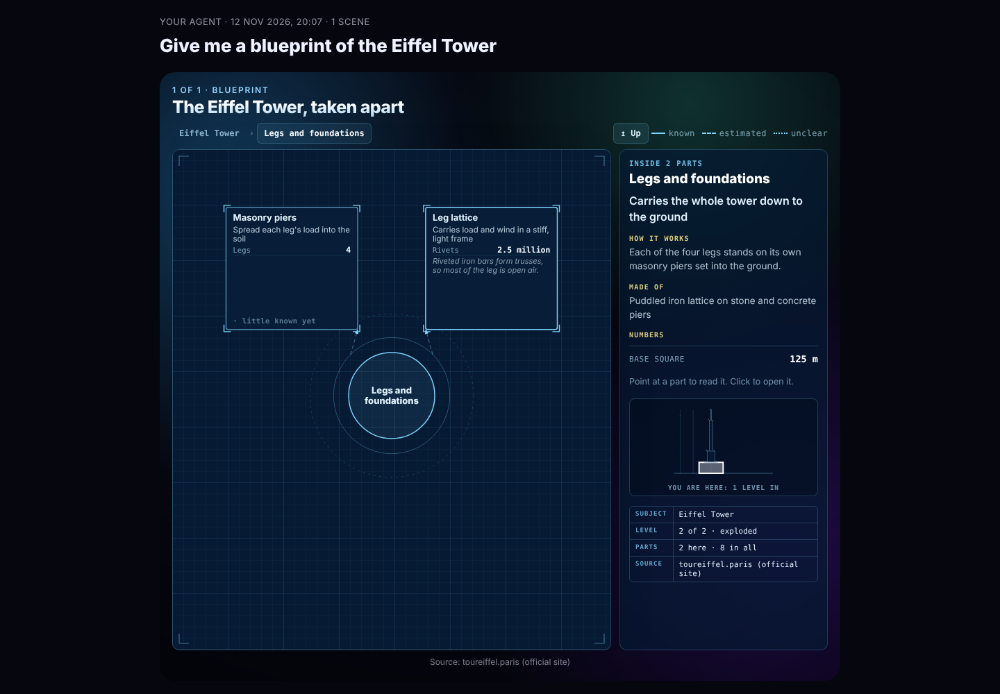

# Bento skills you can download

Four of Bento's features come as Agent Skills: folders with a `SKILL.md` that any agent
reading skills can use. That includes Claude Code, Claude.ai, Codex and Bento itself.

| Skill | What it does |
|---|---|
| **bento-stage** | Answers as a visual story: charts, maps with a note on each place, key numbers, timelines, steps, tables, pictures and videos, drawn as one HTML page. |
| **bento-blueprint** | Takes a building, machine, body, company or process apart into a blueprint you can drill into, part by part. |
| **bento-brief** | Turns what a task produced into a Brief: what needs you, decisions with their choices, FYI and what was done. |
| **bento-mission** | Designs a standing mission with its team, what starts it and a consent sheet, and checks it against Bento's rules. |

The pages are drawn by the Stage's own painter, so a story looks the same as it does on
Bento's Stage. The scripts use only Python's standard library.

## Install

**Claude Code**, as a plugin:

```
/plugin marketplace add contact9prime-lab/bento-ai-os
/plugin install bento@bento-box-ai
```

**From Bento**: `bento skills install` copies all four into `~/.claude/skills`
(`--to <folder>` for another agent, `bento-stage` to pick one). A copy that is already
there is kept unless you pass `--replace`.

**As zips**: `bento skills zip --to dist` writes one zip per skill. Each unpacks to a
folder of its own name; drop it in your agent's skills folder.

## Try them

From `plugins/bento` in the repository:

```
python3 skills/bento-stage/scripts/render.py skills/bento-stage/examples/story.json -o story.html
python3 skills/bento-blueprint/scripts/render.py skills/bento-blueprint/examples/blueprint.json -o blueprint.html
python3 skills/bento-brief/scripts/brief.py skills/bento-brief/examples/items.json -o brief.html
python3 skills/bento-mission/scripts/mission.py skills/bento-mission/examples/mission.json
```





## Bringing a mission into Bento

A `mission.json` from the bento-mission skill comes in with
`bento flow add --file mission.json`. It arrives switched off, like a draft in Missions,
so it holds no permissions until you read it and switch it on.

## Inside Bento

Bento already has these features natively. Each skill says so: with `show_scene` or
`brief_item` available, the agent calls those instead of the scripts.

## Keeping them current

The skills are generated from Bento's source (`agentos/skillpack`) by `bento skills build`,
which writes `plugins/bento` and `.claude-plugin/marketplace.json`. The lists in each
`SKILL.md` (scene kinds, blueprint forms, trigger kinds) are read from the code, and a
test fails when the checked-in copy is stale.
