# The Stage

Ask something worth seeing and your agent shows it as it answers. "Where are the hottest places on
earth?" puts them on a world map. "How does the market behave when volatility is low?" gets a chart and
the chain of cause and effect. The written answer still comes too. The Stage plays the story next to it.

## What it can show

| Scene | What it is for |
|---|---|
| Chart | A trend, a comparison or a share: line, area, bar, scatter or pie, with lines called out ("low IV below 12") |
| Map | Places (dots sized by their value) and countries (shaded by their value), on a world map that works offline |
| Numbers | Three to six key figures, counted up |
| Timeline | Events in order |
| Steps | A chain: this leads to that |
| Table | Rows and columns |
| Picture | A photo, a diagram or an image the agent made, slowly moving |
| Video | A YouTube video, such as a tutorial, played on the Stage |
| Film | A short 3D animation, such as a rocket launch, a city growing or revenue rising, played from a shot list |
| Blueprint | A thing taken apart: a building, a machine, a body, a company or a process, part by part, and every part opens |

When a set of numbers both rises and falls, like a market's day, the Stage reads it by sign: rises
are green and falls are red, every value carries its + or -, and a place on the map is as big as its
move, so the biggest fall is the biggest pin.

A market's day as Telegram receives it, before this (first) and after: the falls in red, the rises in
green, every value signed, the names whole, and every place's note in the picture.

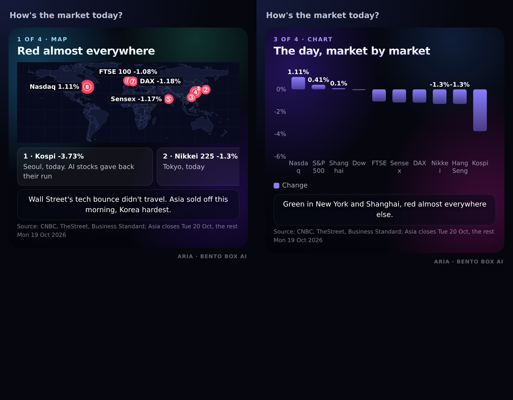
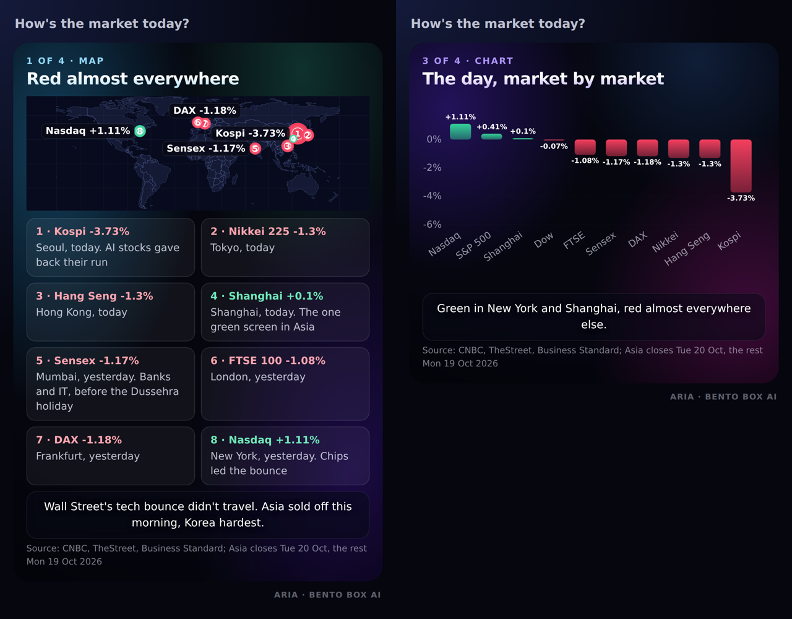

Every scene with numbers says where they came from, or says "Illustrative, not data" when it is an
example. A scene the agent can't back with a source is refused until it names one or says it is an
example.

## Films

For something that moves, grows or gets built, the agent can make a film: three to six shots of two to
eight seconds, each a subject and a camera move with the line said over it. The subjects are a city, a
tower, bars, a rocket, a factory, solar panels, a road, a conveyor, a crowd and a globe. The camera can
orbit, push in, rise, fly across or look down. The light is day, dusk or night.

The agent writes the shot list and your screen builds the scene, so nothing the agent wrote runs as code.
Bars, a tower's height and a crowd's size are numbers, and need a source like a chart. The agent decides
how big an answer deserves: no scenes for a plain fact, a chart for a comparison, and at most one film,
at the start or the end of a big story.

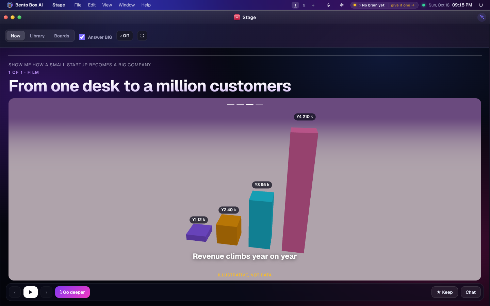

Without 3D graphics, with reduced motion on, and on your phone, a film is a storyboard: one card per
shot with its line.

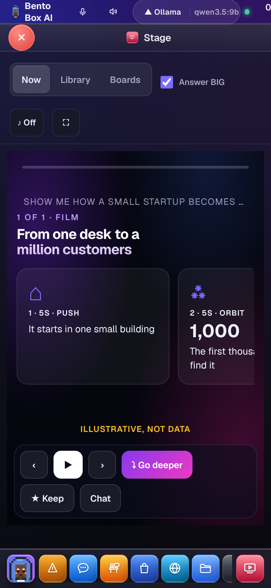

## Blueprints: take anything apart

Ask "give me a fine blueprint of the Burj Khalifa", "what's inside a jet engine?" or "how is a cell
built?" and the agent draws it as an engineer's drawing: cyan ink on a navy sheet, a grid, a ground
line and an elevation scale. It doesn't stop at the outside. Every part opens.

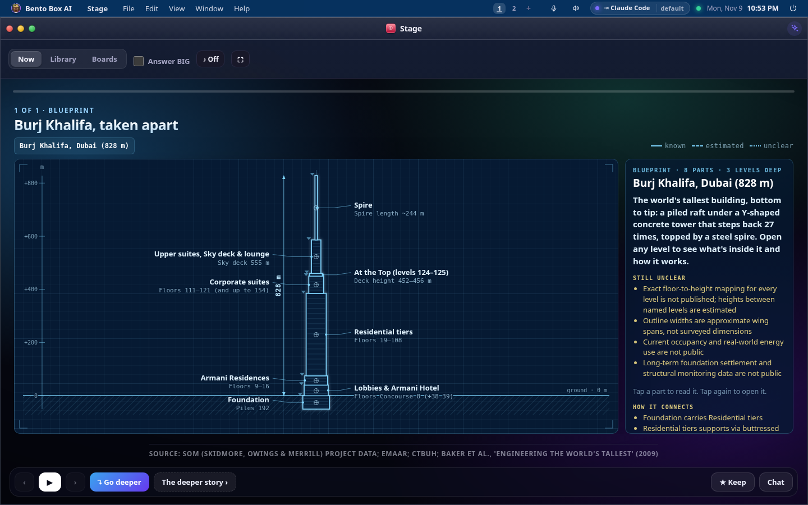

- **Point at a part** (or tap it on a phone) and the panel says what it is for, how it works, its
  real numbers and how sure anyone is of them.
- **Click it** (tap it again on a phone) and the drawing flies into that part: its own parts, drawn
  the way that suits them. A tower's foundation opens as an exploded view of its raft, piles and
  waterproofing. The trail at the top takes you back up, and so does Esc.
- **Take this apart** on a part at the bottom asks the agent for that part as its own blueprint. It
  plays here next, with the way back.

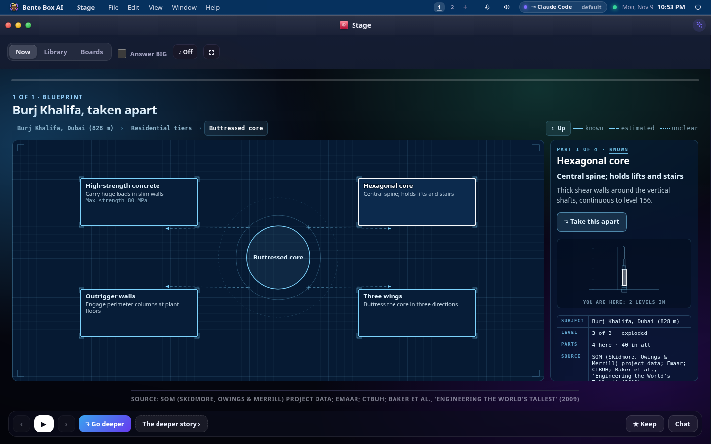

The agent picks how each level is laid out: a **tower** for something built in layers along a height
(drawn to scale when it knows the real widths), an **exploded** view for a thing made of parts round a
core, and a **flow** for a process. The line says how sure it is: solid is known, dashed is an
estimate, dotted is unclear, and the legend says so. **Still unclear** lists what nobody outside can
know. Numbers carry their source, as on every scene.

On a phone the drawing takes the screen. A tap brings up a small sheet with the part and an Open
button, and the details are just below.

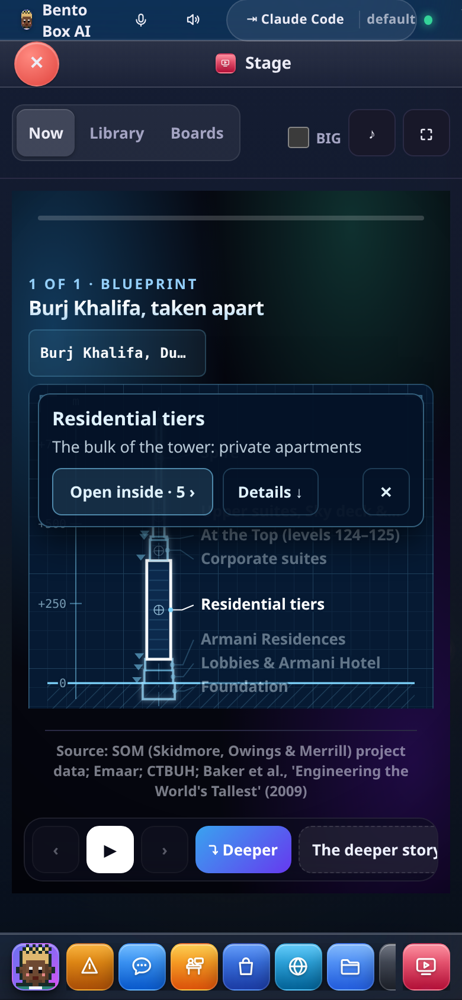

## X-ray: take an answer apart

Every answer in Chat has **⌖ X-ray** under it. It takes that answer apart from this machine's own
records and draws it as a blueprint: what you asked, the brain that answered and what it cost, every
department and person it went to, every decision the permission gate made for them (allowed, asked
you, refused), and the answer. Open the desk, then the person, then "run_python ×12", down to the one
ledger row that was refused and the rule that refused it.

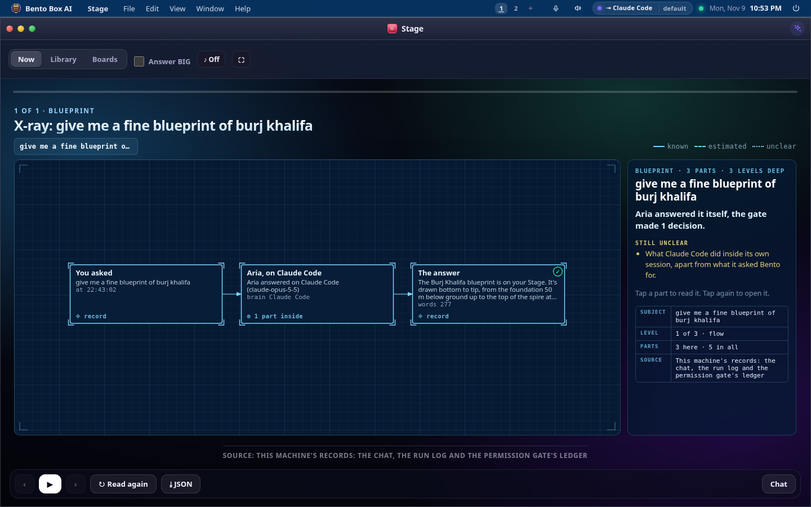

Missions → History and the Run Inspector have the same button for a mission's run. Nothing in an X-ray
is guessed: each part is a row, and what the record can't see is said. Claude Code's own reads and
searches inside its session never pass Bento's gate, so the X-ray says so instead of leaving a gap.
**↻ Read again** reads the records again while a run is still going, and **⤓ JSON** downloads the
same record as one file to hand to an AI. In a terminal: `bento stage xray <chat or run id>`.

## Watching a story

The Now tab is a dark room. Each scene fills it: a title, the drawing, and the narrator's line underneath like
a subtitle. ▶ plays the story from the start (read aloud when voice replies are on), ‹ and › step through it,
and the bars at the top show where you are.

- **♪** plays a soft background score made on your screen. It is off until you turn it on, and stops when the
  Stage closes.
- **⤵ Go deeper** asks for that scene as its own story. It is sent in the same chat, plays here next, and
  **↖ Back** returns to where it came from. A scene you went deeper on shows its deeper story in the bar.
- **Versions**: ask in the chat to change what is on the Stage ("add Japan", "use this year's figures") and
  the agent shows the whole story again. The version before stays, one tap away at the top right.
- **⛶** makes it full screen.

## Answer BIG

On by default. The agent shows answers that have numbers, places, a trend or a story, two to five
scenes in order, without being asked. A plain question still gets a plain answer.

Off, it shows something only when you ask to see it. Switch it in the Stage, in Settings → Appearance,
or with `bento stage big on|off`.

## Where it plays

- **The Stage app** opens by itself when a scene arrives for the chat on your screen (Chat, the
  Office's chat, or the prompt bar). Turn "Open by itself on this screen" off under Boards if you'd
  rather open it yourself.
- **On a phone** the Stage's top and its controls take one row each, with short labels, so the answer
  gets the room. A map is drawn in the frame's own shape and its numbered places are one row of cards you
  swipe through. Before (left) and after (right), at 390px:

  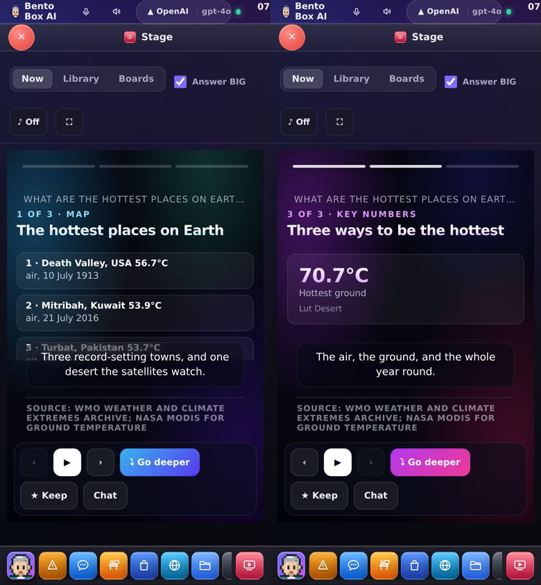
  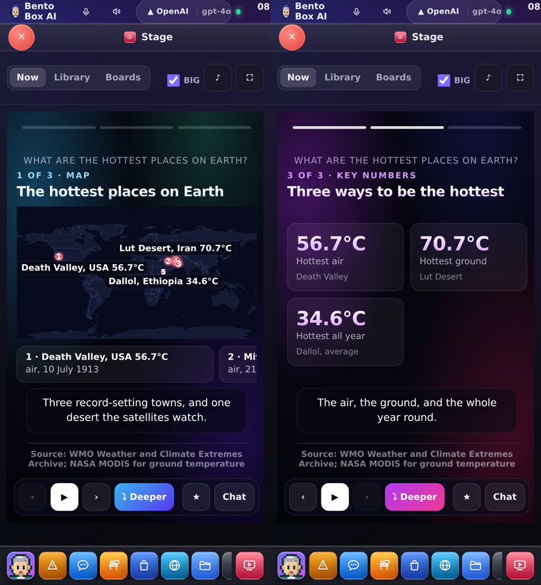
- **Chat** puts a ▶ Play chip under each answer that has a story, also when you reopen the chat later.
- **Telegram** gets the story first, then the words: one album, a picture per scene, with the question on
  top and each scene's title, takeaway and source under it. A map lists what happened at each place, numbered
  on the map and written out under it, so a phone sees the notes a desk sees on hover. With a speech engine
  on this machine (Settings → Voice: ElevenLabs, OpenAI, Google, Piper…), the story follows as one audio
  message, told in your agent's voice; the browser voice can't, because it lives in a browser
  (`telegram.narrate: false` turns it off). A video scene follows as its YouTube link, which Telegram plays
  in place. The pictures are drawn by the Stage's own code in a headless Chromium on this machine. With no
  Chromium here, the story goes as one page instead. **WhatsApp** gets the same pictures, one at a time.

  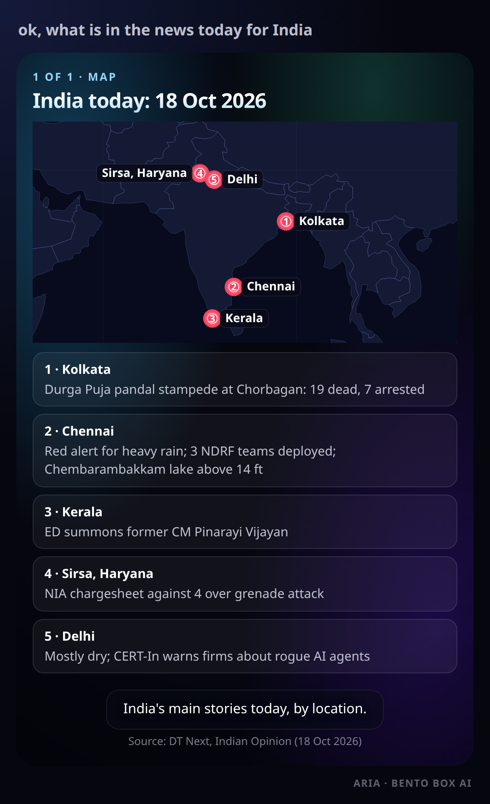
- **A terminal** prints each scene as text: a chart as a sparkline or bars, a map as its places. The TUI
  and the terminal chat print them as they arrive; `bento stage` shows the last chat's story, `bento stage
  list` everything.

## Your stories are kept

Every story stays with its chat. The Stage's **Library** lists everything you've been shown, newest
first, by the question you asked.

**★ Keep** makes a story a **board**. A board can stay as it is, or ask its question again every hour,
day or week: the agent looks the facts up afresh and shows the new story, and the board points at it.
If a refresh shows nothing, the board keeps the last story and says why. Refreshes are listed in
Missions → History. With nobody watching, a refresh can show scenes and look things up; anything that
needs your yes is refused, as for any scheduled run.

## Your own app instead

Under Boards, **Show answers in** can name one of your apps. That app receives each scene and the Stage
stays closed. In the app:

```js
window.addEventListener('appstage', e => draw(e.detail.scene));
```

`e.detail.scene.kind` is one of `chart`, `map`, `numbers`, `timeline`, `steps`, `table`, `image`,
`video`, `film` or `blueprint`, with the same fields the agent's `show_scene` tool takes. App Studio knows this: ask it for "an app that draws my
Stage".

## For developers

- `agentos/stage.py` reads each scene field by field (`clean`), files it under the person's message it
  answers, keeps boards, and builds the Telegram page (`report_html`). It has no HTTP or asyncio.
- `show_scene` is a safe tool: it draws on the person's own screen and stores a row. The conversation is
  injected by the agent loop, never chosen by the model. A forwarded Claude Code chat reaches it through
  the team door (`mcp__bento__show_scene`).
- A blueprint is read field by field at every level (`_bp_parts`): parts nest four deep under the
  subject, twelve to a level, 160 in all, and what is dropped is named with where it was
  (`parts[2].colour`). A width over 1 is the real width in the scene's unit, drawn to the same scale
  as the heights. `ask_deeper(part=)` asks for one part by its place in the whole.
- `agentos/xray.py` builds an X-ray from `trace.conversation` / `trace.run`, the same gathering
  `bento trace` writes out, so the X-ray and the JSON can't disagree. It is read on request
  (`/api/stage/xray`) and never stored.
- `24l-stage.js` and `24v-blueprint.js` draw everything with text nodes and SVG, never markup, because a scene's words are
  often a web page's. The Telegram page embeds both (`PAINTER_JS`). The map is Natural Earth's 1:110m countries (public domain), loaded the first time
  a map is drawn.
