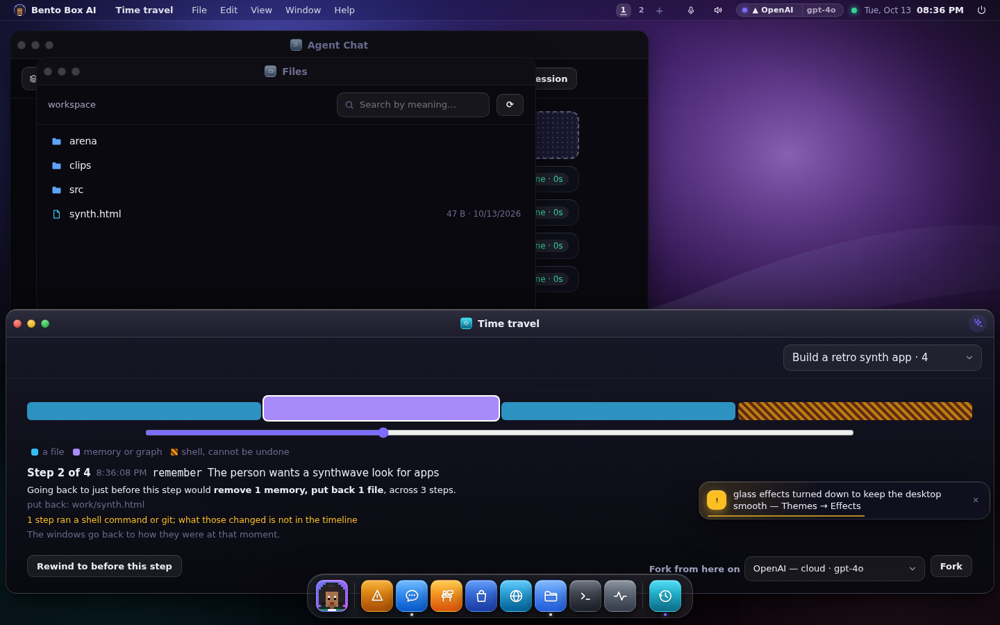
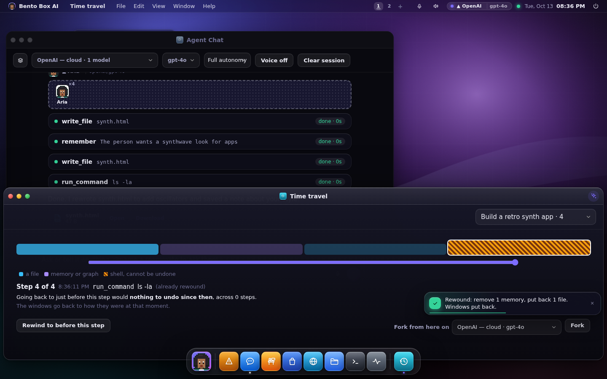
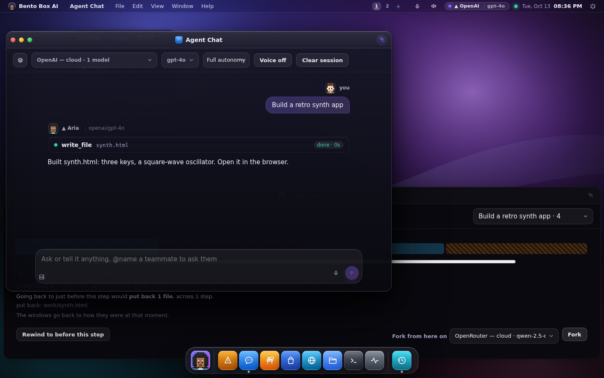

# Time travel

An agent halfway through a task can wreck a working folder, or remember something that is
not true. Time travel keeps enough of the past to undo it: before each step that changes
something, a checkpoint. A scrubber along the bottom of the desktop slides through those
checkpoints, shows exactly what going back would undo, and rewinds. From any step you can
also **fork**: start a new conversation from that point on another brain.

Open **Time travel** from All apps or the prompt bar ("rewind", "undo", "checkpoint").



## What a checkpoint holds

- **Files.** Before the file tools change a file, it is copied. Copies are stored once per
  content under `.timetravel/blobs` in your home. A file over 5 MB is noted as too big
  rather than half kept.
- **Memory, the knowledge graph and skills.** Every row added, changed or removed since
  the checkpoint is journalled, so a rewind puts them back exactly.
- **The windows.** This page saves which windows were open and where, at each checkpoint,
  and a rewind puts them back. A checkpoint taken while the page was closed has no layout,
  and the scrubber says so.

What it cannot hold:

- **A shell command.** What `run_command` changed is not in the timeline. That checkpoint is
  marked in red, and the plan warns you instead of promising a rewind it cannot make.
- **An agent CLI's own edits.** Claude Code, Gemini CLI or Codex editing files with their
  own tools are outside it; their calls to Bento's tools are inside.

## Rewinding

Select a step and the scrubber shows the plan: which files go back, which new files are set
aside, how many memory and graph rows change, and any warning. **Rewind to before this
step** does exactly that plan.

Nothing is deleted. A file a rewind replaces or removes is moved to
`.timetravel/rewound/<time>/` first, so you can undo a rewind by hand. A conversation that
is still working cannot be rewound until you stop it.



## Forking

**Fork from here on** another brain makes a new conversation with everything before that
turn, then asks the same question again on the brain you chose, told which steps had
already run. The original conversation is untouched.



## From a terminal

```
bento timetravel list           # checkpoints, newest last
bento timetravel plan <id>      # what going back would undo
bento timetravel rewind <id> --yes
```

These work with the server down. A terminal has no windows to put back, and a fork starts
a turn, which is the server's job, so forking is on the desktop.

## Notes

- Checkpoints are per account, in your own database and home, and are pruned after 7 days
  or 500 checkpoints.
- The audit ledger is never touched by a rewind: it is history, not state.
