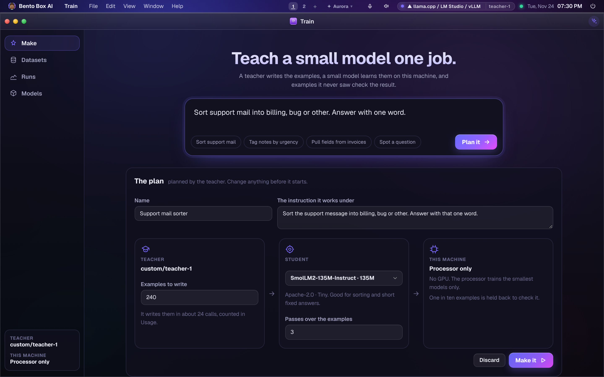
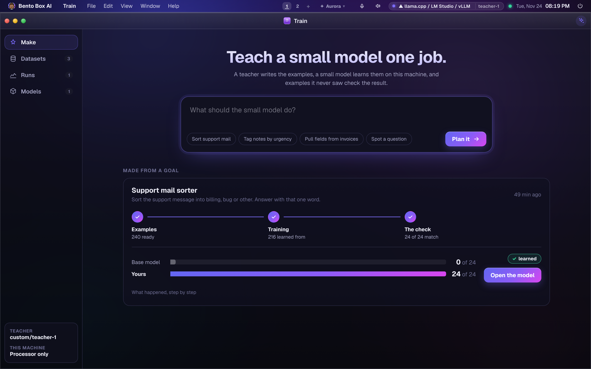
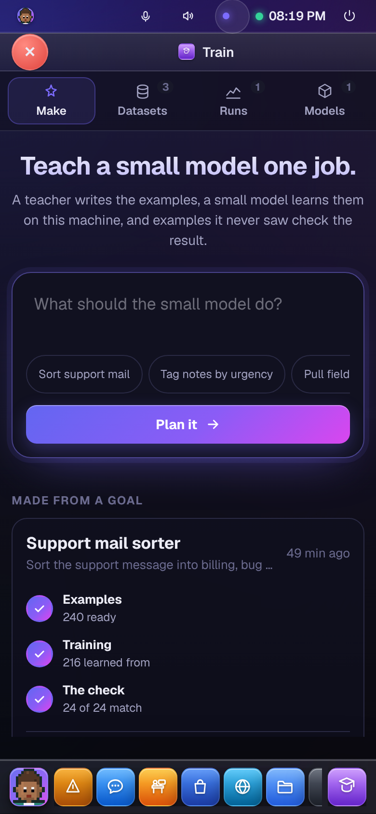
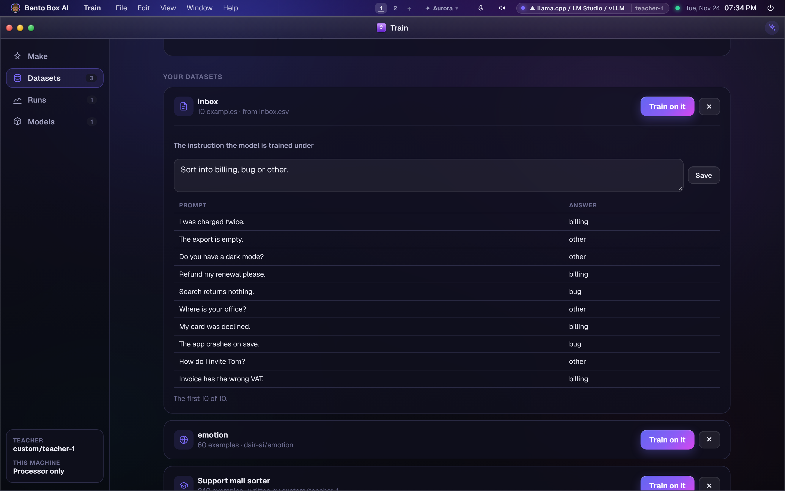
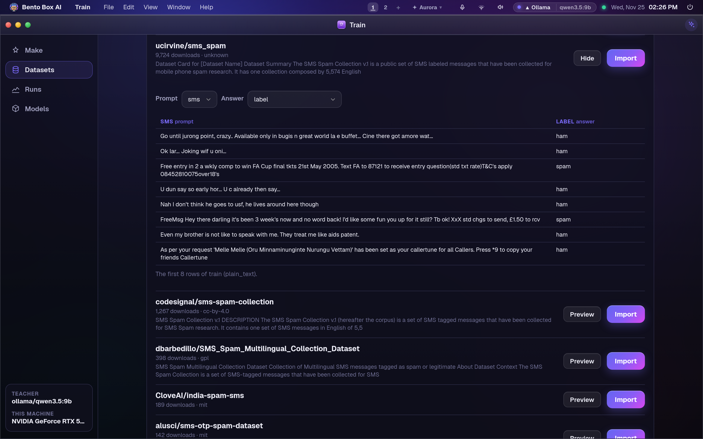
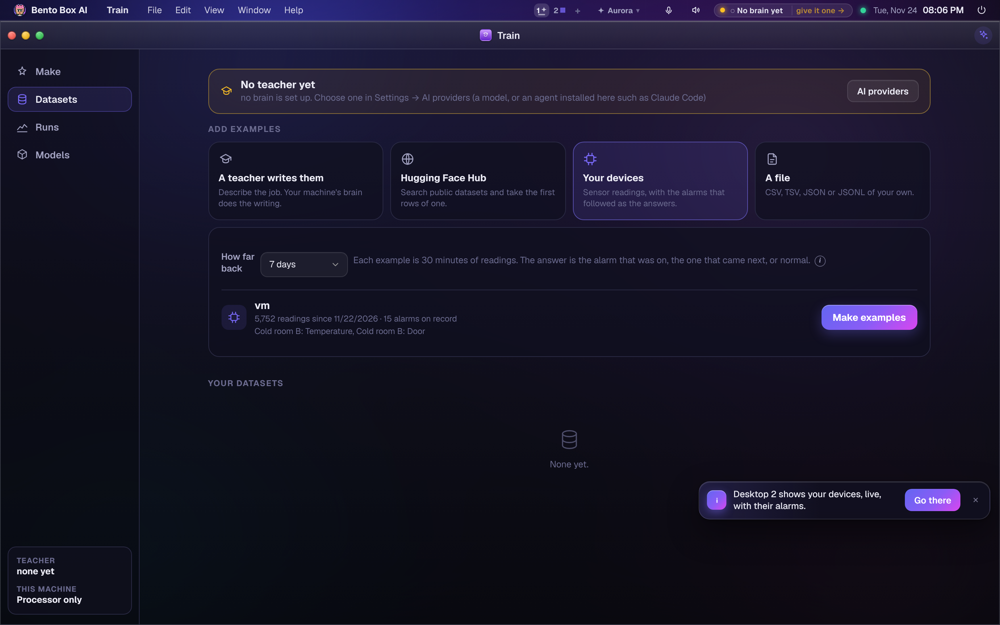
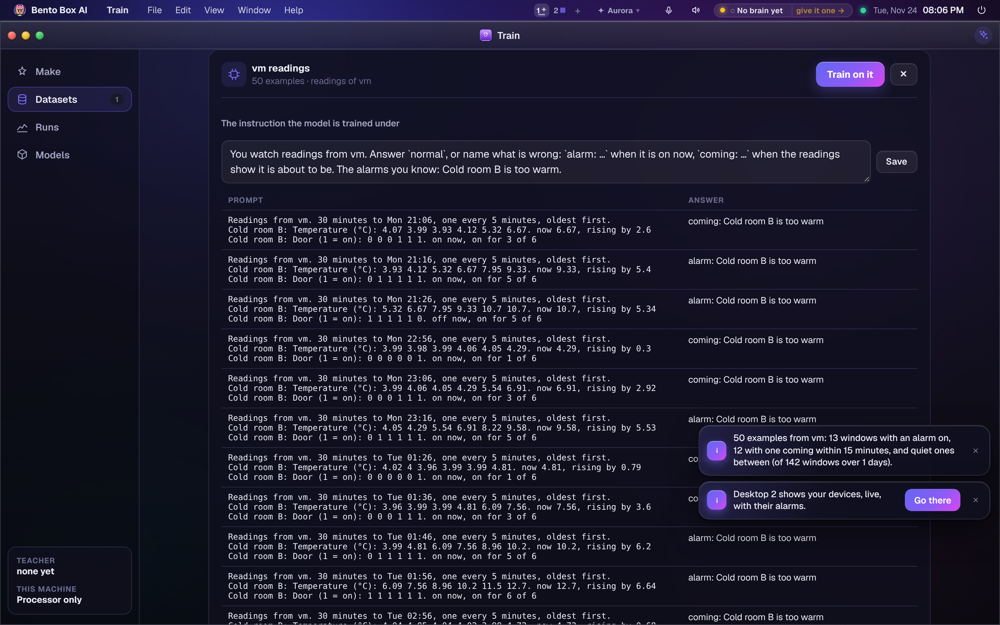
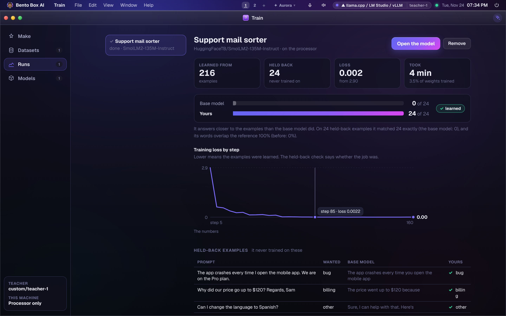
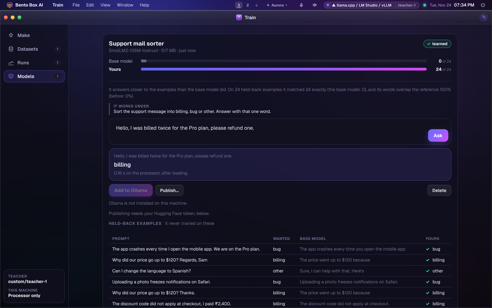
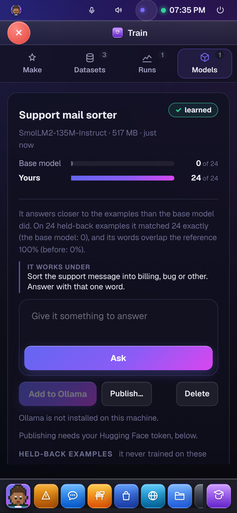

# Train: make a small language model of your own

A small language model does one narrow job: sorting mail, tagging notes, pulling fields out
of a message, answering in a fixed format. It runs on this machine for nothing, and for that
one job it can be as good as the big model you would otherwise pay for on every call.

Train makes one in four steps, and you can stop after any of them:

1. **Examples.** Pairs of a prompt and the answer you want.
2. **A fine-tune.** A small open model learns from them, on this machine.
3. **A check.** Examples it never saw say whether it learned the job.
4. **Use.** Try it, put it in Ollama so an agent can run on it, or publish it.

It is in the **Train** app, in `bento train`, and your agent can do it when you ask.



## The short way: say what you want

Open **Train**, write what the model should do, and press **Plan it**:

> Sort support mail into billing, bug or other. Answer with one word.

You get a plan you can edit: a name, the instruction the model works under, how many
examples, which small model learns (the student), and how many passes. It says who writes the
examples and in about how many calls. Nothing is made until you press **Make it**.

Then it runs on its own. A teacher writes the examples, this machine trains, and the check
runs. Each step is written down as it happens, and you can stop it.



```
bento train make "Sort support mail into billing, bug or other. Answer with one word."
```



## Teacher and student

The **teacher** is this machine's brain: Claude Code, a cloud model, or a bigger local model,
whichever you chose under Settings, AI providers. It does two things.

- **It writes examples** for a job you describe. This is synthetic data. It is good for
  teaching a format or a sorting rule, and it is only as right as the teacher, so read some
  before you train on them.
- **It answers prompts** that came without answers. Import a column of real messages and
  the teacher fills in what the small model should say.

The teacher has none of its tools while it does this. A dataset from the internet is other
people's words, and they reach a model that can only write an answer. Its calls are counted
in Usage like any other.

The **student** is a small open model from the Hugging Face Hub. These are offered, and you
can type any other `owner/name`:

| Model | Size | Licence | Trains on |
|---|---|---|---|
| HuggingFaceTB/SmolLM2-135M-Instruct | 135M | Apache-2.0 | any machine, even without a GPU |
| HuggingFaceTB/SmolLM2-360M-Instruct | 360M | Apache-2.0 | any machine, slowly without a GPU |
| Qwen/Qwen2.5-0.5B-Instruct | 0.5B | Apache-2.0 | 4 GB GPU or Apple Silicon |
| Qwen/Qwen3-0.6B | 0.6B | Apache-2.0 | 4 GB GPU or Apple Silicon |
| TinyLlama/TinyLlama-1.1B-Chat-v1.0 | 1.1B | Apache-2.0 | 6 GB GPU |
| Qwen/Qwen2.5-1.5B-Instruct | 1.5B | Apache-2.0 | 8 GB GPU |
| HuggingFaceTB/SmolLM2-1.7B-Instruct | 1.7B | Apache-2.0 | 8 GB GPU |
| microsoft/Phi-3.5-mini-instruct | 3.8B | MIT | 16 GB GPU |

`bento train bases` prints the list. On a machine with no GPU the plan picks the smallest.

## Datasets





Four ways in, all ending as prompt and answer pairs:

- **The Hugging Face Hub.** Search public datasets, press **Preview** to see the first rows,
  and import the first rows of one. The preview shows which column will be the prompt and
  which the answer, and you can change either, or the split, before importing. When no column
  has a usual name (`sms` and `label`, say), the columns are read from their values: the
  longest text is the prompt and a label column is the answer. A class label arrives as its
  name (`pos`), not its number. Nothing from the dataset's repository runs here: rows are
  asked of the Hub's own rows service.
- **A teacher writes them.** Describe the job and say how many.
- **Your devices.** Sensor readings, with the alarms that followed as the answers. See below.
- **A file.** CSV, TSV, JSON or JSONL. A file of prompts with no answers is fine: have the
  teacher answer them.

```
bento train search sms spam
bento train preview ucirvine/sms_spam          # its first rows, and how they would be read
bento train import ucirvine/sms_spam --rows 1000 --task "Say spam or ham."
bento train import owner/name --prompt question --answer category --split validation
bento train file inbox.csv --task "Sort into billing, bug or other."
bento train write "Sort support mail into billing, bug or other." --count 200
bento train answer DATASET
```

### From your devices

If this machine is a hub with sensors, it already has labelled examples nobody had to write.
It keeps what every sensor read, and the record of which alarms were raised and when they
cleared. **Your devices** puts the two together: each example is 30 minutes of one machine's
readings, and the answer is what was true at the end of it.

```
Readings from Cold room B. 30 minutes to Tue 14:20, one every 5 minutes, oldest first.
Temperature (°C): 4.1 4.2 4.6 5.3 6.1 7.0. now 7, rising by 2.9
Door (1 = on): 0 0 1 1 1 1. on now, on for 4 of 6
                                              →  coming: Cold room B is too warm
```





The answer is `normal`, `alarm: …` when an alarm was on, or `coming: …` when one was raised
within the next 15 minutes. A model trained on them reads a window and says which.

```
bento train devices                  # machines with readings kept, and their alarms on record
bento train devices "Cold room B" --rows 7       # examples from its last 7 days
```

Things to know:

- **You see your own machines only**, the same ones Devices shows you.
- **No alarm on record, no answers.** The windows are made without answers and a teacher can
  fill them in from your instruction. Or add an alarm rule in Devices and come back when it
  has fired a few times.
- **The record is mostly quiet**, so quiet windows are thinned to match the others. A model
  shown mostly "normal" learns to say "normal" to everything.
- **It reads numbers as text.** That suits "have I seen this pattern before an alarm". It is
  not a forecasting model, and the smallest students are weak at it: see the check's "By
  answer" line, which shows when a model missed every alarm.
- Per-minute readings are kept for 30 days, so that is as far back as it goes.

Each dataset keeps the **instruction** the model is trained under. The same instruction is
used when it is tried and when it goes into Ollama.

## Training

```
bento train start DATASET
bento train start DATASET --base Qwen/Qwen2.5-0.5B-Instruct --epochs 3
bento train jobs
bento train log JOB
bento train stop JOB
```



It is a LoRA fine-tune: small adapter weights are trained and merged into the model, which is
what makes this possible on one consumer GPU, or on a processor for the smallest models.
One training runs at a time on a machine. It is a process of its own, so it carries on if
Bento restarts, and you can stop it.

## The check

One example in ten (40 at most) is held back and never trained on. The base model answers
them before training and the tuned model answers them after. You see both, next to what was
wanted.

A model is marked **learned** only when the tuned model is closer to the wanted answers than
the base model was. Otherwise it says **no better**, with the counts. For a sorting job the
check also counts each answer on its own. A model that gives one answer to everything is
marked **one answer** however many it matched, and one that never gives some answer is
marked **partly** and names it. Two numbers are given:
how many answers match exactly, and how much the words overlap. They are counts, not a
judgement of quality. For a sorting job the exact count is the one to read.

```
bento train models
bento train examples MODEL
bento train try MODEL "The dashboard shows a blank page since the update."
```

## Using it



- **Try it** in the app or with `bento train try`. It loads the model each time, so the
  first answer takes a few seconds.
- **Add to Ollama.** Bento hands the weights to this machine's Ollama as `bento-<name>`,
  with the instruction as its system prompt. Then choose it under Settings, AI providers, as
  the machine's brain or as one agent's. Ollama converts the weights itself and imports the
  common small architectures. When it can't take one, you see what it said. On a machine
  with accounts this is an admin's, because every account can then choose the model.
- **Publish** to the Hugging Face Hub, private by default. This needs your token, which is
  kept in your vault and never shown again.



Putting a model into Ollama and publishing one are done by you, in the app or the terminal.
No agent can do either.

## Installing it

Training needs PyTorch and the Hugging Face libraries. They are not part of Bento. Install
them from the Train app, or with:

```
bento train install
```

They go into a folder of their own in your home (`~/.local/share/bento/train`): about 1 GB on
a Mac, 5 GB or more on Linux, where PyTorch brings NVIDIA's libraries. Base models are
downloaded from the Hub the first time each is used. You can collect and read datasets before
any of this is installed.

Hardware: an NVIDIA GPU, or Apple Silicon. Without either, the processor trains the two
smallest models. A Raspberry Pi can run a small model but should not train one: train on a
bigger machine and put the model in the Pi's Ollama.

## Asking your agent

> Make a small model that sorts my support mail into billing, bug or other.

| The agent | Is asked first? |
|---|---|
| lists datasets, runs and models, searches the Hub, reads examples, tries a model | no |
| imports a Hub dataset | yes |
| has a teacher write or answer examples | yes |
| starts a training, or a whole run from a goal | yes |

Starting a training and teaching are their own permission (`model.train`), so "may read my
datasets" and "may start a training" can be granted apart. Apps, linked teams and other
machines can never start one.

## What to know

- **Where it lives.** Each account's datasets, runs and models are in that account's own
  home, under `train/`. Another account can't see them.
- **Backups** carry your datasets and records, not the trained weights. A model is hundreds
  of megabytes and can be trained again from its dataset.
- **A model can repeat what it was trained on.** Think about that before publishing one
  trained on your own mail or notes.
- **Synthetic examples are a teacher's opinion.** The check tells you the student learned
  what the teacher wrote, not that the teacher was right. Try the model on real cases.
- **Not measured yet.** Adding a model to a real Ollama and publishing to the real Hub are
  tested against stand-ins only. Training has been run on a processor, not yet on an NVIDIA
  or Apple GPU.

## Where it came from

Train is the port of [doneitrightai](https://github.com/contact9prime-lab/doneitrightai)
(TrainForge, MIT) into Bento. It used to run beside Bento as a separate service on its own
port. Its LoRA recipe, Hub search, column detection, job runner and Autopilot are here, with
a teacher where it had keyword rules. Its scikit-learn tabular tasks and BERT-style
classifier were not brought over: they are not language models, and a small language model
does the classifying here.
