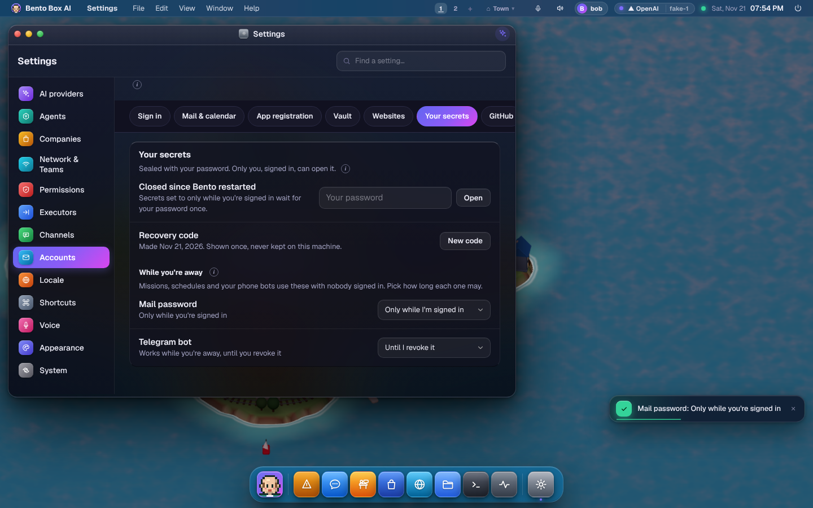
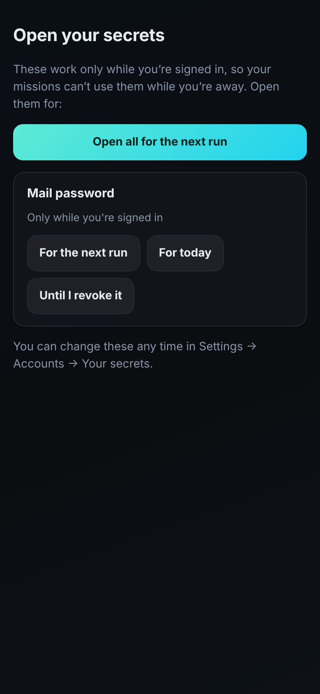
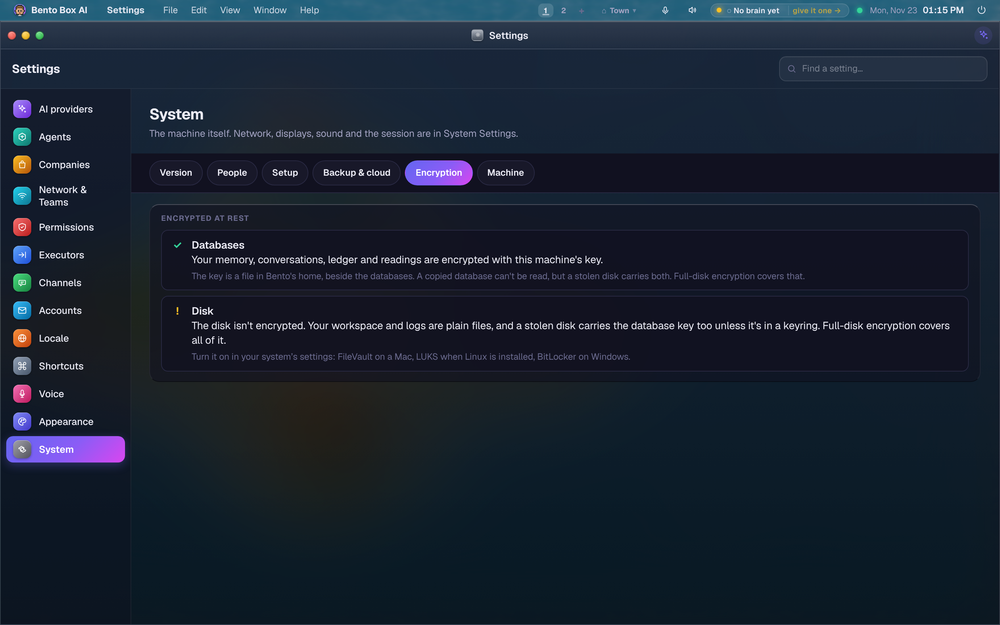
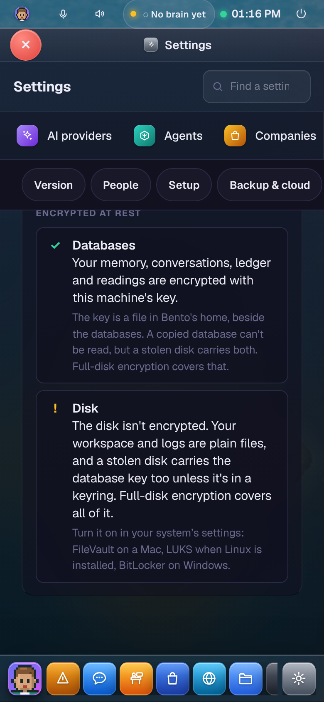

# The vault — where a secret lives, and the only door to it

A password to your mailbox, or the refresh token a sign-in with Google handed
over, used to sit in `config.json` in clear — masked on the one route that
shows config, and nowhere else. Masking a value on the way out is a promise
the next code path has to remember to keep. Storing it somewhere else is not.

So config holds a **reference** — `vault:mail.password` — and the bytes live
in the vault: encrypted (AES-256-GCM) in a 0600 file in your own home
(`~/.agentos/vault.json`, or your user directory on a machine with accounts).

## On a machine with accounts: sealed with your password

When several people use one machine, each person's vault is sealed with a key
made from their own Bento password. Nobody else can open it: not another
account and not an admin. This also covers the websites you're signed in to in
the shared browser, your MCP servers' keys and sign-ins, and your Telegram and
WhatsApp bots' tokens.

- **Your first sign-in after the update seals it** and shows you a recovery
  code, once. Save it somewhere safe, away from the machine. It's the only way
  back in if you forget your password.

  
- **While you're signed in**, half of the key is in your browser's cookie and
  half is on the server, for that session only. Neither half opens anything on
  its own, so the server's memory never holds something that unlocks your
  secrets by itself.
- **Missions, schedules and your phone bots run with nobody signed in.** Bento
  runs as a service, so each secret has a choice of how long it may be used
  while you're away (Settings → Accounts → Your secrets, or `bento vault away`):
  - **Until I revoke it**, the default when you save one.
  - **For 7 or 30 days**, then it stops by itself.
  - **Once**, for the next run that needs it. After that it is back to signed
    in only, whether or not you signed in meanwhile.
  - **Only while I'm signed in**, the strict rule below.

  
- **How that works.** A secret you let work while you're away is also kept as
  a second copy, locked with this machine's own service key, the one Bento
  has from the moment it starts. That copy is made only while the secret is in
  hand: when you save it, or when you switch it on signed in. Revoking deletes
  it, and it is deleted when its time is up. No other account and no admin can
  read it through Bento, but root on this machine could, as it can anything a
  service opens on its own.
- **A secret set to only while I'm signed in** opens with your key alone. A
  mission that needs it asks a page you have open to lend its half for that
  one step; locking your screen keeps it working. With no page of yours open,
  the step stops and says which secret and where to change it.
- **After Bento restarts**, secrets that work while you're away carry on. Ones
  set to signed in only stay closed until you enter your password once
  (Settings → Accounts → Your secrets, or the toast that says so).
- **If an admin resets your password**, your next sign-in asks for your
  recovery code. With it, everything opens and you get a new code. Without it,
  you can start fresh: your saved passwords and website sign-ins are removed,
  because nothing can open them, and you set them up again.

- **After a restart, your phone can open them.** When a mission needs a secret set
  to only while I'm signed in and nobody is, your own paired Telegram or WhatsApp
  chat gets a link. It opens your Bento's remote sign-in page on your phone: sign
  in there, and pick how long the closed secrets may work while you're away (for
  the next run, today, or until you revoke them). The mission waits a few minutes
  for you. Your password goes into that page, never into the chat, which keeps
  history. It only works through remote access: with remote access off, the chat
  says how to turn it on, and no link is sent. Only the chat paired to your account
  gets it, at most once every half hour.

  

What this can't promise: while a secret is in use (a step reading your mail, a
browser that's running) it's in the server's memory or in RAM, and root on
that machine can read memory. A secret that works while you're away can be
opened by root at any time. One set to signed in only can't be opened by
anything on the machine while you're signed out. A machine with no accounts
has nobody to sign in, so its vault keeps the key described below.

The machine's own vault (device passwords, the authenticator code) isn't
anybody's account, so it isn't sealed this way either.

## Provider keys and the machine's own tokens

The provider API keys (Anthropic, OpenAI, Gemini and the rest), the voice engines'
keys, and the machine's Telegram and WhatsApp tokens are in the machine's vault too,
locked with the service key. Config holds a `vault:` reference, Settings and
`/api/config` show only that a key is set, and the service opens a key when it
needs one, so chats, missions and phone turns carry on after a restart. A backup
carries the key the same way it carries a vault's.

What that protects: copies of `config.json`, anything that prints config, and a
stray file read. What it doesn't: root, and the user Bento runs as, because the
service has to open these keys on its own.

An Isolated Tenant's keys are in its own vault (`tenants/<id>/vault.json`), on the
same service key. See [users](users.md#shared-tenant-or-isolated-tenant).

## Who can read it

- **The system, for the job it needs the secret for** — opening the mailbox,
  refreshing a sign-in. Each read is one line in the operator diary saying
  which secret and for what (`read mail.password for mail`).
- **You** — in the sense that it is your file, in your home, keyed by your
  session. There is deliberately no route, verb or tool that prints a value:
  `bento vault` lists names and says what protects them, and stops there.
- **Never the model.** Tools use secrets internally; nothing hands one into a
  turn. The agent sees the mail, not the password.

## What protects it, in the card's own words

The key is not kept next to the lock when it can be elsewhere:

- **A desktop with a keyring** (Secret Service via `secret-tool` on Linux, the
  keychain on macOS): the key sits there, and the file on disk is bytes nobody
  can read without your session. The card says *Encrypted; the key is in this
  machine's keyring*.
- **A headless box** (a Pi, a server): the key is a 0600 file beside the vault.
  The card says *protected by file permissions on this machine, which is all a
  headless box can offer* — because a vault that claimed more would be worse
  than the clear-text file it replaced; somebody would believe it.

The mechanism is decided once, when the first secret is stored, and recorded
in the vault. If the keyring is unreachable later (a desktop session that is
not there), the vault is **locked** and says so — it never mints a fresh key
and quietly fails to decrypt everything it held.

## Your databases, encrypted at rest

Everything else Bento keeps about you is in its databases: memory, the knowledge graph,
conversations, the ledger, usage, missions and device readings. Every one of them is encrypted
with this machine's own key (SQLCipher: each page of the file is AES-256 encrypted with a check
of its own). A copied database file reads as noise.

- **The key** comes from the machine's service key, the same one that opens the machine's vault,
  so Bento opens its databases from the moment it starts, with nobody signed in. It is one key
  for every database on the machine, the accounts' included.
- **An existing install is converted once**, at the server's first start on this version, before
  anything opens a database. The encrypted copy is checked table by table before it replaces the
  plain one. A database another program has open is left plain and done at the next start.
- **A backup's databases are plain inside the backup file**, which is sealed with its own
  passphrase. So a backup restores on any machine, and that machine encrypts them with its own key
  at its next start.
- **What it doesn't protect.** On a machine with a keyring (a Mac, a Linux desktop) the key is in
  the keyring, so a disk taken out of the machine opens nothing. On a headless machine the key is
  a file in Bento's home, beside the databases: a copied database can't be read, but a stolen
  disk carries both. While Bento runs the key is in its memory, and root can read memory. Your
  workspace, logs and `soul.md` are files, not databases, and aren't covered. Full-disk
  encryption (FileVault, LUKS, BitLocker) covers all of it, and Settings says whether this disk
  has it.
- **After converting**, the old plain file is replaced, but on an SSD or SD card its old blocks
  may stay on the flash until they are reused. Nothing a program does can promise otherwise.
- **A 32-bit Pi** has no SQLCipher build, so its databases stay plain, and Settings and `bento
  doctor` say so.

Settings → System → Encryption shows both answers: the databases, and whether the disk itself is
encrypted.





## Your recovery code, again

Settings → Accounts → Your secrets → Recovery code → **New code** makes a new one and shows it
once; the old one stops working. It asks for your password first. If you change your own
password, your recovery code keeps working. If an admin resets your password, your next sign-in
asks for the recovery code. From a terminal: `bento vault code`.

## From a terminal

```
bento vault              # what protects it, how many secrets, their names
bento vault code         # a new recovery code, shown once (asks for your password)
bento vault at-rest      # are the databases and the disk encrypted
bento vault --user ada   # an account's vault: says it's sealed, names only
bento vault away --user ada mail.password once   # how long one works while you're away
bento vault list
bento vault forget oauth.google
```

## What moved

An install that had a mail or calendar password in config gets it moved into
the vault the first time the server starts (or the first time that person's
config is loaded, on a machine with accounts); config is left holding the
reference. Provider API keys and the Telegram token are the **machine's**
(`docs/users.md` says why) and stay where they were — masked, as before.
