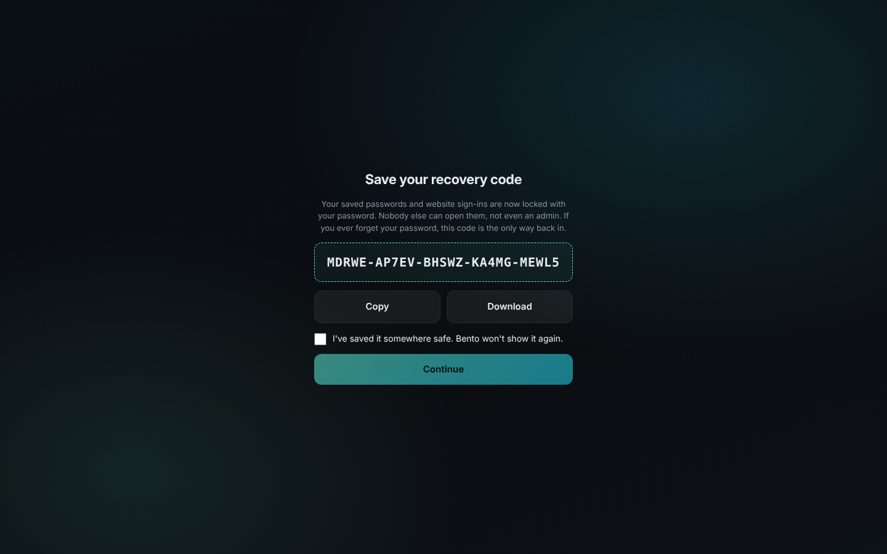

# The vault — where a secret lives, and the only door to it

A password to your mailbox, or the refresh token a sign-in with Google handed
over, used to sit in `config.json` in clear — masked on the one route that
shows config, and nowhere else. Masking a value on the way out is a promise
the next code path has to remember to keep. Storing it somewhere else is not.

So config holds a **reference** — `vault:mail.password` — and the bytes live
in the vault: encrypted (AES-256-GCM) in a 0600 file in your own home
(`~/.agentos/vault.json`, or your user directory on a machine with accounts).

## On a machine with accounts: sealed with your password

When several people use one machine, each person's vault is sealed with a key
made from their own Bento password. Nobody else can open it: not another
account, not an admin, and not root while you're signed out. This also covers
the websites you're signed in to in the shared browser.

- **Your first sign-in after the update seals it** and shows you a recovery
  code, once. Save it somewhere safe, away from the machine. It's the only way
  back in if you forget your password.

  
- **While you're signed in**, half of the key is in your browser's cookie and
  half is on the server, for that session only. Neither half opens anything on
  its own, so the server's memory never holds something that unlocks your
  secrets by itself.
- **A mission running on its own** asks a page you have open to lend its half
  for that one step. If no page of yours is open, the step stops and says so.
  Locking your screen keeps it working; signing out doesn't.
- **After Bento restarts** your secrets stay closed until you enter your
  password once (Settings → Accounts → Your secrets, or the toast that says so).
- **If an admin resets your password**, your next sign-in asks for your
  recovery code. With it, everything opens and you get a new code. Without it,
  you can start fresh: your saved passwords and website sign-ins are removed,
  because nothing can open them, and you set them up again.

What this can't promise: while a secret is in use (a step reading your mail, a
browser that's running) it's in the server's memory or in RAM, and root on
that machine can read memory. At rest, and whenever you're signed out, nothing
on the machine can open it. A machine with no accounts has nobody to sign in,
so its vault keeps the key described below.

The machine's own vault (device passwords, the authenticator code) isn't
anybody's account, so it isn't sealed this way either.

## Who can read it

- **The system, for the job it needs the secret for** — opening the mailbox,
  refreshing a sign-in. Each read is one line in the operator diary saying
  which secret and for what (`read mail.password for mail`).
- **You** — in the sense that it is your file, in your home, keyed by your
  session. There is deliberately no route, verb or tool that prints a value:
  `bento vault` lists names and says what protects them, and stops there.
- **Never the model.** Tools use secrets internally; nothing hands one into a
  turn. The agent sees the mail, not the password.

## What protects it, in the card's own words

The key is not kept next to the lock when it can be elsewhere:

- **A desktop with a keyring** (Secret Service via `secret-tool` on Linux, the
  keychain on macOS): the key sits there, and the file on disk is bytes nobody
  can read without your session. The card says *Encrypted; the key is in this
  machine's keyring*.
- **A headless box** (a Pi, a server): the key is a 0600 file beside the vault.
  The card says *protected by file permissions on this machine, which is all a
  headless box can offer* — because a vault that claimed more would be worse
  than the clear-text file it replaced; somebody would believe it.

The mechanism is decided once, when the first secret is stored, and recorded
in the vault. If the keyring is unreachable later (a desktop session that is
not there), the vault is **locked** and says so — it never mints a fresh key
and quietly fails to decrypt everything it held.

## From a terminal

```
bento vault              # what protects it, how many secrets, their names
bento vault --user ada   # an account's vault: says it's sealed, names only
bento vault list
bento vault forget oauth.google
```

## What moved

An install that had a mail or calendar password in config gets it moved into
the vault the first time the server starts (or the first time that person's
config is loaded, on a machine with accounts); config is left holding the
reference. Provider API keys and the Telegram token are the **machine's**
(`docs/users.md` says why) and stay where they were — masked, as before.
