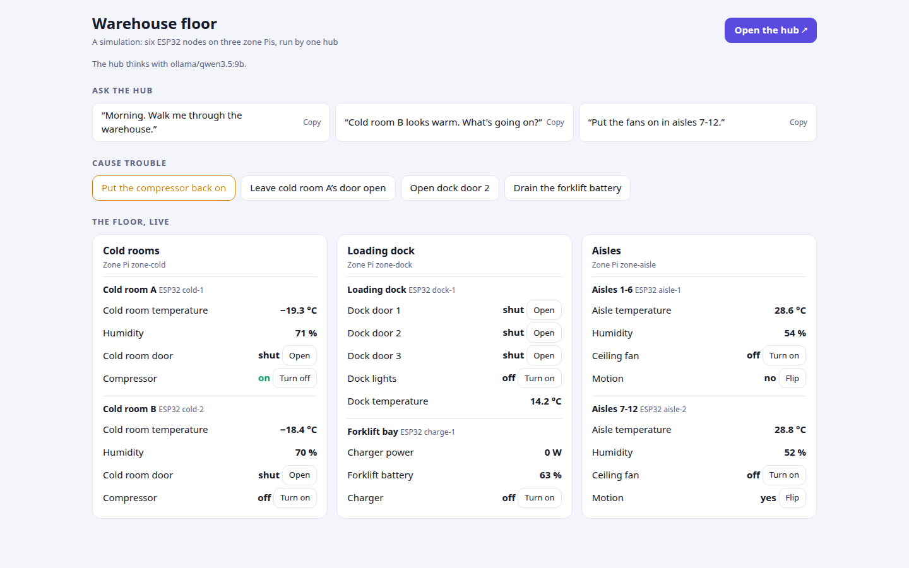
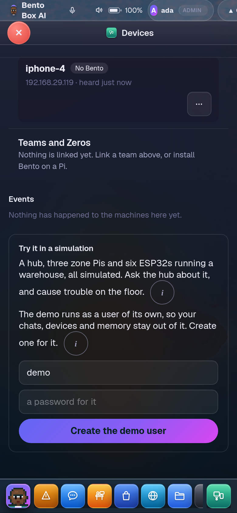
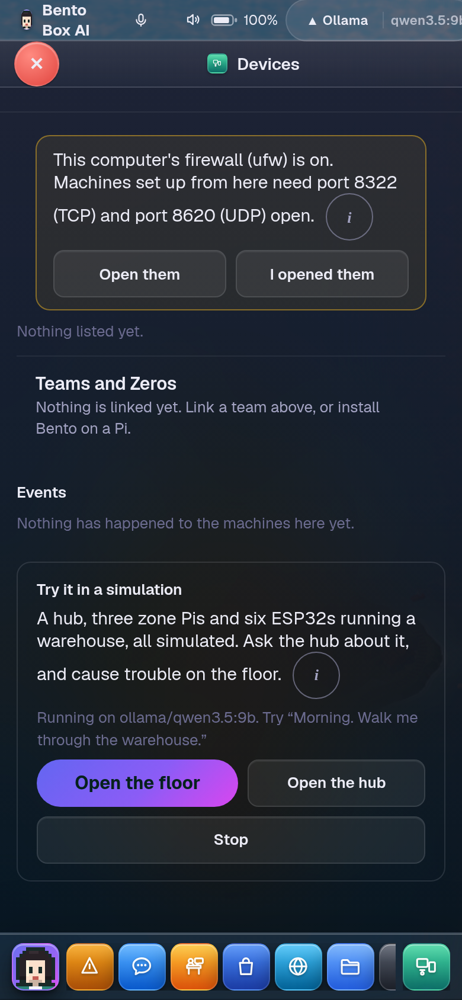
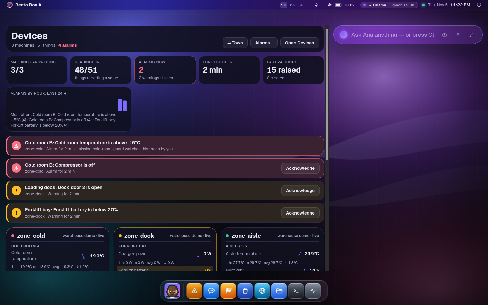
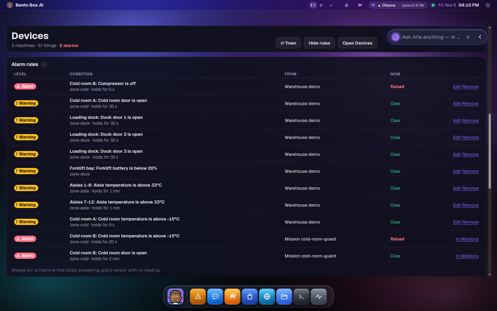
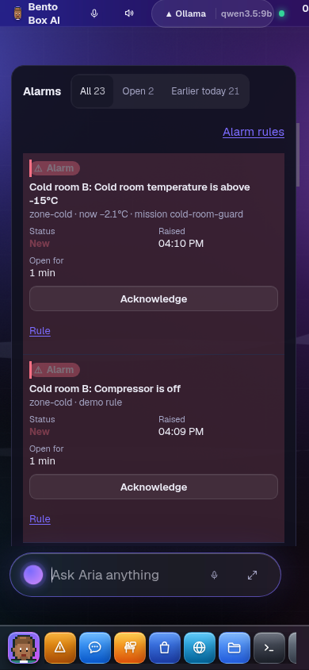
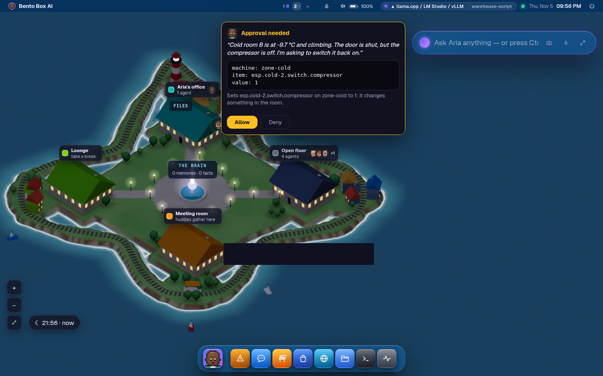

# The warehouse demo

A warehouse you can play with: one hub, three zone Pis and six ESP32 nodes, all simulated on
this computer. Ask the hub how the floor is, cause trouble on the floor page, and watch the agent
find it, ask you, and fix it. It's the quickest way to see what Bento does with hardware, and to
show somebody.



## Start it

In **Devices**, at the bottom, **Try it in a simulation** → **Set up the demo**. The first start
takes about half a minute while the hub sets its three zones up. After that a start takes a few
seconds. Then **Open the floor** and **Open the hub**.

On a machine with accounts, the demo runs as a Bento user of its own, so your chats, devices and
memory stay out of it. The card asks an admin to create that user (a name and a password), then to
sign in as it and start the demo there. Use a private window to stay signed in to your own account.
Only that user can start it; an admin can stop it from any account. On a machine with no accounts it
starts straight away, because making a first account would hand your whole Bento to it.



Or from a terminal:

```
$ bento demo warehouse
starting the warehouse demo on Claude Code. The first start sets the three zones up from the hub and takes a minute or two.
  1/7 Starting the six ESP32 nodes
  2/7 Starting the hub
  3/7 Setting up the three zone Pis from the hub
  4/7 Waiting for each zone to answer
  5/7 Adding each zone's ESP32 nodes
  6/7 Allowing the sensors and switches
  7/7 Switching on the cold room mission

  the floor  http://127.0.0.1:18900/   readings live, and trouble to cause
  the hub    http://127.0.0.1:18901/   ask it in Chat

  try asking:
    Morning. Walk me through the warehouse.
    Cold room B looks warm. What's going on?
    Put the fans on in aisles 7-12.
```

`bento demo warehouse stop` ends it. `--fresh` sets it up again from nothing, `--open` opens the
floor when it's ready.



## Which brain answers

The hub thinks with a copy of your brain: whatever this machine runs on, Claude Code, a provider
model or a local one. It costs what that brain costs.

Tick **Use the scripted brain** (or `bento demo warehouse --scripted`) for one that's free and works
offline. It only understands a warehouse floor: a walk through, a room by name ("how's the dock?"),
and switching the fans, the dock lights, the forklift charger or a compressor on or off. With no
brain set up here, the demo uses it anyway and says so.

## Things to try

1. Ask the hub *"Morning. Walk me through the warehouse."* It reads every zone live from the nodes.
2. On the floor page, **Trip cold room B's compressor**. Wait a minute while the room warms.
3. Ask *"Cold room B looks warm. What's going on?"* The agent reads the room, the door and the
   compressor, then asks to switch the compressor on. A card comes up: every switch is asked of you.
4. Tap **Allow**. The compressor comes back on, read back from the node, and the room starts cooling.
5. Try saying no to a switch, opening a dock door, or draining the forklift battery.

To see it act on its own, trip the compressor and don't ask anything. The demo starts with one
mission switched on, **cold-room-guard**: when cold room B is above -15 °C for 20 seconds, or its
door has been open for two minutes, it starts by itself, reads the room, and asks you to switch the
compressor back on. It can read zone-cold and switch nothing but that compressor, and every switch
is still asked of you. It's an ordinary mission in Missions → Build, so you can change it, switch it
off or delete it, and the demo leaves it as you left it. See
[A mission that starts on its own](network.md#a-mission-that-starts-on-its-own).

## The hub's Devices scene

Open the hub and it's already showing the floor: every zone, every node and every reading, live,
with the alarms on top. That's the **Devices** scene. It sits on desktop 1, and the Town is on
desktop 2, so the desktop numbers in the menu bar (or **⇄ Town** on the board) switch between them.



The board opens on the day's numbers: machines answering, readings coming in, alarms now (and how
many you've seen), the longest one open, and the alarms of the last 24 hours by hour with the ones
that came back most. Every reading carries its last hour as a small line, with its range, average
and how far it moved, so a room that is warming shows it before it crosses a line.

Your own Bento's Devices scene shows the demo too while it runs, for the demo's user and for
admins. The demo's machines are on its own hub, so without that it said "0 machines".

Each "cause trouble" button on the floor page raises one: a compressor that's off, a cold room or a
dock door left open, a flat forklift battery, an aisle that's too hot.

**The alarm table** shows what's open first, then what happened earlier today. Red is an alarm and
amber is a warning, and each row says so in words. A raised alarm nobody has seen blinks and says
**New** until you press **Acknowledge**, which marks that you saw it and fixes nothing. An alarm is a
condition that's true now: it shows while it holds and clears by itself when it stops, and the row
moves down with when it cleared and for how long it was open. Use **All**, **Open** and **Earlier
today** to narrow it. Everything is also a line in Devices → Events.

**Alarms clear themselves after a restart.** What was open when Bento stopped comes back reading
"Checking with zone-cold", and the hub asks the machines what they read now. If it's still true the
alarm carries on, with its first time and your acknowledgement. If it isn't, it's cleared with a line
that says why. A machine that can't be reached keeps its alarms on "Checking", because nobody can say
yet. A row that says "Ended, time not recorded" is from before this existed.

**Alarm rules** on the board lists everything that can raise an alarm, what each one reads now and
who it belongs to. The **Rule** button on an alarm opens its rule. Edit or remove any rule, or add
one: a machine, one of its things, above or below a number, on or off, for how long, and whether it's
an alarm or a warning. The demo's nine are in the same list, on your own desktop as well as on its
hub. A mission's rules are listed too and you change those in the mission. A machine that stops
answering and a sensor with no reading are always on. From a terminal, `bento network alarms` lists
them, and `add` and `remove` change your own.

Away from the board, a new alarm is a toast with the way to it, and Devices has the same table.







On any hub with devices it's the same: the Pis it set up and the ESP32 boards it holds. A desktop
you never gave a scene shows the one you picked in Settings → Appearance; on a hub, desktop 2 shows
Devices. Pick a scene on each desktop there. From a terminal, `bento network board` prints the
board.

From a terminal, `bento demo warehouse floor` lists every reading and
`bento demo warehouse poke cold-2 Compressor off` trips the compressor.

## What it is

Everything is the real thing except the boards. The hub and the zones are ordinary Bento servers,
set up from the hub's one line as Pis are. The nodes speak ESPHome's own web server API and mDNS, so
each zone finds, reads and switches them exactly as it would a flashed ESP32. Reads and switches
pass the same two gates, land in both ledgers, and the readings are kept on the hub for 90 days.
See [ESP32 nodes on a Pi](network.md#esp32-nodes-on-a-pi).

It never touches your own Bento. Each server has its own home under `~/.cache/bento-demo/warehouse`,
its own ports (18900 to 18970), and nothing it does reaches your devices, memory or agents.
`AGENTOS_DEMO_PORT` moves it to other ports if those are taken.

The pages are on this computer's own address, so open Devices on the computer itself to start it.
It runs on Linux and macOS.
