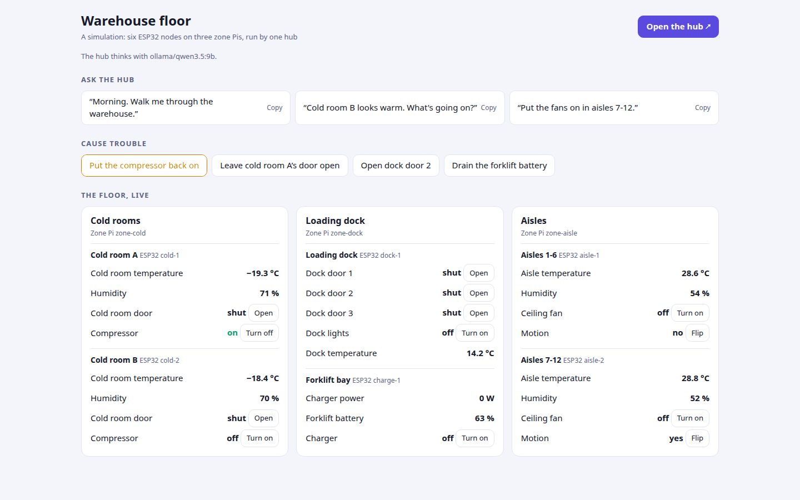
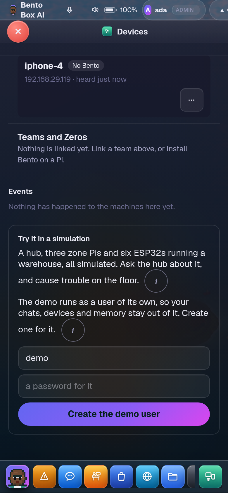
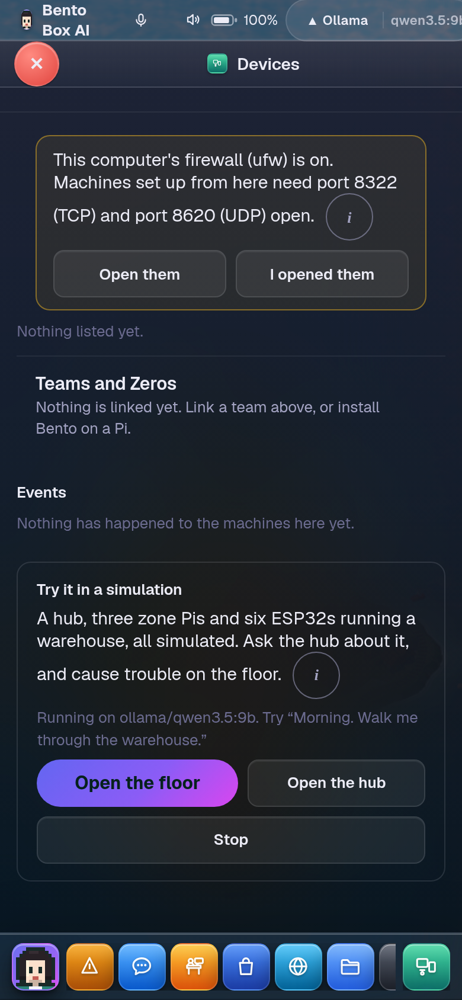

# The warehouse demo

A warehouse you can play with: one hub, three zone Pis and six ESP32 nodes, all simulated on
this computer. Ask the hub how the floor is, cause trouble on the floor page, and watch the agent
find it, ask you, and fix it. It's the quickest way to see what Bento does with hardware, and to
show somebody.



## Start it

In **Devices**, at the bottom, **Try it in a simulation** → **Set up the demo**. The first start
takes about half a minute while the hub sets its three zones up. After that a start takes a few
seconds. Then **Open the floor** and **Open the hub**.

On a machine with accounts, the demo runs as a Bento user of its own, so your chats, devices and
memory stay out of it. The card asks an admin to create that user (a name and a password), then to
sign in as it and start the demo there. Use a private window to stay signed in to your own account.
Only that user can start it; an admin can stop it from any account. On a machine with no accounts it
starts straight away, because making a first account would hand your whole Bento to it.



Or from a terminal:

```
$ bento demo warehouse
starting the warehouse demo on Claude Code. The first start sets the three zones up from the hub and takes a minute or two.
  1/6 Starting the six ESP32 nodes
  2/6 Starting the hub
  3/6 Setting up the three zone Pis from the hub
  4/6 Waiting for each zone to answer
  5/6 Adding each zone's ESP32 nodes
  6/6 Allowing the sensors and switches

  the floor  http://127.0.0.1:18900/   readings live, and trouble to cause
  the hub    http://127.0.0.1:18901/   ask it in Chat

  try asking:
    Morning. Walk me through the warehouse.
    Cold room B looks warm. What's going on?
    Put the fans on in aisles 7-12.
```

`bento demo warehouse stop` ends it. `--fresh` sets it up again from nothing, `--open` opens the
floor when it's ready.



## Which brain answers

The hub thinks with a copy of your brain: whatever this machine runs on, Claude Code, a provider
model or a local one. It costs what that brain costs.

Tick **Use the scripted brain** (or `bento demo warehouse --scripted`) for one that's free and works
offline. It only understands a warehouse floor: a walk through, a room by name ("how's the dock?"),
and switching the fans, the dock lights, the forklift charger or a compressor on or off. With no
brain set up here, the demo uses it anyway and says so.

## Things to try

1. Ask the hub *"Morning. Walk me through the warehouse."* It reads every zone live from the nodes.
2. On the floor page, **Trip cold room B's compressor**. Wait a minute while the room warms.
3. Ask *"Cold room B looks warm. What's going on?"* The agent reads the room, the door and the
   compressor, then asks to switch the compressor on. A card comes up: every switch is asked of you.
4. Tap **Allow**. The compressor comes back on, read back from the node, and the room starts cooling.
5. Try saying no to a switch, opening a dock door, or draining the forklift battery.

To see it act on its own, give it a mission that starts on a device: in Missions → Build, a mission
whose specialist has `device_get` and `device_set` in its tools, a **device** trigger on zone-cold's *Cold room B: Cold room temperature*
**is above** -15 **for** 20 seconds, and `zone-cold/*` under Devices it may read. Trip the
compressor and don't ask anything. Within a minute the mission starts, reads the room, and asks you
to switch the compressor back on. See
[A mission that starts on its own](network.md#a-mission-that-starts-on-its-own).

From a terminal, `bento demo warehouse floor` lists every reading and
`bento demo warehouse poke cold-2 Compressor off` trips the compressor.

## What it is

Everything is the real thing except the boards. The hub and the zones are ordinary Bento servers,
set up from the hub's one line as Pis are. The nodes speak ESPHome's own web server API and mDNS, so
each zone finds, reads and switches them exactly as it would a flashed ESP32. Reads and switches
pass the same two gates, land in both ledgers, and the readings are kept on the hub for 90 days.
See [ESP32 nodes on a Pi](network.md#esp32-nodes-on-a-pi).

It never touches your own Bento. Each server has its own home under `~/.cache/bento-demo/warehouse`,
its own ports (18900 to 18970), and nothing it does reaches your devices, memory or agents.
`AGENTOS_DEMO_PORT` moves it to other ports if those are taken.

The pages are on this computer's own address, so open Devices on the computer itself to start it.
It runs on Linux and macOS.
