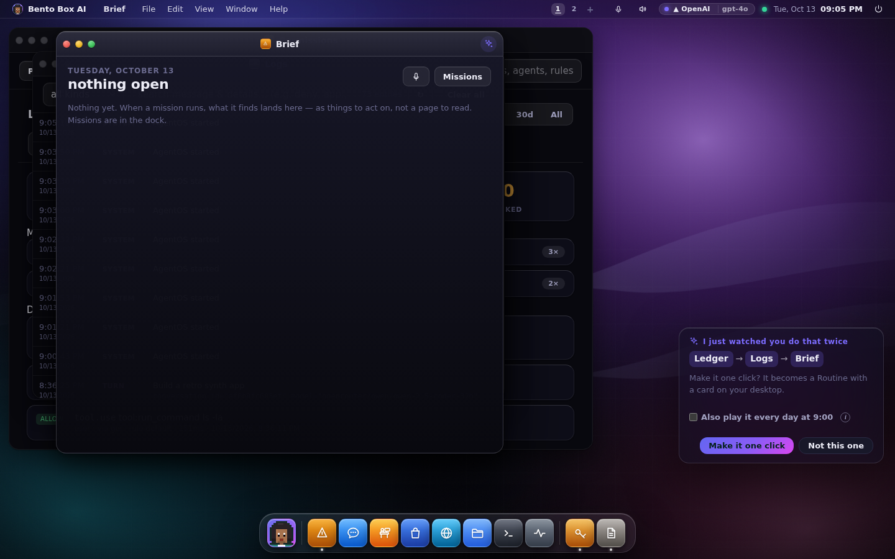
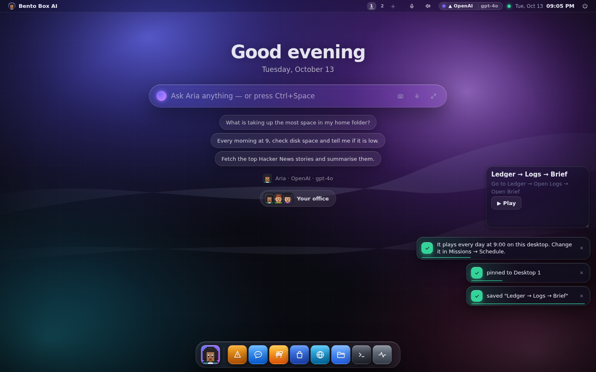

# Watch me once

When you do the same few steps on the desktop twice, Bento notices and offers to make
them one click. Open Logs filtered to errors, then the Brief, then WhatsApp; do it again
later, and a card asks:

> I just watched you do that twice. Make it one click?

**Make it one click** saves a Routine (the desktop's own replayable sequence, in Missions →
Routines) and pins it to the desktop as a card with a Play button. Tick **Also play it every
day at 9:00** and it becomes a daily schedule too, which you can change or stop in
Missions → Schedule. **Not this one** means that sequence is never offered again in this
browser.

## What is noticed

Only the doors you went through: which app, which tab, which place inside an app, which
Logs filter. A sequence counts when it is three to six steps long, has at least two
different doors, and happened twice within 45 minutes.

What is never noticed:

- anything you type, any file, any message;
- anything code opened for you (only steps your own tap or key press caused);
- a routine replaying itself.

It is kept in the page's memory only, so a reload forgets it, and nothing is sent to the
server until you press **Make it one click**.

Switch it off in Settings → Appearance → Characters → **Notice my routines**. The switch is per account.

## The three faces

- **Desktop and session UI:** the card, the pinned routine and its Play button.
- **Terminal:** a terminal has no desktop to watch. A routine made here plays from the
  prompt bar, from Missions → Routines, and from any chat through `run_automation`.
