# A Zero: one line on a Pi, run from your hub

A Zero is a small machine (a Pi Zero, any Raspberry Pi, an old laptop) that you set up by
pasting one line. It installs Bento in Light mode, joins your Tailscale network if you want it
to, finds your main machine (the **hub**) and is set up from there with nobody at it. After
that, what you ask it is worked on by the hub's team, and any file they make comes back to it.

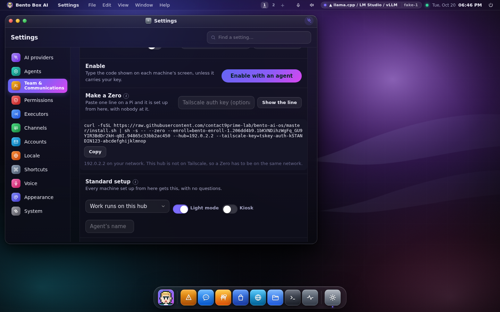

## Make one

1. On the hub, open *Settings → Network → Set machines up → Make a Zero*.
2. If the Zero won't be on the same network as the hub, paste a Tailscale auth key
   ([make one here](https://login.tailscale.com/admin/settings/keys)). Leave it empty when they
   share a network.
3. Press **Show the line**, then **Copy**, and paste it on the Pi:

```sh
curl -fsSL https://raw.githubusercontent.com/<you>/bento-ai-os/master/install.sh \
  | sh -s -- --zero --enroll=bento-enroll-1.… --hub=100.101.102.103,192.168.1.4 \
             --tailscale-key=tskey-auth-…
```

That's all. A minute or two later the Pi is on the hub's list as *set up*, and you get a
toast saying it was heard over Tailscale or on your network.

From a terminal on the hub, the same thing:

```sh
bento pool zero                                  # the line, with this hub's addresses
bento pool zero --tailscale-key tskey-auth-… 100.101.102.103
bento pool standard                              # what every machine set up from here gets
bento pool standard set profile.json             # change it
bento pool hub 100.101.102.103                   # on a Zero: where to announce itself
```

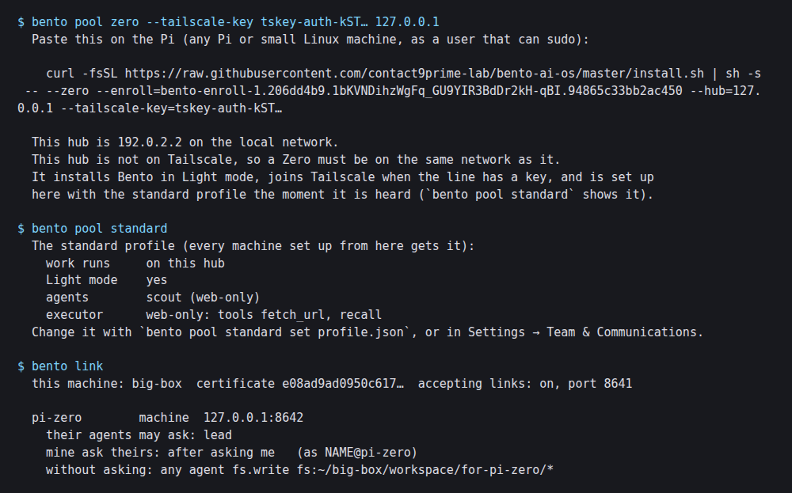

## What the line does on the Pi

- Installs Bento in Light mode and asks nothing. `--zero` answers every question for this one
  install; it doesn't install the optional extras.
- With a Tailscale key, installs Tailscale and joins your tailnet as `bento-<hostname>`. The key
  is used once there. The hub puts it in the line and doesn't keep it anywhere.
- Writes the hub's addresses (`bento pool hub`), keeps the hub's automatic enrolment key, and
  starts Bento waiting to be set up.

## How the hub hears it

A waiting machine announces itself on its own network. Tailscale carries no broadcasts, so a
Zero also sends its announcement straight to each hub address in the line. The hub writes down
which way it arrived, read from the address the announcement came from: *over Tailscale* for an
address in Tailscale's range, *on your network* otherwise.

The Zero carries the hub's automatic key, so the hub sets it up the moment it hears it: no code
to type, no button to press. That is still a ledger row on both machines and a toast on the
hub.

## The standard setup

Every machine set up from the hub gets the same setup, with no questions:

| | |
|---|---|
| Where work runs | *on this hub* (the default for a Zero) or *on the machine* |
| Light mode, kiosk, agent's name | as you set them |
| Its agents | copies of the hub's agents you add, each with its executor |

Add one of your agents under **Its agents** and every machine set up from here gets a copy.
Only the tools a company department may have travel with it (no shell, push or send), and its
executor is copied by value. A key's own setup, and what you choose when enabling by hand, go on
top of the standard one.

## When the hub does the work

With *work runs on this hub*, the Zero keeps no agents of its own (beyond the ones the standard
setup gives it). A chat on the Zero, typed or said at its screen, runs on the hub: the hub's lead
answers it with the hub's team, inside the Zero's section, and the conversation is kept on the hub.
The Zero keeps a copy for its own screen and nothing else. On the hub you see it happen: the
Office shows the question arriving at your agent's desk, the device map lights the Zero up, and
Network → the Zero → Sessions lists its conversations.

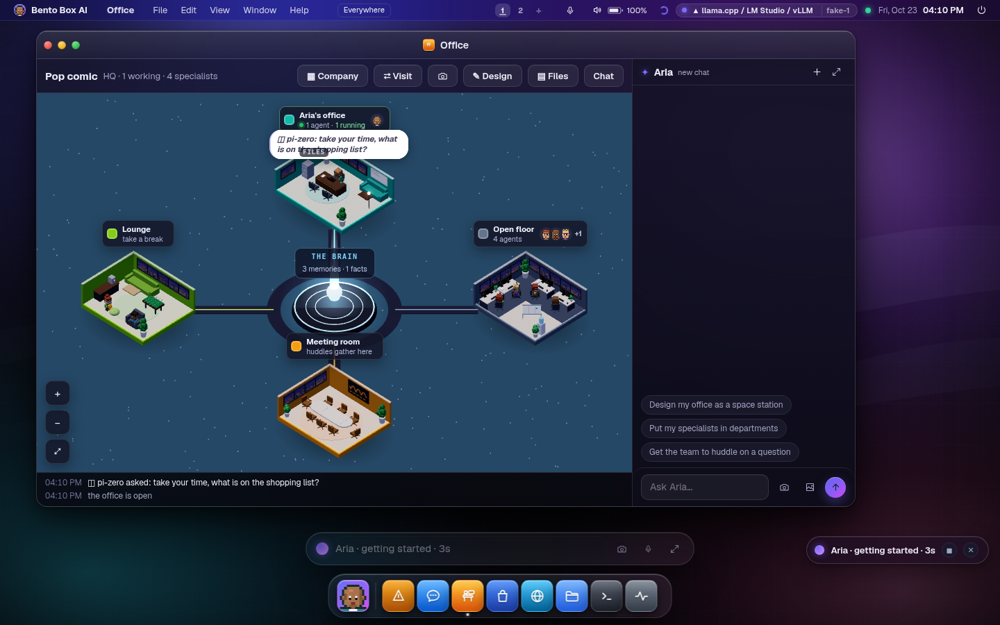

Before, the Zero ran each turn itself and only borrowed the hub's model, which meant sending its
whole prompt, around 24,000 tokens, for every message. On a Pi that filled the window it asked for,
and answers came back one word at a time. A hub that hasn't been updated yet still works the old
way, and the Zero says so once and answers itself. `zero.chat: here` in the Zero's config keeps
its chats local on purpose.

Which brain answers for a Zero is the hub's choice: Network → the Zero → *Its work here runs on*.
It answers in the Zero's own name and with the soul kept for it on the hub, not as the hub's lead.

In the hub's Chat, a Zero's conversations are under **From other machines**. Each opens with where
it came from, and each message wears the machine it was said at and its route to your agent.

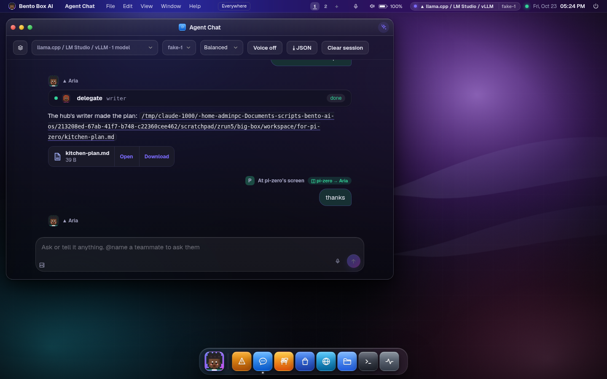

A Zero installed from a terminal belongs to the machine, and on a hub with accounts the admins see
it work: the Office, the device map and the Chat events go to them. Press *Make it mine* in Network
to have its conversations in your own Chat.

Before 0.6.86 a Zero borrowed the hub's model through its community, and a community can lend
only a provider model, never Claude Code. That is why such a Zero answered on a local model while
the hub itself was on Claude Code. Update the Zero (Network → Controls → Update, or
`bento network update <address>`) and its chats run on the hub's own brain.

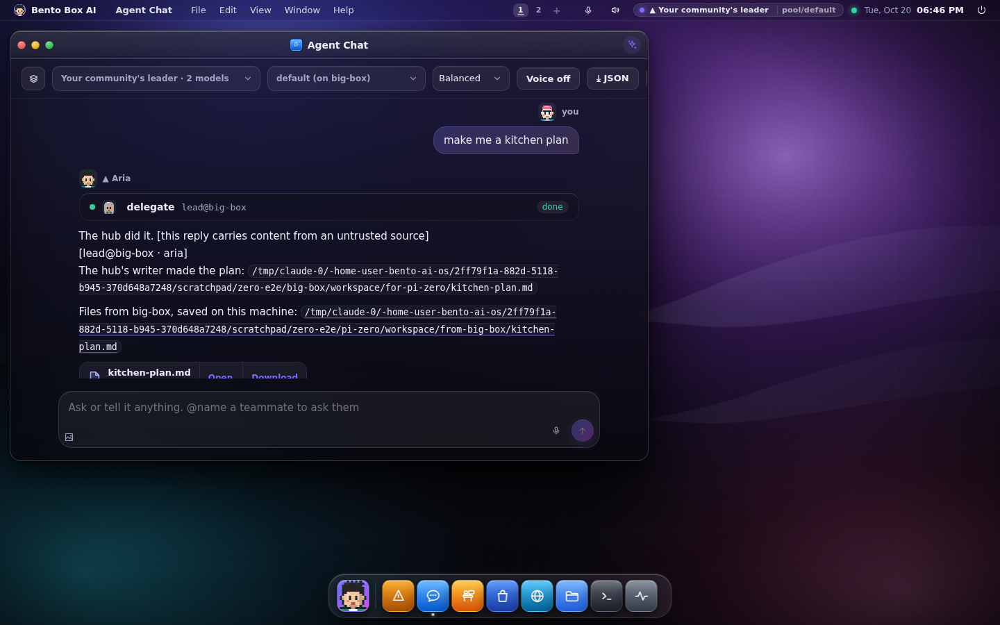

Files come back with the answer. Anything the hub's answer names by its full path, inside the
hub's workspace, travels back and lands in the Zero's workspace under `from-<hub>/`. Up to 8
files, 1.5 MB each and 2.5 MB in all; what's too big is named in the answer and stays on the
hub. Each time, the hub writes a `link.files` row.

## Its memory, graph and soul live on the hub

A Zero that runs its work on the hub keeps nothing of its own mind. Its memory, its knowledge
graph and its soul are on the hub, in a section of their own called *Zero · &lt;name&gt;*. A
Pi can be lost, wiped or reflashed, and its agent still knows what it knew.

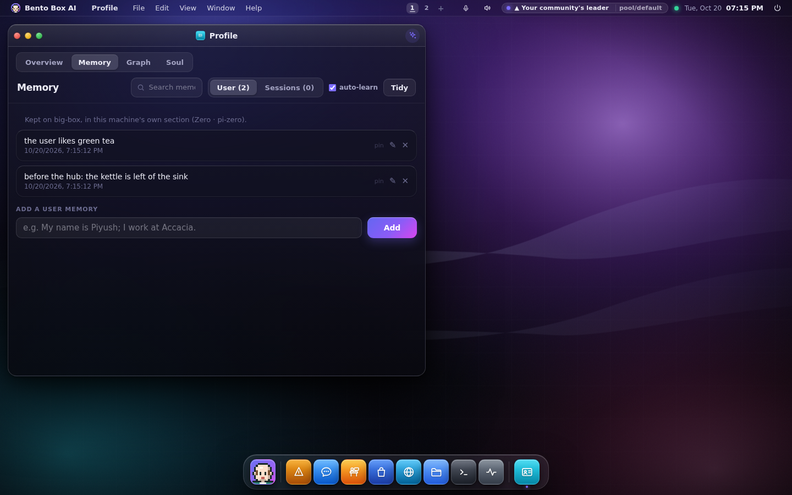

- **On the Zero,** Profile → Memory, Graph and Soul read and write the hub. A line under each
  says where it's kept. When its agent remembers something, adds a fact, or changes its own
  soul, that goes to the hub too. So does what the after-turn pass learns.
- **On the hub,** the soul of each Zero is under Profile → Soul, in *Whose soul*. Its memories
  are in Profile → Memory with a *Zero · &lt;name&gt;* label, and its facts are in the graph.

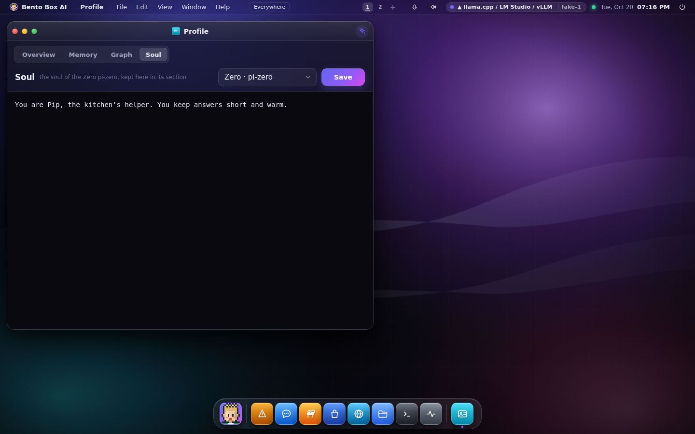

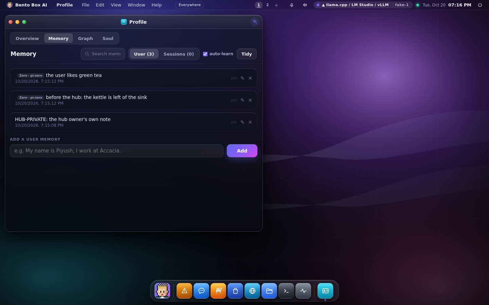

- **A Zero sees only its own section.** It never sees the hub's own memory or another Zero's,
  and it can't change or forget anything outside its section. When the hub's team works a
  task for it, they work inside that section, so what they learn stays with it.
- **What it knew before moves once.** A machine that kept memories, facts or a soul before it
  ran on its hub sends them to its section the first time it needs them. The copies on the Pi
  are left where they are and not read again.
- **When the hub can't be reached,** the Zero says so. It doesn't make up an answer about what
  it remembers, and it doesn't keep a local copy in the meantime.

From a terminal:

```sh
bento pool mind                  # on the hub: every Zero's section, with counts
bento pool mind pi-kitchen       # on the hub: one Zero's soul, memories and facts
bento pool mind pi-kitchen --soul soul.md   # on the hub: replace that Zero's soul
bento pool mind                  # on a Zero: what its hub keeps for it
```

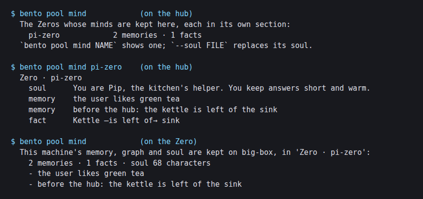

## Keeping it up to date

A Zero updates itself when its own hub asks, over their link, so no password is needed. Network →
Teams and Zeros shows each Zero's version, marked when it's behind the hub, with **Update**. When
the hub itself updates, it looks at its Zeros, and *When this hub updates* decides what happens:

- **Ask me to update the Zeros** (the default): a toast with *Update it*, once per version.
- **Update the Zeros too**: each one is asked straight away, and a ledger row says so.
- **Leave the Zeros alone.**

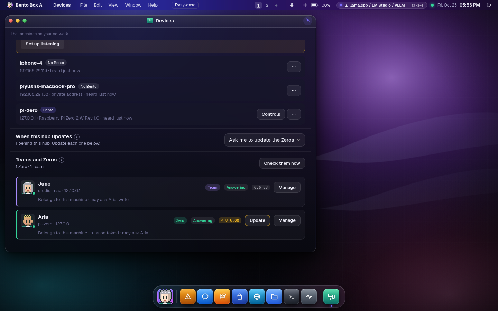

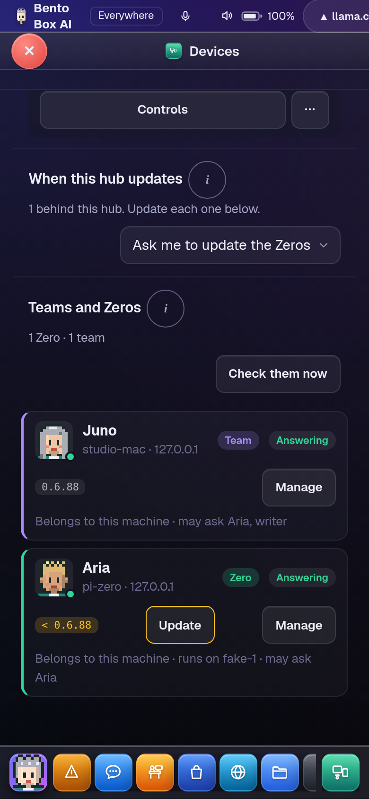

The Zero also checks on its own, once a day, and offers a waiting update on its screen. An update
on a Zero skips the test suite, which ran where the code was built and would keep a Pi 3 busy
for most of an hour, and it restarts on its own (a Pi takes a few minutes). From a terminal:
`bento network ties <zero> update`. A Zero on 0.6.87 or older can't be asked over the link yet:
update it once with Controls → Update, or `bento network update <address>`.

## Whose it is

On a hub with accounts, every Zero belongs to one of them: the person who made it. *Make a Zero*
makes a line for whoever is signed in, and only for them. There's no list of other people, and the
hub refuses a line for anybody else, an admin included. Anyone signed in can make their own; setting
up other machines stays an admin's job. A Zero set up with that line is its owner's: the hub answers
it as that person, with their lead, their specialists, their memory and their integrations. Bob's
Zero can use the MCP servers Bob set up, and Ada's can't, even on the same hub.

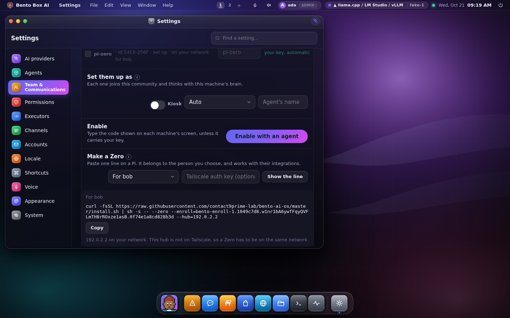

Integrations were already per account: MCP servers, channels, mail, calendar and sign-ins are
each person's own, kept in their own home. AI provider keys stay the machine's, because they
spend its money. What changed is that a Zero now attaches to an account. Before, every Zero was
answered as the machine, which on a hub with accounts meant nobody's integrations.

From a terminal at the hub, which nobody signs in to, `bento pool zero --for bob` prints Bob's
line, and `bento pool enable … --for bob` sets a machine up for Bob by its code. A Zero set
up by its code with no account named stays the machine's, as before.

## What it shows

A Zero is light on purpose. It has no integrations of its own, so it doesn't start any: no MCP
servers, no Telegram, no WhatsApp. Its screen is one agent and the basics:

- **Chat**, where its answers arrive, with any file the hub made.
- **Office**, with one person at one desk, drawn flat, and **Visit** to look in on the hub's office.
  No lounge, no pet, no 3D: it is a small screen, and its work happens on the hub.

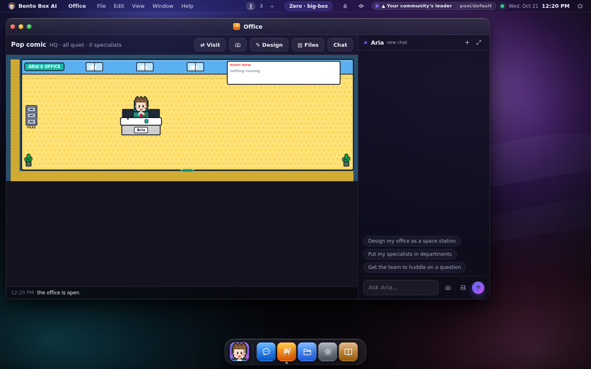
- **Files**, **Settings** and **Docs**.

A *Zero · hub* chip in the menu bar opens the Office. Settings leaves out AI providers,
Executors, Channels and Accounts, and says at the top where those live. The Brain row says the
agent thinks on the hub, and the Office's brain says *on* the hub, because that's where its
memory is.

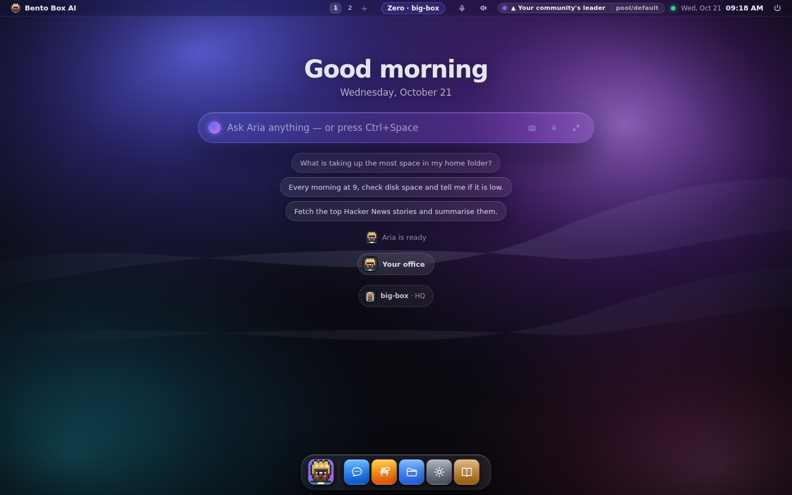

## What keeps it safe

- **The hub only hears a Zero, it never trusts one.** An announcement is a stranger's words,
  read field by field. A Zero is set up automatically only if it proves it holds the hub's key,
  and the hub proves it back.
- **A task from a Zero is untrusted on the hub,** as every linked team's question is. The
  hand-over to the hub's specialists carries that mark, so a step that changes something waits
  for a person.
- **Two things are decided ahead of time, when the hub sets the Zero up:** the hub's lead may
  hand the Zero's task to its own specialists or departments, and any of the hub's agents may
  write files into one folder for that Zero (`<workspace>/for-<zero>/`). A report through
  *save report* needs nothing. Both rows are in *Permissions*, and removing the link removes
  them. A page the agent also read, a hidden file, or a path outside that folder still needs a
  person.
- **Files go back only to a machine the hub set up to run its work there.** Any other linked
  team gets words only.
- **The Tailscale key is never stored by Bento.** It's in the line you copy and nowhere else.
- **A Zero's mind is kept only by the hub that set it up to run there.** Any other machine that
  asks for its memory is refused. Changing a Zero's soul is a ledger row on the hub, and so is
  the one-time move.

## The three faces

- **Desktop:** *Settings → Network → Set machines up*: Make a Zero (for the person signed in), Standard setup, Its agents, and a *via* label and the owner on each machine
  heard. On the Zero itself, the light desktop above.
- **Terminal:** `bento pool zero`, `bento pool standard`, `bento pool hub`, and `bento link`
  shows the standing folder for each Zero.
- **Session UI:** the same Settings page; nothing here touches the compositor.

## What was tested, and what wasn't

- `tests/test_zero.py`: where a machine was heard, the line (the Tailscale key is never written
  to disk), the standard setup as a closed set, the Zero's side after a claim, the hub's
  standing folder against `..`, hidden files and mixed untrusted content, files capped both
  ways, and a whole task from a Zero on the hub at the default autonomy level.
- `packaging/dev/provision-e2e/zero_run.py`: a hub and a Zero as real `bento serve` processes.
  The Zero's own broadcast goes nowhere, so the hub hears it only through the address in the
  line. It is set up by the key with the standard setup (one agent with its own executor), and a
  task typed on the Zero comes back with the file the hub's writer made.

- `tests/test_zero_mind.py`: a hub and a Zero over real mTLS. What the Zero remembers, the facts
  it adds and its soul land in its section and nothing on the Zero. It can't see or change the
  hub's own rows or another Zero's. Its lead's prompt is built from the hub. What it kept
  before moves once. An unreachable hub is said. The hub's `bento pool mind` was found
  printing nothing by the live run, and is tested now.
- The live run's step 5 does the same on real servers, through the routes the screens use.

- `tests/test_zero_accounts.py`: one key per account, a machine set up with an account's line
  belongs to it, a code with no account named stays the machine's.
- `packaging/dev/provision-e2e/zero_accounts_run.py`: a hub with two accounts and a Zero, as real
  servers. Ada makes the line for Bob; the Zero is set up as Bob's; the hub's lead is Bob's
  agent; Bob's writer is offered Bob's MCP tool and Ada's isn't; the conversation and memory
  land in Bob's home only; the Zero starts no integrations and shows the light desktop.

Not tested: a real tailnet. The run can't give a process a `100.x` address, so *over Tailscale*
is covered by the unit tests on the address ranges, and the run's Zero is heard *on your
network*. Tailscale's own installer and `tailscale up` were not run.
